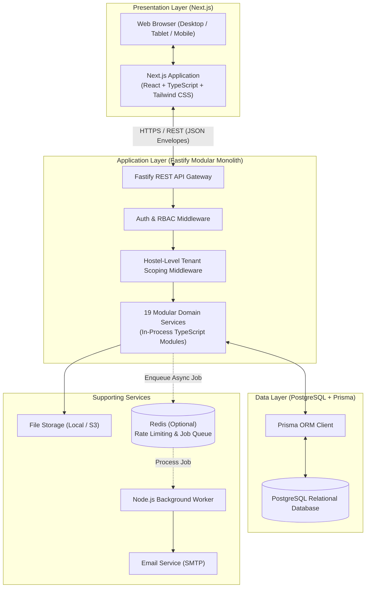

# Nestora — University Hostel Management System

A centralized, web-based University Hostel Management System engineered to administer multiple student residential hostels under a single university institution.

---

## Table of Contents
- [Overview](#overview)
- [Key Features](#key-features)
- [User Roles](#user-roles)
- [System Modules](#system-modules)
- [Technology Stack](#technology-stack)
- [System Architecture](#system-architecture)
- [Database Overview](#database-overview)
- [Project Structure](#project-structure)
- [Documentation](#documentation)
- [Installation and Setup](#installation-and-setup)
- [Development Status](#development-status)
- [Future Improvements](#future-improvements)
- [Contributing](#contributing)
- [License](#license)

---

## Overview

### Purpose
**Nestora** is an academic software engineering project designed for a Bachelor of Computer Applications (BCA) curriculum. The platform aims to centralize student housing operations, replace fragmented administrative records, and enforce strict institutional accountability across university residential facilities.

### Problem Context
In conventional university environments, hostel administration is frequently managed through disjointed, manual mechanisms:
- **Decentralized Paper Registers & Spreadsheets**: Student admissions, attendance records, gate registers, and fee receipts are maintained in physical silos, creating data redundancy and clerical errors.
- **Allocation Inefficiencies**: Manual tracking of multi-bed rooms, floors, blocks, and buildings leads to double-booking, underutilized bed capacity, and prolonged onboarding times.
- **Safety & Movement Tracking Vulnerabilities**: Gate logbooks and paper gate passes hinder real-time tracking of resident outings, overnight leaves, and curfew compliance.
- **Lack of Role-Based Data Isolation**: Staff and wardens often lack scoped workspaces, creating risks of unauthorized data access across neighboring hostels.
- **Delayed Grievance Redressal**: Physical complaint books lack priority tracking, staff assignment, and audit trails.

### Proposed Solution
Nestora provides a unified, web-based platform that pairs **centralized university-wide administration** with **autonomous, hostel-level operational isolation**:
- Hierarchical modeling of multi-hostel physical infrastructure down to individual bed spaces.
- Rigorous Role-Based Access Control (RBAC) across six dedicated user roles.
- Enforced hostel-level tenant isolation ensuring wardens and staff operate strictly within their assigned hostel jurisdiction.
- Digitized operational workflows covering admissions, bed allocations, nightly attendance, temporary leaves, gate movements, visitor logging, maintenance grievances, and fee records.
- Immutable business audit logging for sensitive administrative and financial actions.

---

## Key Features

### Multi-Hostel Infrastructure & Bed Allocation
- **Hierarchical Infrastructure Modeling**: Maps physical housing across seven levels: $\text{University} \rightarrow \text{Hostel} \rightarrow \text{Building} \rightarrow \text{Block} \rightarrow \text{Floor} \rightarrow \text{Room} \rightarrow \text{Bed}$.
- **Gender Categorization**: Enforces strict segregation into Boys' Hostel and Girls' Hostel facilities.
- **Six Standardized Room Configurations**: Supports Single, Double, and Triple bed rooms in both AC and Non-AC configurations.
- **Granular Bed Management**: Individual beds are allocated and tracked independently (`Available`, `Occupied`, `Reserved`, `Maintenance`) with atomic concurrency safeguards to prevent double allocations.
- **Room-Change Requests**: Enables resident students to apply for room/bed transfers with structured review workflows.

### Resident Onboarding & Two-Tier Admission
- **Two-Tier Verification Gate**: Student admissions require sequential verification by the University Administrator (Tier 1: Institutional eligibility) followed by the Hostel Warden (Tier 2: Hostel capacity and room suitability).
- **Dual Sign-Off Approval**: Accommodation eligibility is locked until both administrative tiers grant approval.
- **Duplicate Prevention**: Prevents duplicate records using unique student registration IDs and email addresses.

### Daily Operations, Safety & Movement Tracking
- **Nightly Attendance Roll-Call**: Rapid individual and bulk floor attendance logging (`Present`, `Absent`, `On Leave`) with leave cross-referencing to eliminate false absence alerts.
- **Attendance Correction Auditing**: Requires mandatory justification notes and retains editor identities and timestamps for any attendance revision.
- **Temporary Leaves & Daily Outings**: Digital leave application and Warden approval workflows; active bed allocations remain strictly reserved during approved leaves.
- **Gate Movement Verification**: Security Guards verify digital gate pass tokens, log actual departure/arrival timestamps, and record late returns.
- **Visitor Access Control**: Checkpoint visitor registration, mandatory Warden digital pre-approval, and entry/exit timestamp logging.

### Facilities Upkeep & Financial Administration
- **Maintenance Ticketing Lifecycle**: Resident complaint lodging with damage photographs across seven discrete lifecycle states (`Submitted` through `Closed`/`Reopened`).
- **Staff Duty Scheduling**: Operational staff profile management, hostel assignment, shift duty scheduling, and maintenance ticket assignments.
- **Hostel Fee & Dues Management**: Annual and semester-wise fee schedules, Administrator approval gates, manual/offline fee receipt logging, and balance tracking (online payment gateways are explicitly excluded from the initial scope).
- **Waiver & Adjustment Authorization**: Requires explicit University Administrator approval before any fee concession or penalty adjustment alters a student ledger.

### Governance, Safety & Communication
- **Emergency & Incident Response**: Universal emergency reporting across all six roles, severity ratings, Warden response coordination, unacknowledged incident auto-escalation, and audited emergency contact lookups.
- **Conduct & Disciplinary Management**: University and hostel rulebook publication, infraction logging with evidence attachments, progressive sanctions, and student appeal workflows.
- **Targeted Announcements**: University-wide and hostel-scoped notice publishing with document attachments and mandatory student acknowledgement tracking.

---

## User Roles

Nestora defines exactly six confirmed user roles, each operating within clearly established privilege boundaries:

| User Role | Operational Scope | Key Responsibilities & Access Boundaries |
| :--- | :--- | :--- |
| **University Administrator** | University-Wide | Holds institutional governance across all university hostels. Configures infrastructure, provisions all six user roles, completes Tier-1 admission verification and final sign-off, authorizes fee schedules and waivers, adjudicates escalated appeals, reviews emergency incidents, and accesses centralized audit history. |
| **Hostel Warden** | Assigned Hostel(s) | Exercises operational authority strictly within assigned hostel(s). Completes Tier-2 admission verification, allocates rooms and beds, approves leaves and outings, records nightly attendance, authorizes visitor entries, assigns maintenance tasks, manages staff duties, logs disciplinary infractions, and provisions Student, Staff, and Guard accounts for the assigned hostel. |
| **Student** | Personal Resident | Resident user whose access is restricted to their personal profile, assigned room/bed details, accommodation preferences, leave/outing applications, personal attendance records, itemized fee statements, complaint lodging, and hostel circulars. Cannot view peer records or self-approve requests. |
| **Hostel Staff** | Operational Task | Facility support personnel (e.g., electricians, plumbers, cleaning staff) restricted to viewing and updating assigned maintenance tickets, recording daily shift notes, and logging night attendance only when explicitly delegated by the Warden. |
| **Security Guard** | Gate Security | Perimeter gatekeeping personnel restricted to verifying student gate passes, recording entry and exit timestamps, logging late returns, and registering visitor check-ins/outs. Cannot approve leaves, modify student records, or access financial data. |
| **Accountant** | Financial | Financial officer responsible for drafting fee schedules, recording external/offline fee payments, tracking outstanding student balances and late fees, proposing fee waivers, and generating financial reports. Cannot manage room allocations, attendance, or security operations. |

---

## System Modules

The system is organized into 19 cohesive functional modules:

1. **Authentication & Account Management (MOD-01)**: Credential authentication, salted password hashing, secure session management, password resets, and account provisioning.
2. **Hostel Infrastructure Management (MOD-02)**: Configures the 7-tier physical hierarchy and manages the 6 standardized room configurations.
3. **Audit Logging Service (MOD-03)**: Captures immutable audit entries for administrative, financial, admission, and security actions.
4. **Student Admission & Registration (MOD-04)**: Manages student onboarding through a sequential two-tier verification and dual sign-off approval gate.
5. **Room & Bed Allocation (MOD-05)**: Manages bed preference capture, atomic bed assignment, vacancy tracking, and room-change transfers.
6. **Student Check-In & Check-Out (MOD-06)**: Handles physical arrival onboarding, room inspection sign-offs, dues clearance checks, and atomic bed release.
7. **Notification Engine (MOD-07)**: Delivers in-app alerts and queues asynchronous transactional emails via background workers.
8. **Temporary Leave & Outings (MOD-08)**: Manages student leave applications, Warden review, extension requests, and digital gate pass generation while preserving bed allocation.
9. **Student Attendance (MOD-09)**: Manages daily night roll-call logging, correction audit trails, absence alerts, and leave cross-referencing.
10. **Student Movement & Gate Security (MOD-10)**: Provides gate pass verification, real-time departure/arrival timestamp logging, and late return alerts.
11. **Visitor Management (MOD-11)**: Manages gate visitor registration, Warden pre-approval, entry/exit timestamp logging, and visiting hour enforcement.
12. **Complaints & Maintenance Management (MOD-12)**: End-to-end maintenance ticketing across 7 statuses, staff assignment, and student resolution sign-off.
13. **Staff Management (MOD-13)**: Manages operational staff profiles, hostel assignments, daily duty scheduling, and staff leave routing.
14. **Hostel Fee & Financial Management (MOD-14)**: Manages fee schedules, offline payment recording, dues tracking, late fee computation, and Admin waiver approvals.
15. **Hostel Rules & Disciplinary Management (MOD-15)**: Digital rulebook publishing, infraction logging, progressive sanctions, and student appeal reviews.
16. **Emergency & Incident Management (MOD-16)**: Universal emergency reporting, initial severity ratings, Warden response, auto-escalation to Admin, and audited emergency contact lookups.
17. **Notices & Announcements (MOD-17)**: University-wide and hostel-scoped circulars, PDF attachments, and mandatory recipient acknowledgement tracking.
18. **Reports & Administrative Monitoring (MOD-18)**: Aggregates operational analytics across 10 administrative report categories with automated tenant data isolation.
19. **Role-Specific Dashboards (MOD-19)**: Dedicated landing dashboards for each of the six roles displaying pertinent operational indicators and quick-action queues.

---

## Technology Stack

The planned technology stack comprises modern, type-safe, and production-tested technologies:

| Layer / Category | Technology | Architectural Responsibility |
| :--- | :--- | :--- |
| **Frontend Framework** | **Next.js (App Router)** | Client-side routing, server-rendered layouts, dynamic role dashboards |
| **UI Library** | **React 18+** | Declarative, component-driven user interface construction |
| **Language** | **TypeScript** | End-to-end static typing across frontend, backend, and data models |
| **Styling & Components** | **Tailwind CSS + shadcn/ui** | Responsive utility styling, accessible WCAG-compliant UI primitives |
| **Backend Runtime** | **Node.js (LTS)** | Asynchronous, event-driven server runtime |
| **Backend Framework** | **Fastify** | High-throughput REST API gateway, native JSON schema validation |
| **Database Engine** | **PostgreSQL** | Relational data persistence, referential constraints, ACID transactions |
| **ORM / Query Builder** | **Prisma ORM** | Type-safe database queries, declarative migrations, connection pooling |
| **Authentication & Security** | **Argon2 / bcrypt + HTTP-Only Cookies** | Salted adaptive password hashing, secure session management, RBAC |
| **Asynchronous Workers** | **Node.js Task Worker** | Non-blocking background email dispatch and heavy report compilation |
| **Caching & Queue (Optional)** | **Redis** | In-memory caching, rate-limiting counters, and job queues *(Proposed)* |
| **Containerization** | **Docker & Docker Compose** | Reproducible multi-container development and deployment environments |
| **CI/CD Automation** | **GitHub Actions** | Automated linting, type-checking, and test suite execution |

---

## System Architecture

Nestora is architected as a **Decoupled Client-Server Modular Monolith** organized into three standard architectural tiers:
1. **Presentation Layer**: Next.js App Router client rendering responsive role dashboards and executing real-time client-side schema validation.
2. **Application Layer**: Fastify REST API backend hosting modular domain services, Fastify lifecycle hook pipelines, RBAC guards, and tenant scoping middleware.
3. **Data Layer**: PostgreSQL relational database managed via Prisma ORM, enforcing foreign key constraints (`RESTRICT` on physical assets), uniqueness constraints, and ACID transactions.

### High-Level Architecture Diagram


---

## Database Overview

The persistence architecture utilizes **PostgreSQL** configured with relational integrity constraints:
- **Seven-Tier Accommodation Hierarchy**: Relational mapping from the central university entity down to individual beds ($\text{University} \rightarrow \text{Hostel} \rightarrow \text{Building} \rightarrow \text{Block} \rightarrow \text{Floor} \rightarrow \text{Room} \rightarrow \text{Bed}$).
- **Room Configurations**: Strict mapping to one of the six confirmed configurations (Single, Double, Triple; AC and Non-AC).
- **Referential Integrity**: Physical infrastructure employs `ON DELETE RESTRICT` constraints to prevent accidental cascade deletion of occupied rooms or buildings.
- **Unique Constraints**: Strictly enforced on natural keys (`users.email`, `students.registration_number`, room bed labels, and active bed allocations).
- **ACID Transactions**: Complex multi-step operations (bed allocation, check-out clearance, fee adjustments) execute within `prisma.$transaction()` blocks.
- **Indexing Strategy**: B-Tree composite indexing on `hostel_id`, foreign keys, and timestamps ensures fast querying as attendance and gate logs grow.

> [!NOTE]
> Detailed physical DDL schemas, table structures, and Prisma schema definitions will be formally codified in `docs/07-database-design.md` prior to physical database migration.

---

## Project Structure

### Current Repository Structure
The repository is currently in the **System Documentation and Architectural Design** phase:

```
Nestora/
├── docs/
│   ├── 01-project-overview.md             # Project background, aim, and objectives
│   ├── 02-project-scope.md                # In-scope capabilities and explicit exclusions
│   ├── 03-functional-requirements.md       # 144 functional requirements and 16 business rules
│   ├── 04-non-functional-requirements.md   # 61 quality attributes and performance benchmarks
│   ├── 05-user-roles-and-permissions.md   # 6 user roles and 19-module RBAC matrix
│   ├── 06-system-architecture.md          # 3-tier modular monolith architecture & diagrams
│   ├── 07-database-design.md              # 56 relational entities, DDL schemas, indexes & ERDs
│   └── 08-module-development-plan.md      # 6-phase development roadmap and milestones
└── README.md                              # Project overview and architectural index
```

### Planned Implementation Structure
When application implementation commences, the repository will be structured as follows:

```
Nestora/
├── frontend/                              # Next.js App Router application
│   ├── src/app/                           # Role-based dashboard routes
│   ├── src/components/                    # Reusable shadcn/ui and domain components
│   └── src/lib/                           # API client and client validators
├── backend/                               # Fastify modular monolith API
│   ├── src/modules/                       # 19 domain business modules
│   ├── src/plugins/                       # Fastify security and database plugins
│   ├── src/middleware/                    # Auth, RBAC, and tenant scoping hooks
│   └── src/workers/                       # Background task worker
├── prisma/                                # Database schema, migrations, seed fixtures
├── docker/                                # Docker Compose and container definitions
├── docs/                                  # Complete project documentation suite
└── README.md
```

---

## Documentation

The project maintains a sequential documentation suite serving as the primary source of truth:

| Document | File Link | Description & Key Contents |
| :--- | :--- | :--- |
| **Project Overview** | [01-project-overview.md](docs/01-project-overview.md) | Introduces Nestora, university multi-hostel background, problem statement, project objectives, and intended users. |
| **Project Scope** | [02-project-scope.md](docs/02-project-scope.md) | Defines the 18 in-scope functional domains, 7-tier organizational scope, data visibility, and 4 explicit exclusions (SMS, customization, date-filters, payment gateway). |
| **Functional Requirements** | [03-functional-requirements.md](docs/03-functional-requirements.md) | Specifies 144 formal functional requirements (`FR-001` to `FR-144`) and 16 core business rules (`BR-001` to `BR-016`). |
| **Non-Functional Requirements** | [04-non-functional-requirements.md](docs/04-non-functional-requirements.md) | Defines 61 quality benchmarks (`NFR-PER`, `NFR-SEC`, `NFR-PRI`, `NFR-REL`, `NFR-USA`, etc.) covering security, performance, and reliability. |
| **User Roles & Permissions** | [05-user-roles-and-permissions.md](docs/05-user-roles-and-permissions.md) | Establishes access boundaries for all six roles, the complete 19-module RBAC matrix, and 12 authorization enforcement rules (`AUTH-001` to `AUTH-012`). |
| **System Architecture** | [06-system-architecture.md](docs/06-system-architecture.md) | Details the decoupled modular monolith, 3-tier architecture, technology stack, security design, and 5 Mermaid architecture diagrams. |
| **Database Design** | [07-database-design.md](docs/07-database-design.md) | Formal entity-relationship models across 56 tables, 6 Mermaid ER diagrams, physical DDL schemas, indexing strategies, and tenant data isolation rules. |
| **Module Development Plan** | [08-module-development-plan.md](docs/08-module-development-plan.md) | Outlines the 6 sequential development phases (`MS-1` to `MS-6`), module dependencies, frontend/backend plans, testing pyramid, and quality criteria. |

---

## Installation and Setup

> [!NOTE]
> **Implementation Status**: Application implementation has not yet started. Nestora is completing its formal documentation and architectural specifications sequentially. Complete setup, environment configuration, database migration, and local execution instructions will be added during the implementation phase.

---

## Development Status

Nestora is progressing through a disciplined software engineering lifecycle:

- **System Documentation & Architecture Specifications**: Complete (All 8 primary design documents: `01` through `08`).
- **Database Schema Modeling (`07-database-design.md`)**: Complete (56 relational entities, PostgreSQL constraints, and 6 ERDs).
- **Application Code Implementation**: Not Yet Started (Planned following implementation planning).
- **Testing & System Hardening**: Not Yet Started.

---

## Future Improvements

The following capabilities represent valuable future enhancements identified in the project documentation, but are **explicitly excluded from the initial academic scope**:
- **Cloud SMS Gateway Integration**: Automated SMS notifications for gate passes, emergency alerts, and curfew reminders.
- **Real-Time WebSockets / Server-Sent Events (SSE)**: Live gate log streams and real-time emergency dashboard broadcasts.
- **Hardware Biometric / RFID Integration**: Physical turnstiles and smart-card readers at hostel security checkpoints.
- **Direct Online Payment Gateway Integration**: Digital payment processing (credit cards, net banking, UPI) for automated fee receipts.
- **Read-Replica Database Architecture**: Multi-node database replication for large-scale multi-campus deployments.

---

## Contributing

Nestora is developed as an academic software engineering project for a Bachelor of Computer Applications (BCA) curriculum. Academic collaborators and contributors are invited to propose enhancements, report issues, and participate in development:

1. **Review Requirements**: Ensure all proposals align with the documented requirements in `docs/01` through `docs/08`.
2. **Open an Issue**: Describe the bug, clarification, or architectural improvement with reference to specific functional IDs (`FR-xxx`) or architectural rules (`AUTH-xxx`).
3. **Submit a Pull Request**: Follow the modular package conventions and testing standards outlined in [08-module-development-plan.md](docs/08-module-development-plan.md).

---

## License

The license for this project has not yet been specified.
