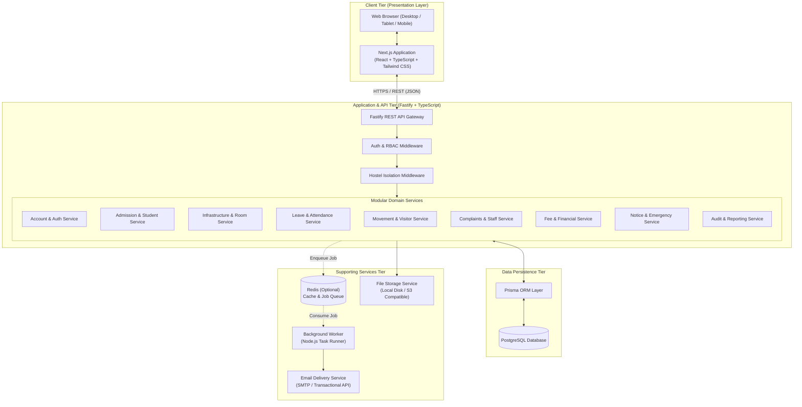
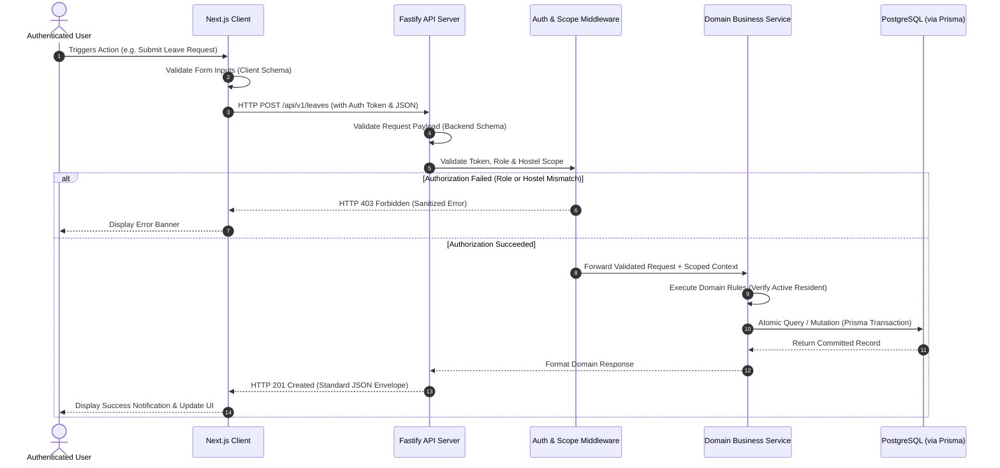
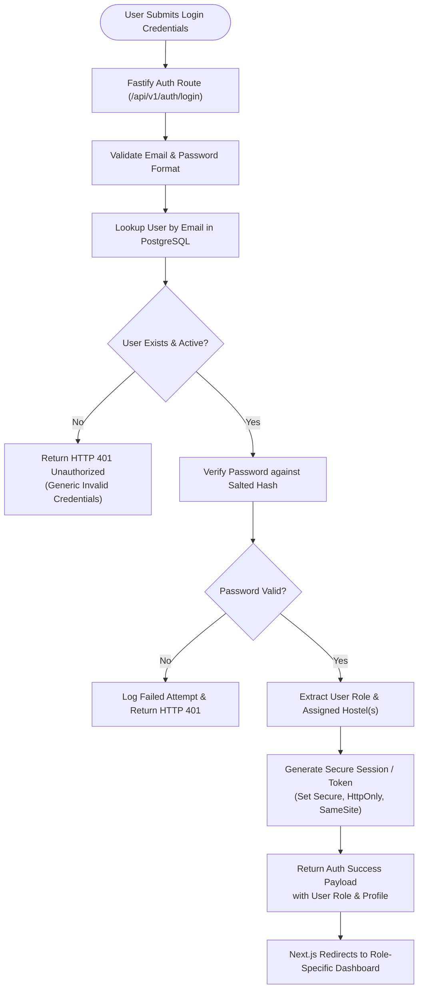
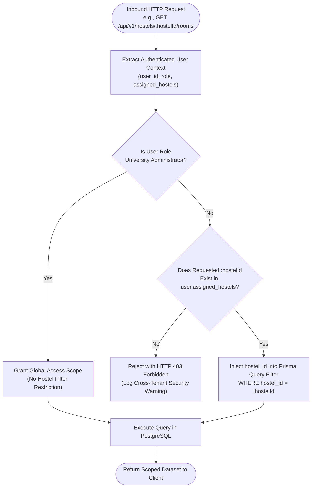

# Nestora — System Architecture Specification

## 1. Document Purpose
The purpose of this System Architecture Specification is to establish the comprehensive architectural blueprint, structural component hierarchy, communication patterns, and data flow mechanisms for **Nestora — University Hostel Management System**.

In software engineering, architectural design bridges the gap between functional requirements and physical software construction. It defines how modular subsystems interact, enforces non-functional constraints (such as security, performance, and data integrity), and establishes clean boundaries across presentation, application logic, and persistence layers. For Nestora—an academic software engineering project for a Bachelor of Computer Applications (BCA) curriculum—this specification serves as the authoritative technical reference for subsequent database implementation, backend API development, and frontend interface construction.

All architectural designs, component structures, and technology selections described herein represent **planned engineering specifications** formulated for this project, building upon the foundational context of [01-project-overview.md](file:///Users/sayamdas/Documents/Programming/Mern%20Stack/My%20Website/Nestora/docs/01-project-overview.md), the system scope in [02-project-scope.md](file:///Users/sayamdas/Documents/Programming/Mern%20Stack/My%20Website/Nestora/docs/02-project-scope.md), the functional requirements in [03-functional-requirements.md](file:///Users/sayamdas/Documents/Programming/Mern%20Stack/My%20Website/Nestora/docs/03-functional-requirements.md), the quality standards in [04-non-functional-requirements.md](file:///Users/sayamdas/Documents/Programming/Mern%20Stack/My%20Website/Nestora/docs/04-non-functional-requirements.md), and the authorization model in [05-user-roles-and-permissions.md](file:///Users/sayamdas/Documents/Programming/Mern%20Stack/My%20Website/Nestora/docs/05-user-roles-and-permissions.md).

---

## 2. Introduction
University hostel administration requires coordinating physical infrastructure assets, diverse resident populations, financial records, security operations, and daily student welfare. Managing these operations across multiple residential hostels under a single university necessitates a software architecture capable of balancing **centralized institutional administration** with **localized hostel-level autonomy**.

Nestora is structured around six confirmed user roles:
1. **University Administrator**
2. **Hostel Warden**
3. **Student**
4. **Hostel Staff**
5. **Security Guard**
6. **Accountant**

To accommodate these roles while maintaining data isolation and operational performance, the platform is architected as a **modular monolithic web application** featuring a decoupled single-page / server-rendered frontend, a high-performance RESTful API backend, a relational database, and asynchronous background worker capabilities.

---

## 3. Architecture Goals
The system architecture of Nestora is designed to satisfy the following primary engineering goals:

1. **Strict Role-Based and Hostel-Level Data Isolation**: Guarantee that users access only the records permitted by their role and assigned hostel jurisdiction, preventing cross-hostel data leakage at the API and database levels.
2. **Modularity and Separation of Concerns**: Maintain distinct boundaries between user interface rendering, HTTP request routing, domain business logic, data persistence, and background tasks.
3. **Transactional Integrity and Consistency**: Ensure that multi-step operations (such as student admission verifications, bed allocations, room transfers, and fee adjustments) execute with strict ACID transactional guarantees.
4. **Responsiveness and Performance**: Meet or exceed proposed design targets ($\le 2.0\text{s}$ dashboard rendering, $\le 500\text{ms}$ transactional read latency) through optimized query patterns, database indexing, and lean API serialization.
5. **Architectural Feasibility for BCA Curriculum**: Select modern, industry-standard, and well-documented technologies that demonstrate sound software engineering principles without unnecessary operational overhead.

---

## 4. Architectural Style
Nestora adopts a **Decoupled Client-Server Modular Monolith** architectural style.

### Why Modular Monolith?
In software engineering, microservices introduce distributed systems complexities—such as network latency overhead, distributed transaction management (Two-Phase Commit / Sagas), service discovery, and complex orchestration—which are unnecessary and counterproductive for a university hostel management application within an academic scope. 

A **Modular Monolith** provides:
- **Logical Domain Boundaries**: Backend services are structured into independent domain modules (e.g., Admissions, Allocation, Finance, Attendance) with clear interfaces.
- **In-Process Communication**: Subsystems communicate via in-memory function calls and local events, eliminating cross-network serialization overhead.
- **Single Source of Truth**: All modules share a unified PostgreSQL database instance while maintaining entity relationship integrity.
- **Simplified Deployment and Maintenance**: The backend is compiled and executed as a single cohesive unit, reducing infrastructure operational requirements.

---

## 5. High-Level System Architecture
The system is organized into five distinct structural tiers:

```
+--------------------------------------------------------------------------+
| 1. Presentation Tier: Next.js + React + TypeScript + Tailwind CSS        |
+--------------------------------------------------------------------------+
                                     |  HTTPS / REST (JSON)
                                     v
+--------------------------------------------------------------------------+
| 2. API & Routing Tier: Fastify HTTP Server + Request Validation          |
+--------------------------------------------------------------------------+
                                     |
                                     v
+--------------------------------------------------------------------------+
| 3. Business Logic Tier: Domain Services + RBAC & Tenant Scoping Guards   |
+--------------------------------------------------------------------------+
                                     |
                                     v
+--------------------------------------------------------------------------+
| 4. Data Access Tier: Prisma ORM (Type-Safe Query Layer & Transactions)   |
+--------------------------------------------------------------------------+
                                     |
                                     v
+--------------------------------------------------------------------------+
| 5. Persistence Tier: PostgreSQL Relational Database                      |
+--------------------------------------------------------------------------+
                                     |
         +---------------------------+---------------------------+
         | (Async Jobs / Cache)                                  | (File Uploads)
         v                                                       v
+----------------------------------+          +----------------------------------+
| Supporting Services:             |          | File Storage:                    |
| - Background Task Worker         |          | - Local Disk (Development)       |
| - Redis (Optional Queue / Cache) |          | - S3-Compatible Storage (Prod)   |
| - Transactional Email Service    |          +----------------------------------+
+----------------------------------+
```

### Layer Responsibilities:
- **Presentation Tier**: Renders user interfaces, executes client-side form validation, manages client session state, and initiates HTTP requests.
- **API & Routing Tier**: Ingests HTTP requests, parses headers/parameters, applies rate limiting and CORS, and validates inbound payloads against strict schemas.
- **Business Logic Tier**: Enforces domain invariants, verifies authentication tokens, applies role permissions, injects hostel data filters, and coordinates business workflows.
- **Data Access Tier**: Translates domain operations into type-safe SQL queries, manages connection pools, and enforces atomic transaction boundaries.
- **Persistence Tier**: Persists institutional entities, enforces primary/foreign key constraints, ensures relational referential integrity, and maintains table indexes.
- **Supporting Services Tier**: Handles non-blocking asynchronous workloads, including transactional email delivery, report compilation, and file attachment persistence.

---

## 6. Technology Stack
The planned technology stack comprises modern, type-safe, and production-tested technologies:

### Frontend
- **Framework**: Next.js (React framework supporting App Router architecture).
- **Core Library**: React (Component-driven declarative user interfaces).
- **Language**: TypeScript (Static typing for component props, state, and API contracts).
- **Styling**: Tailwind CSS (Utility-first responsive styling).
- **UI Components**: shadcn/ui (Accessible, headless component primitives built on Radix UI).

### Backend
- **Runtime**: Node.js (Asynchronous, event-driven JavaScript runtime).
- **HTTP Framework**: Fastify (High-throughput, low-overhead HTTP web framework with native JSON schema compilation).
- **Language**: TypeScript (End-to-end static typing shared with frontend data contracts).
- **Architecture**: REST API with structured JSON payloads.

### Database
- **Database Engine**: PostgreSQL (Enterprise-grade relational database management system).
- **Data Access Layer**: Prisma ORM (Type-safe schema definitions, automated migrations, and programmatic query construction).

### Supporting & Infrastructure Services
- **Cache & Queue Coordinator (Optional)**: Redis (In-memory data store for API rate limiting, session caching, and background job queue coordination).
- **Background Worker**: Node.js asynchronous task runner for processing non-blocking email notifications and report generation.
- **Transactional Email Service**: SMTP service or transactional email API for account activations, password resets, and emergency advisories.
- **Containerization**: Docker and Docker Compose (Encapsulating application, database, and cache runtimes for reproducible environments).
- **CI/CD Automation**: GitHub Actions (Automated linting, type-checking, and unit/integration test execution).

---

## 7. Frontend Architecture

### 1. Role-Specific Dashboards and Layouts
The frontend is organized around six role-specific dashboard views:
- `/admin/*`: University Administrator Console (institutional metrics, hostel management, admission approvals, fee approvals).
- `/warden/*`: Hostel Warden Console (assigned hostel stats, bed allocations, leave reviews, complaints, attendance).
- `/student/*`: Student Portal (personal bed info, leave requests, complaint tracker, fee statement).
- `/staff/*`: Hostel Staff Console (assigned maintenance tickets, duty rosters, task progress updates).
- `/guard/*`: Security Guard Console (gate movement logging, pass verification, visitor check-in/out).
- `/accountant/*`: Accountant Console (fee structure management, offline payment entry, dues tracking).

Shared layouts wrap these views with standardized headers, navigation sidebars, user profile dropdowns, and alert banners.

### 2. Route Organization & Protection
- Public Routes: Login (`/login`), Forgot Password (`/forgot-password`), Account Activation (`/activate`).
- Protected Routes: Grouped under role-specific route segments guarded by client-side authentication checks.
- *Security Note*: Client-side route guards optimize user experience by redirecting unauthorized visitors. True security is enforced independently on the backend API.

### 3. API Communication Layer
- The client communicates with the Fastify backend via native browser `fetch()`.
- A centralized API client wrapper manages base URLs, serializes JSON payloads, attaches authentication session credentials, and intercepts HTTP error responses (e.g., redirecting to login upon HTTP 401).

### 4. Form State & Validation
- Interactive forms utilize controlled components paired with schema validation (e.g., Zod).
- Form validation occurs client-side for immediate user feedback, mirrored by authoritative schema validation on the backend.

### 5. Responsive Design
- Layouts reflow fluidly across Desktop ($\ge 1200\text{px}$), Tablet ($768\text{px} - 1199\text{px}$), and Mobile ($360\text{px} - 767\text{px}$) screens using Tailwind CSS responsive modifiers (`md:`, `lg:`).

---

## 8. Backend Architecture

### 1. Modular Directory Structure
The Fastify backend codebase is structured into modular domain feature packages:
```
backend/
├── src/
│   ├── config/             # Environment, database, and runtime configs
│   ├── plugins/            # Fastify plugins (CORS, Rate Limiting, Prisma, Auth)
│   ├── middleware/         # Authentication and authorization guards
│   ├── common/             # Shared utilities, constants, and error classes
│   ├── modules/            # Domain business modules
│   │   ├── auth/           # Login, sessions, password resets
│   │   ├── users/          # User profiles and provisioning
│   │   ├── admissions/     # Two-tier student admissions
│   │   ├── infrastructure/ # Hostels, buildings, floors, rooms, beds
│   │   ├── allocation/     # Room and bed assignments
│   │   ├── checkin-out/    # Arrival and departure clearances
│   │   ├── leaves/         # Temporary leaves and outing passes
│   │   ├── attendance/     # Night roll-calls and corrections
│   │   ├── visitors/       # Visitor registration and logging
│   │   ├── complaints/     # Maintenance tickets and staff assignment
│   │   ├── finance/        # Fee schedules, offline payments, dues
│   │   ├── notices/        # Announcements and acknowledgements
│   │   ├── staff/          # Staff duty rosters and shift tracking
│   │   ├── discipline/     # Conduct rules, infractions, appeals
│   │   ├── emergency/      # Incident logging and escalation
│   │   ├── notifications/  # In-app and email alert dispatching
│   │   ├── reports/        # Administrative reporting queries
│   │   └── audit/          # System mutation audit logging
│   ├── workers/            # Background task workers (Email, Reports)
│   └── server.ts           # Application bootstrap and lifecycle hooks
```

### 2. Request Processing Pipeline
Every incoming HTTP request traverses a structured lifecycle:
1. **Network & Transport**: TLS/HTTPS termination.
2. **Global Plugins**: CORS validation, Helmet security headers, rate-limiting checks.
3. **Authentication Hook**: Extracts and verifies session token/cookie; populates `request.user` context.
4. **Authorization Hook**: Validates role permissions and matches requested `hostel_id` against `request.user.assigned_hostels`.
5. **Schema Validation**: Fastify's native JSON schema compiler validates request parameters, headers, and request body.
6. **Domain Controller**: Extracts validated data and delegates execution to the corresponding Domain Service.
7. **Domain Service**: Executes core business logic, verifies domain invariants, and interacts with Prisma ORM.
8. **Prisma ORM & PostgreSQL**: Executes type-safe SQL query within transaction boundaries.
9. **Response Serialization**: Serializes response data into a standardized JSON envelope.

---

## 9. Database Architecture

### 1. Relational Paradigm & PostgreSQL
PostgreSQL is chosen for its strict ACID compliance, robust referential integrity, strong support for complex joins, and advanced indexing capabilities.

### 2. Entity Relational Hierarchy
The database mirrors the seven-tier accommodation structure:
$$\text{University} \xrightarrow{1:N} \text{Hostel} \xrightarrow{1:N} \text{Building} \xrightarrow{1:N} \text{Block} \xrightarrow{1:N} \text{Floor} \xrightarrow{1:N} \text{Room} \xrightarrow{1:N} \text{Bed}$$

### 3. Key Relational Constraints
- **Primary Keys**: Every entity utilizes a unique surrogate primary key (e.g., UUID or auto-incrementing identity).
- **Foreign Keys**: Explicit foreign keys with relational constraints (`ON DELETE RESTRICT` for physical infrastructure to prevent accidental cascade deletion of occupied rooms).
- **Unique Constraints**: Strictly enforced on natural keys:
  - `users.email`
  - `students.registration_number`
  - `beds.room_id + beds.bed_number`
  - `active_allocations.bed_id` (Ensuring a bed has at most one active occupant).

### 4. Transaction Management
Critical multi-step operations execute within atomic database transactions via `prisma.$transaction()`:
- **Bed Allocation**: Atomically marks student as allocated, updates bed status from `Available` to `Occupied`, and creates an allocation record.
- **Check-Out**: Terminates allocation record, logs room inspection notes, and resets bed status to `Available`.
- **Fee Waiver Approval**: Deducts waived balance from student dues ledger and appends an approved credit transaction.

### 5. Indexing Strategy
To ensure constant-time lookups and satisfy latency requirements:
- B-Tree indexes on `hostel_id` across all operational tables for instant tenant partitioning.
- Indexes on `student_id`, `status`, and `created_at` timestamps for historical queries and dashboards.

---

## 10. Authentication and Authorization Architecture

### 1. Credential Verification
- Users authenticate using their registered email and password.
- Passwords are encrypted using a modern, adaptive cryptographic hashing algorithm (e.g., Argon2id or bcrypt) with unique per-user salts. Plaintext passwords are never stored or logged.

### 2. Session Management
- Upon successful credential verification, the server establishes an authenticated session.
- Authentication credentials (tokens or session identifiers) are transmitted via secure HTTP cookies flagged with `HttpOnly`, `Secure`, and `SameSite=Strict/Lax` attributes to eliminate client-side JavaScript access and mitigate XSS-based credential theft.

### 3. Password Recovery Architecture
- The password recovery workflow issues a single-use, time-limited cryptographic token linked to the user's account.
- A secure link is dispatched to the user's verified email. The token expires after a short validity window (e.g., 15 minutes) and is invalidated immediately upon successful password reset.

---

## 11. Role-Based Access Control (RBAC)

### 1. Role Representation
Each user account maintains an explicit `role` attribute belonging to the enumerated set:
`UNIVERSITY_ADMINISTRATOR`, `HOSTEL_WARDEN`, `STUDENT`, `HOSTEL_STAFF`, `SECURITY_GUARD`, `ACCOUNTANT`.

### 2. Role Permissions vs. Resource-Level Restrictions
The architecture distinguishes between coarse-grained role permissions and fine-grained resource restrictions:
- **Role Permission**: Determines whether a role is authorized to invoke a specific capability (e.g., "Can this role approve leave requests?").
- **Resource Restriction**: Determines whether the authenticated user has jurisdiction over the specific data record being manipulated (e.g., "Is this leave request from a student in the Warden's assigned hostel?").

Both checks must pass before a request is processed.

---

## 12. Hostel-Level Data Isolation

### 1. Multi-Tenant Scoping Mechanism
Nestora treats each individual hostel as an operational tenant boundary:

| Role | Operational Scope | Query Filter Injected by Backend |
| :--- | :--- | :--- |
| **University Administrator** | Global (All Hostels) | No hostel filter (Unrestricted) |
| **Hostel Warden** | Assigned Hostel(s) | `WHERE hostel_id IN (user.assigned_hostel_ids)` |
| **Student** | Own Records + Assigned Hostel | `WHERE student_id = user.id AND hostel_id = user.hostel_id` |
| **Hostel Staff** | Assigned Hostel + Assigned Tasks | `WHERE hostel_id = user.hostel_id AND assigned_to = user.id` |
| **Security Guard** | Assigned Hostel Gate | `WHERE hostel_id = user.hostel_id` |
| **Accountant** | Global Financial Records | Restricted strictly to financial entity schemas |

### 2. Backend Enforcement Rule
The backend authorization middleware extracts `assigned_hostels` directly from the authenticated user's verified session. Route handlers programmatically merge this scope into Prisma database queries. If a user attempts to supply an unassigned `hostel_id` via route parameters or JSON payloads, the authorization guard aborts execution with HTTP 403 Forbidden.

---

## 13. Major Application Modules & Interactions
The architecture coordinates several tightly coupled operational workflows:

```
[Admissions Module] ──(Admission Approved)──> [Allocation Module]
                                                     │
                                       (Allocates Bed / Updates Status)
                                                     ▼
[Attendance Module] <──(Leave Active)─── [Leave & Outing Module]
         │                                           │
(Absence Alert)                              (Gate Pass Validated)
         ▼                                           ▼
[Incident / Emergency]                     [Security Movement Module]
         │
(Alerts Dispatched)
         ▼
[Notification Module] <────────────────── [Finance / Fee Module]
                                           (Fee Due Reminders)
```

### Key Module Interactions:
- **Admission $\rightarrow$ Allocation**: A student record cannot be allocated a room or bed until both Tier-1 (Admin) and Tier-2 (Warden) verifications are committed, setting status to `FULLY_APPROVED`.
- **Allocation $\rightarrow$ Infrastructure**: Allocating a bed space updates the corresponding bed entity status from `Available` to `Occupied` within an atomic transaction.
- **Leave $\rightarrow$ Attendance**: The attendance roster service cross-references active approved temporary leaves. A resident with an active leave is automatically marked as `On Leave`, preventing false unexcused absence alerts.
- **Outing $\rightarrow$ Security**: Approved outings generate digital pass records verifiable by Security Guards at gate checkpoints.
- **Complaints $\rightarrow$ Staff Management**: When a Warden reviews a maintenance ticket, the system presents matching staff members based on category (e.g., Electrical $\rightarrow$ Electrician).
- **Emergency $\rightarrow$ Notification & Audit**: Reporting an emergency immediately triggers high-priority alerts to Wardens and logs an immutable audit event.

---

## 14. API Communication Architecture

### 1. RESTful Design
The backend exposes a resource-oriented REST API adhering to standard HTTP conventions:
- `GET /api/v1/hostels`: List authorized hostels.
- `POST /api/v1/admissions`: Submit student registration.
- `PATCH /api/v1/leaves/:id/approve`: Approve leave request.
- `DELETE /api/v1/allocations/:id`: Deallocate bed space.

### 2. Standardized JSON Envelope
All API endpoints return standardized JSON response envelopes:

**Success Response:**
```json
{
  "success": true,
  "data": { ... },
  "meta": {
    "timestamp": "2026-11-04T10:00:00Z",
    "pagination": { "page": 1, "limit": 20, "total": 85 }
  }
}
```

**Error Response:**
```json
{
  "success": false,
  "error": {
    "code": "AUTHORIZATION_DENIED",
    "message": "User is not authorized to access records for this hostel.",
    "correlation_id": "req-9842a-c71b"
  }
}
```

### 3. API Versioning
All public routes are version-prefixed (`/api/v1/`) to allow future evolutionary enhancements without breaking existing client integrations.

---

## 15. File and Attachment Management

### 1. Attachment Types
The platform supports attachments for three specific operational workflows:
- Maintenance Complaints: Damage photographs (JPEG, PNG).
- Notices & Circulars: Official documentation (PDF).
- Emergency Incidents: Evidence photographs and incident documentation (JPEG, PNG, PDF).

### 2. Storage Abstraction Layer
A storage abstraction interface (`IStorageService`) isolates the application from the underlying storage mechanism:
- **Development**: Local filesystem storage within a protected server directory.
- **Production**: S3-compatible cloud object storage bucket.

### 3. Upload Security
- Strict MIME-type inspection and file extension validation.
- File size caps (e.g., maximum 5 MB per image, 10 MB per PDF).
- Random cryptographic UUID file renaming to prevent directory traversal and file overwriting attacks.
- Direct public access to storage directories is disabled; files are served through authorized streaming endpoints or time-limited pre-signed URLs.

---

## 16. Notification Architecture

### 1. Multi-Channel Notification Dispatch
Nestora supports two planned communication channels:
1. **In-App Notifications**: Stored in a database table and queried by the client application for real-time notification drop-down alerts.
2. **Email Notifications**: Asynchronous email delivery for account activation, password resets, leave determinations, and emergency notices.

> [!IMPORTANT]
> In accordance with [02-project-scope.md](file:///Users/sayamdas/Documents/Programming/Mern%20Stack/My%20Website/Nestora/docs/02-project-scope.md), third-party SMS messaging is explicitly excluded from the initial system scope.

### 2. Asynchronous Queue Processing
To ensure API responsiveness, email dispatching is decoupled from HTTP request handling. When an event triggers an email (e.g., leave approval), the API enqueues a lightweight job payload into a background queue. A background worker picks up the job and executes delivery via the configured SMTP/email provider.

### 3. Emergency Priority Bypassing
Emergency incident alerts are flagged as `CRITICAL` priority. They bypass standard user notification suppression preferences, ensuring mandatory delivery.

---

## 17. Audit Logging Architecture
The platform enforces a strict architectural distinction between two logging streams:

1. **Business Audit Trail**:
   - Stores permanent business records of sensitive institutional events (admissions, bed changes, financial waivers, disciplinary actions, emergency contact views).
   - Saved in an append-only PostgreSQL table (`audit_logs`).
   - Immutable: No update or delete operations are exposed via any API.
   - Accessible exclusively to the University Administrator.
2. **Technical Application Logs**:
   - Diagnostic runtime logs capturing server health, HTTP request metrics, warnings, and unhandled errors.
   - Output as structured JSON streams (`pino` logger integrated into Fastify).
   - Sensitive user credentials, passwords, and tokens are scrubbed from log streams via automated masking serializers.

---

## 18. Error Handling and Validation

### 1. Boundary Request Validation
Every API route binds a strict JSON schema compiled by Fastify. Inbound requests with missing required fields, illegal data types, or unexpected attributes are rejected at the network boundary with HTTP 400 Bad Request before reaching domain logic.

### 2. Centralized Error Handler
A global Fastify error handler intercepts all synchronous and asynchronous exceptions:
- Known Domain Exceptions (e.g., `NotFoundError`, `UnauthorizedError`, `ConflictError`) map directly to appropriate HTTP status codes (404, 403, 409).
- Unhandled Runtime Exceptions return a generic HTTP 500 Internal Server Error message to the client while logging full stack traces with a unique correlation ID to the technical log stream.

---

## 19. Deployment Architecture

### 1. Deployment Model
The planned deployment architecture utilizes containerized services orchestrated via Docker Compose:

```
[Internet]
    │
    ▼ (Ports 80/443 - TLS)
[Nginx / Reverse Proxy Gateway]
    ├───> [Next.js Web Frontend Service] (Port 3000)
    └───> [Fastify API Backend Service] (Port 4000)
              │
              ├───> [PostgreSQL Database] (Port 5432)
              ├───> [Redis Service (Optional)] (Port 6379)
              ├───> [Background Task Worker] (Node.js Process)
              └───> [Local / Cloud Object Storage]
```

### 2. Environment Segregation
- **Development**: Runs locally via Docker Compose with hot-reloading and SQLite/PostgreSQL local instance.
- **Staging / Testing**: Dedicated environment mirroring production for automated end-to-end integration tests.
- **Production**: Hardened configuration with compiled TypeScript builds, production database connection pooling, and strict TLS encryption. All configuration is externalized via environment variables.

---

## 20. Security Considerations
- **TLS/HTTPS Enforcement**: All external communications mandate Transport Layer Security.
- **OWASP Mitigation**:
  - SQL Injection: Neutralized via Prisma ORM parameterized queries.
  - XSS: Neutralized via React's automatic output escaping and strict Content Security Policies (CSP).
  - CSRF: Mitigated via `SameSite` cookie flags and header token verification on mutating requests.
  - IDOR: Neutralized via mandatory backend hostel-scope and user-ownership authorization middleware.
- **Rate Limiting**: Configured on sensitive authentication routes (`/api/v1/auth/login`, `/api/v1/auth/forgot-password`) to prevent credential stuffing.

---

## 21. Scalability and Maintainability
- **Stateless API Design**: The Fastify application retains no in-memory session state; horizontal scaling can be achieved by placing multiple backend instances behind a reverse proxy.
- **Database Indexing & Read Scalability**: Heavy read tables (attendance, movement logs) utilize composite indexing and can support read-replicas if institutional scale expands in future academic phases.
- **Maintainable Modularity**: Domain modules are isolated into separate folders with explicit interfaces, allowing BCA developers to modify individual features without triggering cascading regressions.

---

## 22. Architecture Diagrams

### Diagram 1: High-Level System Architecture
The following diagram illustrates the complete high-level technical topology of Nestora:



---

### Diagram 2: Request and Data Flow
The sequence diagram demonstrates how a user request traverses validation, authentication, authorization, business logic, and database persistence:



---

### Diagram 3: Authentication and Authorization Flow
The following flowchart illustrates the credential verification, role resolution, and dashboard redirection workflow:



---

### Diagram 4: Hostel-Level Access Control
The following flowchart shows how backend middleware intercepts requests and enforces hostel data boundaries:



---

## 23. Architectural Decisions and Assumptions

### Confirmed Architectural Decisions:
1. **Modular Monolith**: Fastify backend structured into discrete domain modules rather than microservices.
2. **Relational Database**: PostgreSQL utilized with Prisma ORM for relational integrity and transactional atomicity.
3. **Decoupled Frontend**: Next.js client communicating exclusively through standardized RESTful JSON endpoints.
4. **Backend-Enforced Security**: All role and hostel boundary validations occur authoritatively at the backend service layer.
5. **Non-Blocking Email Delivery**: Decoupling email dispatching from interactive HTTP request threads.

### Assumptions and Open Decisions:
- **Redis Queue Optionality**: For local development and low-traffic prototypes, background tasks may execute via in-memory event queues; Redis is planned for high-concurrency staging and production environments.
- **Storage Driver Abstraction**: Local filesystem storage is assumed for development; transition to S3-compatible cloud storage depends on institutional hosting infrastructure decisions.
- **Session Token Format**: Low-level session implementation (stateless JWT vs. stateful database session identifiers) will be finalized in the dedicated authentication phase.

---

## 24. Conclusion
The system architecture of **Nestora — University Hostel Management System** establishes a robust, secure, and maintainable foundation for multi-hostel administration. By pairing a high-throughput Fastify REST backend with a modern Next.js frontend and PostgreSQL persistence, the design delivers clear role governance, strict hostel-level data isolation, and transactional integrity. 

This specification serves as the formal architectural blueprint guiding the upcoming database schema design ([07-database-design.md](file:///Users/sayamdas/Documents/Programming/Mern%20Stack/My%20Website/Nestora/docs/07-database-design.md)) and component implementation.
