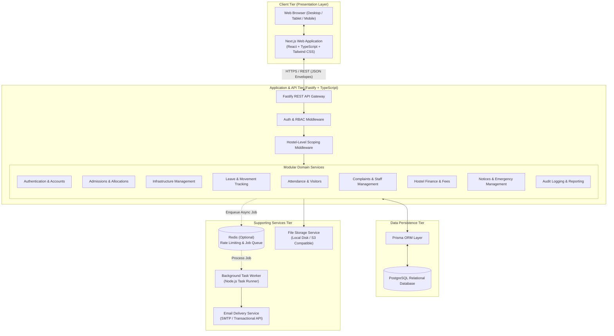
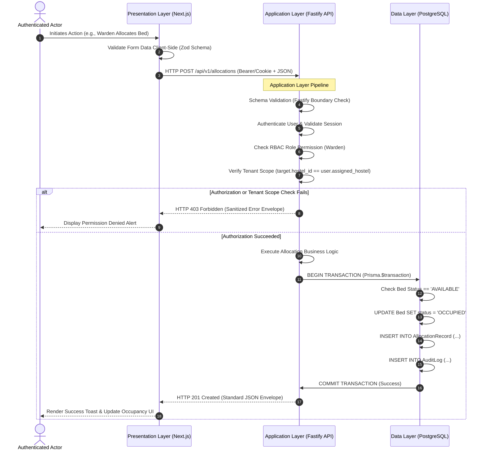
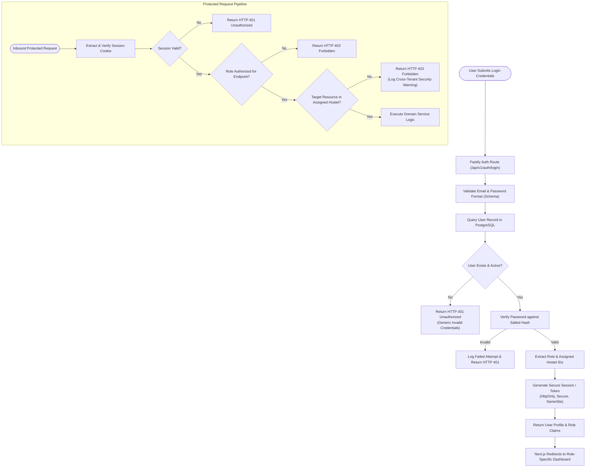
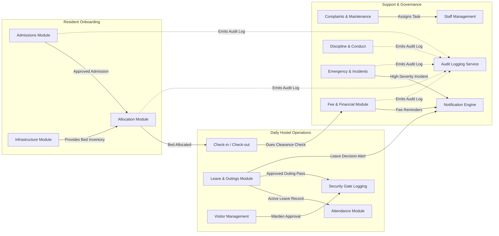
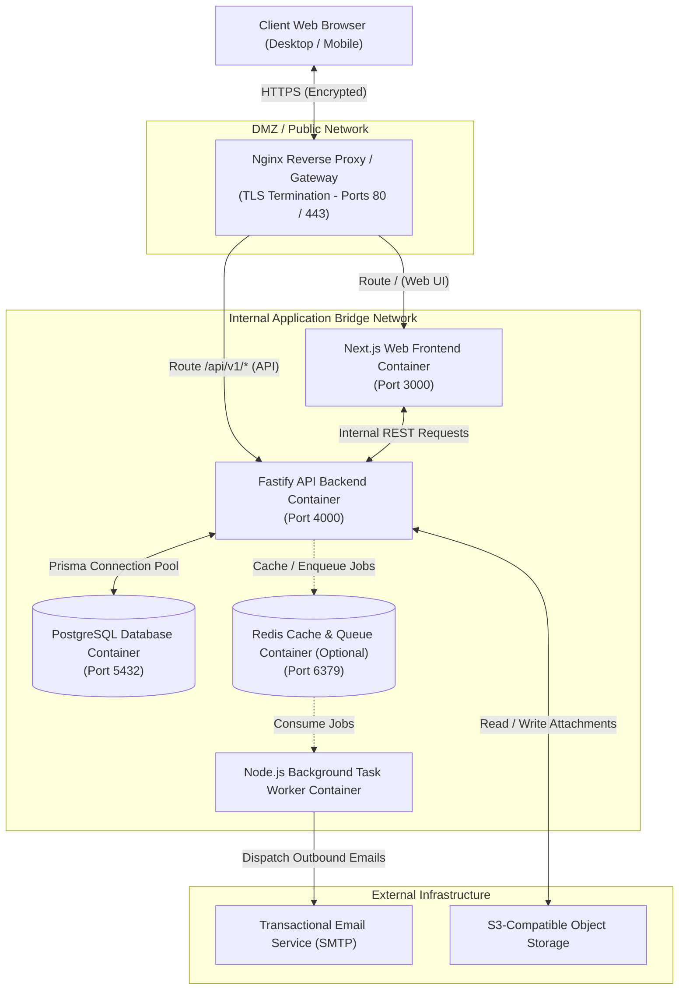

# Nestora — System Architecture Specification

## 1. Introduction

The purpose of this System Architecture Specification is to establish the authoritative architectural blueprint, component design, communication patterns, and technical infrastructure for **Nestora — University Hostel Management System**.

Nestora is a centralized, web-based platform designed to manage multiple university hostels under a unified administrative umbrella. In collegiate residential management, accommodating hundreds or thousands of students requires coordinating physical infrastructure assets, diverse user populations, academic admissions, financial transactions, perimeter security, and resident welfare. The core premise of Nestora is to couple **centralized university-wide administration** with **autonomous, hostel-level operational isolation**.

The system operates across six confirmed user roles:
1. **University Administrator**
2. **Hostel Warden**
3. **Student**
4. **Hostel Staff**
5. **Security Guard**
6. **Accountant**

This specification bridges the project's foundational requirements and physical implementation. It is an architectural design document for a Bachelor of Computer Applications (BCA) software engineering project, serving as the primary design baseline before physical database modeling and application development commence.

This document directly derives its requirements from:
- [01-project-overview.md](./01-project-overview.md)
- [02-project-scope.md](./02-project-scope.md)
- [03-functional-requirements.md](./03-functional-requirements.md)
- [04-non-functional-requirements.md](./04-non-functional-requirements.md)
- [05-user-roles-and-permissions.md](./05-user-roles-and-permissions.md)

---

## 2. Architecture Goals and Principles

### High-Level Architecture Goals

1. **Multi-Hostel Tenant Data Isolation**: Enforce data boundaries so that operational staff (Wardens, Hostel Staff, Security Guards) interact strictly with records of their assigned hostel, while the University Administrator retains institution-wide governance.
2. **Robust Role-Based Access Control (RBAC)**: Ensure fine-grained authorization across all six user roles, strictly enforcing least privilege at every application boundary.
3. **High Modularity and Maintainability**: Organize system components into cohesive, decoupled domain modules that can be understood, tested, and maintained within an academic software engineering scope.
4. **Data Integrity and Transactional Consistency**: Guarantee atomic execution for complex multi-entity operations (e.g., student admission sign-offs, bed allocations, check-out clearances, and fee waivers) to eliminate orphaned or conflicting states.
5. **High Operational Responsiveness**: Achieve target latency benchmarks ($\le 2.0\text{s}$ dashboard rendering, $\le 500\text{ms}$ transactional read responses) through efficient database query patterns, indexing, and lightweight API serialization.
6. **Evolutionary Readiness**: Structure backend services and frontend components to support future feature additions without necessitating structural rewrites.

### Foundational Architectural Principles

- **Separation of Concerns**: Strict boundary separation between presentation rendering, HTTP routing/validation, domain business logic, and data persistence.
- **Fail-Safe Defaults (Default Deny)**: Every API endpoint and resource is inaccessible by default unless explicitly granted by authenticated role and tenant scope bindings.
- **Complete Backend Mediation**: Security and authorization must be verified authoritatively on the backend. Client-side UI controls (such as disabled buttons or hidden menus) are purely for user experience and never serve as security enforcement.
- **Single Source of Truth**: Data models and relational invariants are centralized within a unified relational database, preventing redundant or desynchronized data silos.
- **Stateless Application Tier**: The backend API retains no client session state in server memory, allowing requests to be handled deterministically and supporting straightforward horizontal scaling.

---

## 3. Overall System Architecture

Nestora follows a **Decoupled Client-Server Modular Monolith** architectural style.

### Modular Monolith Design Rationale

Rather than decomposing the application into a complex distributed microservices architecture—which introduces distributed transaction hurdles (Two-Phase Commit / Sagas), network serialization latency, service discovery overhead, and substantial deployment complexity—Nestora organizes all functional domains as cohesive, in-process modules within a single backend service.

This approach provides:
- **Clean Logical Boundaries**: Domain logic (Admissions, Allocation, Attendance, Finance, Emergency) is partitioned into isolated folders with clear interfaces.
- **Zero-Latency Internal Calls**: Inter-module communication occurs via in-process TypeScript function calls and local event hooks rather than cross-network HTTP/gRPC calls.
- **Unified Transaction Management**: Multi-module database transactions execute within a shared PostgreSQL database connection with native ACID guarantees.
- **Simplified Operational Footprint**: The entire system can be developed, tested, and containerized seamlessly using Docker Compose.

### Diagram 1: High-Level System Architecture

The following diagram illustrates the interaction between the presentation tier, API tier, domain services, data persistence, and supporting services:



---

## 4. Three-Tier Architecture

Nestora divides its physical and logical responsibilities across three standard architectural tiers:

```
+─────────────────────────────────────────────────────────────────────────────+
|                          1. PRESENTATION LAYER                              |
|   Next.js (App Router) • React 18+ • TypeScript • Tailwind CSS • shadcn/ui  |
|   - Role Dashboards   - Form Validation   - State Management   - Responsive |
+─────────────────────────────────────────────────────────────────────────────+
                                       │
                                       │ HTTPS / REST (JSON)
                                       ▼
+─────────────────────────────────────────────────────────────────────────────+
|                           2. APPLICATION LAYER                              |
|          Node.js Runtime • Fastify Framework • TypeScript Modules           |
|   - HTTP Routing      - Request Schema    - RBAC Middleware   - Domain Logic|
|   - Hostel Isolation  - Transactions      - Error Handling    - Async Jobs  |
+─────────────────────────────────────────────────────────────────────────────+
                                       │
                                       │ SQL (Prisma ORM Client)
                                       ▼
+─────────────────────────────────────────────────────────────────────────────+
|                              3. DATA LAYER                                  |
|                  PostgreSQL Relational Database Engine                      |
|   - Relational Tables - Foreign Keys      - Unique Constraints- Indexes     |
|   - ACID Transactions - Audit Trail       - Multi-Tier Housing Hierarchy    |
+─────────────────────────────────────────────────────────────────────────────+
```

### 1. Presentation Layer (Frontend)

- **Role**: Delivers the visual user interface, client-side route navigation, dynamic role-based dashboards, and interactive forms.
- **Responsibilities**:
  - Render accessible, responsive UI layouts optimized for Desktop, Tablet, and Mobile viewports.
  - Perform real-time client-side form validation using schema libraries (e.g., Zod) for instant feedback.
  - Dispatch asynchronous HTTP requests to backend REST endpoints via native browser `fetch()`.
  - Maintain client session awareness, dynamically adapting navigation menus based on verified user claims.
  - Display informative loading skeletons, empty states, error alerts, and success toasts.

### 2. Application Layer (Backend/API)

- **Role**: Serves as the central computing engine, orchestrating validation, security boundaries, and domain workflows.
- **Responsibilities**:
  - Ingest inbound HTTP requests, parse route parameters, and terminate TLS connections.
  - Validate all inbound request headers, query parameters, and JSON payloads against compiled schemas before passing them to controllers.
  - Authenticate user credentials, verify session integrity, and attach user claims to request contexts.
  - Enforce RBAC permissions and automatically inject `hostel_id` scope constraints into data queries.
  - Execute business logic rules, coordinate multi-entity domain workflows, and manage atomic transactions.
  - Emit structured audit log events for all administrative and financial mutations.
  - Offload non-blocking asynchronous workloads (e.g., email dispatch) to background workers.

### 3. Data Layer (Database)

- **Role**: Houses institutional records, enforces referential constraints, and provides persistent storage.
- **Responsibilities**:
  - Enforce primary key uniqueness, foreign key relationships, and cascade/restrict rules across the seven-tier accommodation schema.
  - Execute ACID transactions for complex operations, ensuring that database updates commit fully or rollback completely.
  - Optimize query execution through B-Tree indexing on tenant keys (`hostel_id`), foreign keys, and search fields.
  - Store permanent, append-only audit trail records for compliance and institutional accountability.

### Diagram 2: Three-Tier Architecture Flow

The following sequence diagram details how an operational request flows through the three architectural tiers:



---

## 5. Technology Stack and Responsibilities

The planned technology stack comprises modern, open-source, and academically viable tools:

| Tier / Category                | Technology                   | Primary Architectural Responsibility                                  | Adoption Rationale                                                                                   |
| :----------------------------- | :--------------------------- | :-------------------------------------------------------------------- | :--------------------------------------------------------------------------------------------------- |
| **Frontend Framework**         | **Next.js (App Router)**     | Client-side routing, server rendering, layout composition             | Industry-standard React framework; robust nested layouts and optimized asset delivery.               |
| **UI Library**                 | **React 18+**                | Declarative, component-based user interface rendering                 | Component reusability, virtual DOM performance, and rich ecosystem support.                          |
| **Programming Language**       | **TypeScript**               | Static typing across frontend, backend, and data contracts            | Eliminates runtime type errors, improves code quality, and guarantees API contract alignment.        |
| **Styling & Design**           | **Tailwind CSS + shadcn/ui** | Responsive styling, accessible headless UI primitives                 | Rapid layout development, zero CSS bloat, and full compliance with WCAG accessibility standards.     |
| **Backend Runtime**            | **Node.js (LTS)**            | Asynchronous, event-driven server runtime                             | Excellent I/O throughput, vast package ecosystem, and unified TypeScript language stack.             |
| **Backend Framework**          | **Fastify**                  | High-throughput HTTP API gateway and request routing                  | Low overhead, benchmarked high performance, and built-in JSON schema compilation.                    |
| **Database Engine**            | **PostgreSQL**               | Relational data persistence, integrity constraints, ACID transactions | Enterprise-grade reliability, foreign key enforcement, advanced indexing, and audit logging support. |
| **Data Access / ORM**          | **Prisma ORM**               | Type-safe query building, database migrations, connection pooling     | Programmatic query safety, auto-generated TypeScript types, and intuitive transaction APIs.          |
| **Caching & Queue (Optional)** | **Redis**                    | In-memory caching, rate-limiting counters, async job queueing         | Ultra-fast in-memory operations; optional in local dev, planned for high-concurrency production.     |
| **Background Processing**      | **Node.js Task Worker**      | Asynchronous email dispatching and heavy report generation            | Offloads slow operations from the HTTP event loop, preserving API response latency.                  |
| **Email Service**              | **SMTP / Transactional API** | Dispatching system emails (activations, resets, urgent notices)       | Secure, standards-based outbound communication protocol.                                             |
| **Containerization**           | **Docker & Compose**         | Container packaging, isolated runtime environments                    | Ensures consistent development, testing, and deployment environments across developer machines.      |
| **CI/CD Automation**           | **GitHub Actions**           | Automated linting, type-checking, and test execution                  | Continuous verification on repository pushes to uphold software quality standards.                   |

---

## 6. Frontend Architecture

### 1. Application Structure

The Next.js frontend is structured under the `app/` directory according to App Router conventions:

```
frontend/
├── src/
│   ├── app/                      # Next.js App Router root
│   │   ├── (auth)/               # Public authentication route group
│   │   │   ├── login/page.tsx
│   │   │   ├── forgot-password/page.tsx
│   │   │   └── activate/page.tsx
│   │   ├── (dashboard)/          # Authenticated layout route group
│   │   │   ├── admin/            # University Administrator views
│   │   │   ├── warden/           # Hostel Warden views
│   │   │   ├── student/          # Student portal views
│   │   │   ├── staff/            # Hostel Staff views
│   │   │   ├── guard/            # Security Guard views
│   │   │   └── accountant/       # Accountant views
│   │   ├── layout.tsx            # Global root layout (providers, fonts)
│   │   └── page.tsx              # Landing / Redirection root
│   ├── components/               # Component hierarchy
│   │   ├── ui/                   # shadcn/ui headless primitives (Button, Modal, Input)
│   │   ├── common/               # Shared layout elements (Header, Sidebar, UserMenu)
│   │   └── modules/              # Domain components (AttendanceTable, LeaveForm, FeeCard)
│   ├── hooks/                    # Custom React hooks (useAuth, useFetch, useDebounce)
│   ├── lib/                      # Core utilities (apiClient, formatters, validators)
│   └── types/                    # Shared TypeScript interfaces and API schemas
```

### 2. Routing and Navigation

- **Public Routes**: Unauthenticated endpoints (`/login`, `/forgot-password`, `/activate`).
- **Role-Guarded Routes**: Segmented routes (`/admin/*`, `/warden/*`, `/student/*`, `/staff/*`, `/guard/*`, `/accountant/*`) wrapped by layout guards that verify authenticated session status.
- **Dynamic Redirection**: Upon successful authentication, the frontend inspects the user's role claim and automatically redirects the browser to the appropriate role dashboard root.

### 3. Component Organization

- **Primitive UI Layer**: Headless, accessible primitives (`components/ui/*`) styled with Tailwind CSS.
- **Composite Layout Layer**: Persistent shell layouts containing the top bar, navigation sidebar, and role-specific breadcrumbs.
- **Feature Component Layer**: Isolated business widgets (e.g., `BedAllocationGrid`, `VisitorLogTable`, `ComplaintResolutionModal`) that encapsulate localized UI state and data presentation.

### 4. State Management

- **Server Cache & Async State**: Handled via lightweight data fetching hooks or React server state tools, caching fetched records and handling refetching.
- **Client UI State**: Managed via native React hooks (`useState`, `useReducer`) for ephemeral interface states (modal visibility, form step progression, search filters).
- **Session State**: Managed via an `AuthContext` provider that exposes the authenticated user's ID, role, and assigned hostels globally across client components.

### 5. API Communication

- Centralized `apiClient` wrapper built on browser `fetch()`:
  - Automatically prepends the base API URL (`/api/v1`).
  - Includes session cookies or authentication tokens in request headers.
  - Automatically serializes outbound JSON bodies.
  - Intercepts error responses, handling HTTP 401 (redirect to login) and HTTP 403 (render unauthorized banner) uniformly.

---

## 7. Backend Architecture

### 1. Modular Directory Organization

The Fastify backend organizes domain capabilities into self-contained feature modules:

```
backend/
├── src/
│   ├── config/             # Environment, database, and server configurations
│   ├── plugins/            # Fastify plugins (CORS, Rate Limiting, Prisma, Auth)
│   ├── middleware/         # Security, authentication, and tenant isolation hooks
│   ├── common/             # Cross-cutting error classes, utilities, and constants
│   ├── modules/            # Domain-driven modular packages
│   │   ├── auth/           # Login, sessions, password recovery
│   │   ├── users/          # User accounts and provisioning
│   │   ├── admissions/     # Two-tier admission verifications
│   │   ├── infrastructure/ # Hostels, buildings, blocks, floors, rooms, beds
│   │   ├── allocation/     # Bed assignment and vacancy management
│   │   ├── checkin-out/    # Arrival logging and departure clearance
│   │   ├── leaves/         # Leave and outing applications
│   │   ├── attendance/     # Night roll-calls and corrections
│   │   ├── visitors/       # Visitor registration and gate passes
│   │   ├── complaints/     # Maintenance tickets and staff assignments
│   │   ├── finance/        # Fee schedules, offline payments, dues ledgers
│   │   ├── notices/        # Announcements and acknowledgements
│   │   ├── staff/          # Duty rosters and shift allocations
│   │   ├── discipline/     # Conduct rules, infractions, appeals
│   │   ├── emergency/      # Emergency logging and auto-escalation
│   │   ├── notifications/  # In-app and email alert generation
│   │   ├── reports/        # Analytical queries and monitoring
│   │   └── audit/          # Administrative audit trail persistence
│   ├── workers/            # Asynchronous background tasks (Mailer, Reporter)
│   └── server.ts           # Server bootstrap and lifecycle entry point
```

### 2. Controllers and Services Pattern

Each domain module enforces a strict separation between HTTP transport and business logic:
- **Routes & Controllers**: Declare API paths, bind JSON validation schemas, parse parameters, and invoke service methods. No SQL queries or business calculations reside in controllers.
- **Domain Services**: Pure business logic components that execute domain rules, enforce state transitions, coordinate transactions, and interact with the Prisma ORM.

### 3. Middleware and Validation Pipeline

Incoming requests traverse Fastify's lifecycle hooks:
1. `onRequest`: Applies rate limiting and security headers (Helmet).
2. `preParsing`: Validates request body size limits.
3. `preValidation`: Compiles and executes Fastify's native JSON Schema validation on body, params, and querystring.
4. `preHandler`: Executes `authenticate` middleware (session token extraction) followed by `authorize` middleware (role verification) and `scopeHostel` middleware (tenant boundary check).

### 4. Error Handling Architecture

- A centralized error handling hook catches all synchronous and asynchronous exceptions.
- Domain exceptions inherit from a base `AppError` class defining HTTP status codes and error codes.
- Unhandled runtime errors return a sanitized JSON envelope (`{ success: false, error: { message: "Internal server error", correlation_id } }`) while logging the full stack trace to technical log streams.

---

## 8. Database Architecture Overview

### 1. Relational Entity Hierarchy

Nestora models physical housing assets through an explicit parent-child relational hierarchy:
$$\text{University} \xrightarrow{1:N} \text{Hostel} \xrightarrow{1:N} \text{Building} \xrightarrow{1:N} \text{Block} \xrightarrow{1:N} \text{Floor} \xrightarrow{1:N} \text{Room} \xrightarrow{1:N} \text{Bed}$$

- **Hostels**: Partitioned by gender (`BOYS_HOSTEL`, `GIRLS_HOSTEL`).
- **Rooms**: Mapped to exactly one of the six confirmed configurations:
  1. Single Bed (Capacity 1, Non-AC)
  2. Single Bed + AC (Capacity 1, AC)
  3. Double Bed (Capacity 2, Non-AC)
  4. Double Bed + AC (Capacity 2, AC)
  5. Triple Bed (Capacity 3, Non-AC)
  6. Triple Bed + AC (Capacity 3, AC)
- **Beds**: Granular allocation units maintaining operational status (`AVAILABLE`, `OCCUPIED`, `RESERVED`, `MAINTENANCE`).

### 2. Referential Integrity and Constraints

- **Foreign Keys**: Enforced on all relational boundaries. Physical infrastructure utilizes `ON DELETE RESTRICT` to prevent accidental deletion of parent assets (e.g., deleting a building that contains active rooms).
- **Unique Constraints**:
  - `users.email`: Global uniqueness for credentials.
  - `students.registration_number`: Unique academic identifier.
  - `beds.(room_id, bed_number)`: Prevents duplicate bed labels within a room.
  - `allocations.bed_id WHERE status = 'ACTIVE'`: Enforces single active occupancy per bed.

### 3. Transactional Integrity

Multi-entity mutations execute within atomic database transactions (`prisma.$transaction()`):
- **Bed Allocation**: Atomically validates bed vacancy, updates bed status to `OCCUPIED`, creates the allocation record, and emits an audit log entry.
- **Check-Out Clearance**: Terminates the allocation, updates room condition inspection logs, resets the bed to `AVAILABLE`, and verifies financial balance zeroing.

### 4. Indexing Strategy

- Primary B-Tree indexes on `id` across all tables.
- Foreign key indexes on `hostel_id`, `building_id`, `room_id`, `student_id`, and `user_id`.
- Composite indexes on `(hostel_id, status)` and `(hostel_id, created_at)` for high-frequency dashboard queries and operational reporting.

---

## 9. Authentication and Role-Based Access Control (RBAC)

### 1. Authentication Architecture

- **Credential Storage**: Passwords are encrypted using modern adaptive hashing algorithms (Argon2id or bcrypt) with unique per-user salts. Plaintext passwords are never stored or logged.
- **Session Management**: Authenticated sessions are issued via secure HTTP cookies flagged with `HttpOnly`, `Secure`, and `SameSite=Strict/Lax` attributes, protecting session tokens from client-side script inspection.
- **Password Recovery**: Utilizes time-limited (15-minute), cryptographically random single-use tokens sent to the user's registered email address.

### 2. RBAC Enforcement Model

The architecture distinguishes between coarse-grained role permissions and fine-grained resource restrictions:
- **Role Permission Check**: Verifies whether the authenticated role possesses the capability to invoke the endpoint (e.g., `HOSTEL_WARDEN` is permitted to approve leaves).
- **Resource Restriction Check**: Verifies whether the target resource falls within the user's authorized scope (e.g., the leave application belongs to a resident in the Warden's assigned hostel).

### Diagram 3: Authentication and Authorization Flow

The following flowchart illustrates the complete credential verification and access control pipeline:



---

## 10. Multi-Hostel Architecture and Data Isolation

### 1. Multi-Hostel Organization

Nestora manages multiple physical hostels operating under a single university institution:
- Distinct facilities for **Boys' Hostels** and **Girls' Hostels**.
- Multiple independent buildings, blocks, floors, rooms, and beds per hostel.
- Centralized policy, rule, and fee governance established by university leadership.

### 2. Tenant Isolation Mechanism

Data isolation is enforced at the service and query layers rather than relying on client-side visual filtering:

| User Role                    | Operational Scope             | Query-Level Filter Injected by Backend                       |
| :--------------------------- | :---------------------------- | :----------------------------------------------------------- |
| **University Administrator** | Global (All Hostels)          | No hostel filter injected (Full institutional view)          |
| **Hostel Warden**            | Assigned Hostel(s)            | `WHERE hostel_id IN (user.assigned_hostel_ids)`              |
| **Student**                  | Own Records + Assigned Hostel | `WHERE student_id = user.id AND hostel_id = user.hostel_id`  |
| **Hostel Staff**             | Assigned Hostel + Tasks       | `WHERE hostel_id = user.hostel_id AND assigned_to = user.id` |
| **Security Guard**           | Assigned Hostel Gate          | `WHERE hostel_id = user.hostel_id`                           |
| **Accountant**               | Global Financial Records      | Restricted strictly to financial entity models               |

### 3. URL Parameter Tampering Defense

If an authenticated user assigned to Hostel 1 submits a request targeting Hostel 2 (e.g., `GET /api/v1/hostels/2/residents` or `PATCH /api/v1/leaves/984/approve`), the `scopeHostel` middleware intercepts the request, verifies that target ID `2` is absent from `request.user.assigned_hostel_ids`, and aborts execution with HTTP 403 Forbidden.

---

## 11. Major System Modules and Their Interactions

The system coordinates 19 planned functional domains, functioning as an integrated ecosystem:

### Diagram 4: Backend Module Interaction Diagram

The following diagram demonstrates the core operational connections between backend modules:



### Key Workflow Integrations:

- **Admission to Allocation**: Fully approved students (verified by Admin and Warden) unlock the bed preference submission and allocation pipeline.
- **Leave to Attendance Reconciliation**: Students on active, approved leave are marked `On Leave` during night attendance roll-call, preventing false unexcused absence alerts.
- **Outing to Security Movement**: Outing approvals generate digital pass tokens verifiable by Security Guards at gate checkpoints.
- **Check-Out to Financial Clearance**: Final check-out sign-off validates zero outstanding balance with the finance module before releasing the bed.
- **Emergency to Notification**: High and Critical incidents automatically dispatch immediate email advisories to wardens and administrators, bypassing suppression settings.

---

## 12. API Communication Architecture

### 1. RESTful Conventions

The Fastify backend exposes resource-oriented endpoints following standard HTTP verbs:
- `GET`: Retrieve resource collections or individual entities.
- `POST`: Create new entities or initiate transactional workflows.
- `PUT` / `PATCH`: Update existing entities or transition workflow states.
- `DELETE`: Remove entities (where soft deletion or physical deallocation is permitted).

### 2. Standardized JSON Envelope Format

All endpoints return consistent JSON response envelopes:

**Successful Response Envelope:**
```json
{
  "success": true,
  "data": { ... },
  "meta": {
    "timestamp": "2026-11-04T12:00:00Z",
    "pagination": {
      "page": 1,
      "limit": 20,
      "total_records": 142,
      "total_pages": 8
    }
  }
}
```

**Error Response Envelope:**
```json
{
  "success": false,
  "error": {
    "code": "TENANT_ACCESS_DENIED",
    "message": "You are not authorized to view or modify records for this hostel.",
    "correlation_id": "req-9842f-871b"
  }
}
```

### 3. API Versioning Strategy

All routes are versioned under `/api/v1/` (e.g., `/api/v1/admissions`, `/api/v1/allocations`) to ensure future extensions do not disrupt active client interfaces.

---

## 13. File and Document Storage Architecture

### 1. Attachment Categories

The system manages three categories of binary files:
- **Maintenance Complaints**: Damage and repair photographs (JPEG, PNG).
- **Notices and Circulars**: Official administrative circulars and rules documents (PDF).
- **Emergency Incidents**: Incident photographs, witness statements, and security reports (JPEG, PNG, PDF).

### 2. Storage Abstraction Layer

A storage interface (`IStorageService`) isolates domain services from physical storage infrastructure:
- **Development**: Local filesystem storage within a protected directory outside public web server roots.
- **Production**: S3-compatible cloud object storage bucket.

### 3. Upload Security Controls

- **MIME & Header Inspection**: Inbound files undergo binary magic-byte inspection to verify genuine file types, preventing executable script uploads.
- **Size Caps**: Strictly enforced size limits (e.g., 5 MB for images, 10 MB for PDFs).
- **Cryptographic Renaming**: Uploaded files are renamed using cryptographically secure UUIDs (e.g., `d3b07384-d113-4660.png`), neutralizing directory traversal and overwriting risks.
- **Access Authorization**: Files are not served publicly; they are accessed through authorized streaming endpoints that verify user permissions or time-limited pre-signed URLs.

---

## 14. Security Architecture

### 1. Network & Transport Security

- **Mandatory TLS/HTTPS**: All HTTP communication is encrypted using modern TLS (TLS 1.2 / 1.3), redirecting unencrypted HTTP port 80 requests to port 443.

### 2. OWASP Top 10 Defenses

- **Injection (SQL/NoSQL)**: Fully neutralized by Prisma ORM's parameterized query engine.
- **Cross-Site Scripting (XSS)**: Mitigated by React's automatic string escaping, coupled with strict HTTP Content Security Policy (CSP) headers.
- **Cross-Site Request Forgery (CSRF)**: Mitigated by `SameSite=Strict/Lax` cookie flags and custom request header verification on all mutating requests.
- **Insecure Direct Object References (IDOR)**: Prevented by mandatory backend tenant-scoping middleware that verifies resource ownership before query execution.

### 3. Rate Limiting and Brute-Force Protection

Rate-limiting middleware limits rapid successive requests to authentication endpoints (`/api/v1/auth/login`, `/api/v1/auth/forgot-password`), returning HTTP 429 Too Many Requests upon threshold breach.

### 4. Audit Logging Architecture

The platform enforces a strict separation between operational application logs and business audit logs:
- **Business Audit Logs**: Stored in an append-only PostgreSQL table (`audit_logs`), recording actor user ID, role, action, target entity, previous state, new state, client IP, and timestamp. Accessible exclusively to the University Administrator.
- **Technical Application Logs**: Structured JSON streams generated via Fastify's native Pino logger, with automated serializers redacting passwords, session tokens, and personal financial identifiers.

---

## 15. Deployment Architecture

### 1. Containerized Service Topology

Nestora is architected for containerized deployment using Docker and Docker Compose. Each core tier operates in an isolated container within a private network bridge.

### Diagram 5: Deployment Architecture Diagram

The following diagram illustrates the deployment topology across reverse proxy, web, application, database, and supporting services:



### 2. Environment Segregation

- **Development**: Runs locally via Docker Compose with hot-reloading for Next.js and Fastify, local PostgreSQL, and local disk file storage.
- **Staging / Testing**: Dedicated environment mirroring production for automated end-to-end integration tests and security scans.
- **Production**: Hardened configuration with compiled TypeScript builds, production database connection pooling, externalized secrets via environment variables, and automated database backups.

---

## 16. Scalability and Maintainability

### 1. Scalability Strategies

- **Stateless Application Tier**: The Fastify backend stores zero session state in local memory. If institutional user load increases, additional Fastify containers can be deployed behind the Nginx reverse proxy with load balancing.
- **Database Connection Pooling**: Prisma manages database connection pools to prevent connection exhaustion during concurrent roll-call rollouts or fee payment deadlines.
- **Query Optimization & Partitioning**: B-Tree indexing on `hostel_id` and timestamps ensures fast querying as attendance and gate movement logs grow over successive academic semesters.

### 2. Maintainability Strategies

- **Domain Modularity**: Business logic is decoupled into discrete feature folders. A modification to the `complaints` module does not impact the `finance` or `admissions` modules.
- **Strict Typing Contracts**: End-to-end TypeScript interfaces ensure that payload schema changes produce immediate compile-time errors rather than silent runtime bugs.
- **Automated Testing Support**: Service layers are decoupled from HTTP transport, facilitating isolated unit testing with mock repositories and integration testing with test database fixtures.

---

## 17. Architecture Decisions and Trade-offs

The following table documents the core architectural decisions evaluated during system design:

| Decision Area           | Selected Approach         | Alternative Evaluated        | Key Rationale for Selection                                                                                                    | Trade-off Accepted                                                                         |
| :---------------------- | :------------------------ | :--------------------------- | :----------------------------------------------------------------------------------------------------------------------------- | :----------------------------------------------------------------------------------------- |
| **System Architecture** | **Modular Monolith**      | Microservices Architecture   | Avoids network overhead, distributed transactions, and operational complexity within a BCA academic scope.                     | Scales as a single deployment unit rather than independently scaling individual features.  |
| **Backend Framework**   | **Fastify**               | Express.js                   | Higher HTTP throughput, lower latency, built-in JSON schema compilation, and native TypeScript integration.                    | Slightly smaller community plugin ecosystem compared to legacy Express.                    |
| **Database Engine**     | **PostgreSQL**            | MongoDB (NoSQL)              | Strict relational modeling, ACID transactions for financial/room allocations, and native referential integrity.                | Schema changes require structured migration scripts via Prisma.                            |
| **Data Access Layer**   | **Prisma ORM**            | Raw SQL / TypeORM            | Auto-generated type-safe queries, intuitive declarative schema, and automated migration management.                            | Advanced specialized SQL queries may require raw query escapes.                            |
| **Frontend Framework**  | **Next.js (App Router)**  | Vite + React SPA             | Integrated routing, built-in server-side rendering capability, and structured layout nesting for dashboards.                   | Slightly steeper learning curve for nested layouts and server/client boundary definitions. |
| **Data Isolation**      | **Backend Query Scoping** | Separate Database Per Hostel | Unified schema, consolidated reporting, and cross-hostel administrative governance without multi-database connection overhead. | Requires rigorous unit and integration testing of tenant scoping middleware.               |

---

## 18. Future Architectural Improvements

The initial architecture establishes a complete, robust baseline for the core academic project. The following architectural enhancements represent potential future improvements:

1. **Real-Time WebSockets / SSE**: Integration of Server-Sent Events (SSE) or WebSockets for instantaneous, live dashboard notifications (e.g., real-time emergency broadcasts and gate pass updates) without requiring client polling.
2. **Third-Party SMS Gateway**: Incorporation of cloud SMS gateways (e.g., Twilio) for sending critical gate pass and emergency alerts directly to mobile devices (explicitly excluded from initial scope).
3. **Hardware Biometric / RFID Integration**: Direct integration with hardware turnstiles, smart-card readers, or biometric fingerprint scanners at campus gates to automate student entry and exit logging.
4. **Online Payment Gateway Integration**: Integration with payment aggregators (e.g., Razorpay, Stripe) for real-time digital fee collection and automated receipt generation (initial scope models manual/offline payments).
5. **Read-Replica Database Architecture**: For large university campuses operating tens of hostels, introducing PostgreSQL read-replicas to offload heavy administrative analytical reporting from primary transactional nodes.

---

## 19. Architectural Summary and Conclusion

The architecture of **Nestora — University Hostel Management System** establishes a secure, modular, and performant technical framework designed specifically for multi-hostel university administration.

By combining:
- A modern, responsive **Next.js** frontend delivering six tailored role dashboards,
- A high-throughput, type-safe **Fastify** modular monolithic API backend,
- A robust, ACID-compliant **PostgreSQL** relational database managed via **Prisma ORM**,
- Rigid **hostel-level tenant data isolation** enforced authoritatively at the backend service layer, and
- Asynchronous **background processing** for non-blocking notifications,

Nestora fulfills all functional capabilities and quality benchmarks defined in earlier requirements documents. This specification stands as the authoritative architectural blueprint guiding the database design ([07-database-design.md](./07-database-design.md)), module development plan ([08-module-development-plan.md](./08-module-development-plan.md)), and monorepo architecture ([09-monorepo-architecture.md](./09-monorepo-architecture.md)).
