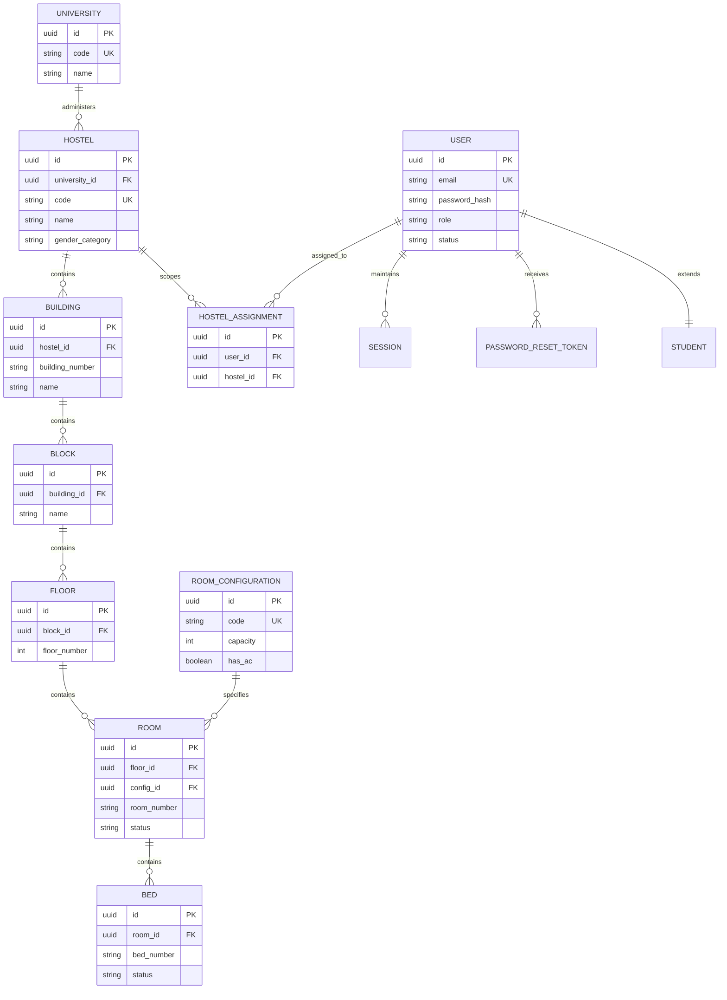
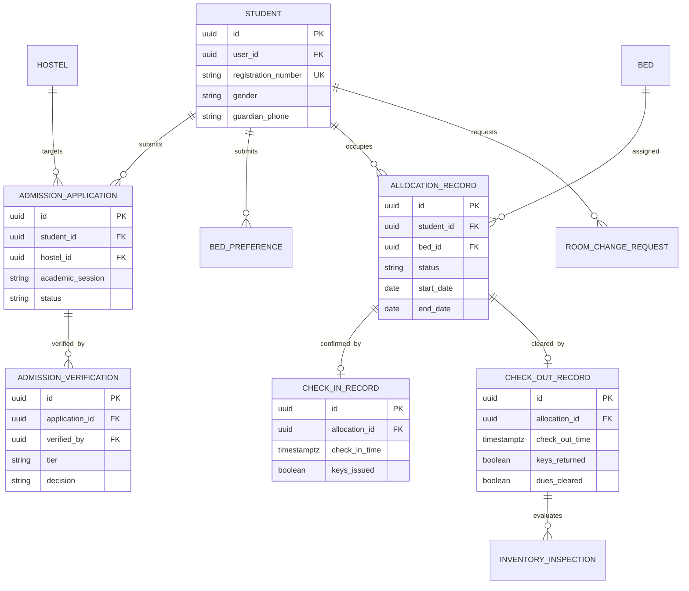
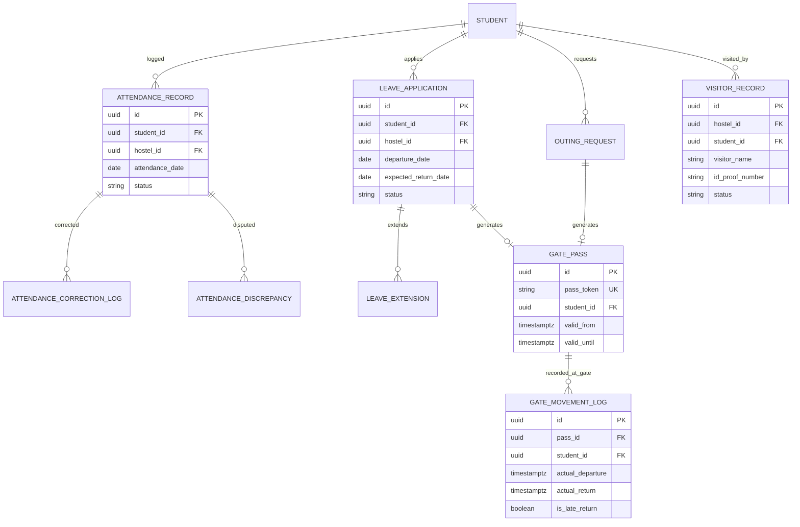
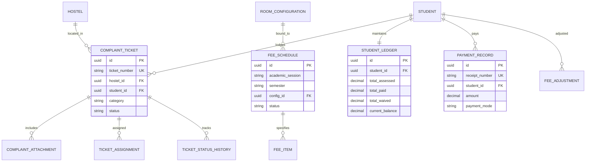
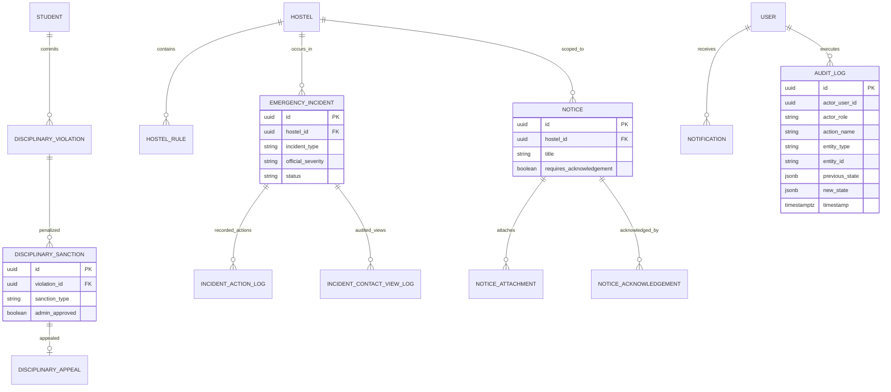

# Nestora — Database Design Specification

## 1. Introduction

### Purpose of the Database Design
The purpose of this Database Design Specification is to define the logical data models, relational entity schemas, attribute definitions, integrity constraints, and multi-tenant isolation mechanisms for **Nestora — University Hostel Management System**.

In software engineering, the database design serves as the persistence blueprint of an enterprise platform. It formalizes domain entities into normalized relational tables, enforces data integrity invariants, eliminates destructive redundancy, and provides optimized query access paths. For Nestora—an academic software engineering project for a Bachelor of Computer Applications (BCA) curriculum—this specification establishes the authoritative schema design required before Prisma ORM migrations and backend API integration commence.

### Scope of the Database
The database encompasses the entire operational lifecycle of university hostel administration across multiple campus residential facilities:
- Centralized user account management and role-based access control.
- Seven-tier physical accommodation infrastructure modeling.
- Two-tier student admissions and sequential verifications.
- Bed inventory allocation, vacancy tracking, and room transfers.
- Physical check-in onboarding and check-out clearance auditing.
- Nightly attendance roll-calls, correction logs, and discrepancy handling.
- Student leave applications, outing passes, gate movements, and visitor access control.
- Facility maintenance complaint ticketing and operational staff duty scheduling.
- Semester fee schedules, offline payment ledgers, and administrative waiver workflows.
- University and hostel conduct rules, disciplinary infractions, and student appeals.
- Universal emergency reporting, auto-escalations, and audited contact access.
- Targeted institutional notices, attachments, and mandatory recipient acknowledgements.
- Permanent, append-only business audit logging.

### Relationship with Existing Documentation
This specification is directly grounded in the authoritative requirements baseline:
- [01-project-overview.md](file:///Users/sayamdas/Documents/Programming/Mern%20Stack/My%20Website/Nestora/docs/01-project-overview.md): Institutional context, aim, and multi-hostel scope.
- [02-project-scope.md](file:///Users/sayamdas/Documents/Programming/Mern%20Stack/My%20Website/Nestora/docs/02-project-scope.md): In-scope functional domains and explicit exclusions.
- [03-functional-requirements.md](file:///Users/sayamdas/Documents/Programming/Mern%20Stack/My%20Website/Nestora/docs/03-functional-requirements.md): 144 functional requirements and 16 business rules.
- [04-non-functional-requirements.md](file:///Users/sayamdas/Documents/Programming/Mern%20Stack/My%20Website/Nestora/docs/04-non-functional-requirements.md): 61 quality benchmarks covering security, ACID transactions, and integrity.
- [05-user-roles-and-permissions.md](file:///Users/sayamdas/Documents/Programming/Mern%20Stack/My%20Website/Nestora/docs/05-user-roles-and-permissions.md): Six user roles, 19-module RBAC matrix, and hostel scoping rules.
- [06-system-architecture.md](file:///Users/sayamdas/Documents/Programming/Mern%20Stack/My%20Website/Nestora/docs/06-system-architecture.md): 3-tier architecture, PostgreSQL engine, and modular monolith design.
- [08-module-development-plan.md](file:///Users/sayamdas/Documents/Programming/Mern%20Stack/My%20Website/Nestora/docs/08-module-development-plan.md): 19 functional modules and 6-phase development roadmap.

---

## 2. Database Design Objectives

The database architecture is engineered to fulfill eight foundational software engineering objectives:

1. **Strict Multi-Hostel Data Isolation**: Guarantee that data queries for operational roles (Wardens, Staff, Guards) are isolated to their authorized hostel, preventing cross-hostel data leakage at the query layer.
2. **ACID Transactional Consistency**: Ensure that multi-step operations (e.g., student admission approvals, bed allocations, check-out clearances, and fee waivers) execute atomically without orphaned or corrupt states.
3. **High Data Integrity & Referential Invariants**: Enforce primary key uniqueness, foreign key constraints (`ON DELETE RESTRICT` on physical assets), NOT NULL requirements, and CHECK constraints directly within the database engine.
4. **Elimination of Data Redundancy (Normalization)**: Structure entities in Third Normal Form (3NF) to eliminate insertion, update, and deletion anomalies while maintaining clean separation of concerns.
5. **Zero Plaintext Sensitive Storage**: Enforce secure credential storage (salted hashes), protect student emergency contacts from public exposure, and mask confidential attributes.
6. **Query Performance & Index Optimization**: Meet target response benchmarks ($\le 500\text{ms}$ transactional read latency) through composite B-Tree indexing on tenant keys (`hostel_id`), foreign keys, statuses, and search fields.
7. **Append-Only Regulatory Auditability**: Maintain permanent, un-editable audit records capturing actor identities, timestamps, and state transitions for all sensitive operations.
8. **Maintainability & Type-Safe Integration**: Design relational tables that map cleanly to Prisma ORM models, providing end-to-end type safety shared with Fastify backend services and Next.js frontend interfaces.

---

## 3. Database Technology and Approach

### Database Engine: PostgreSQL
As confirmed in [06-system-architecture.md](file:///Users/sayamdas/Documents/Programming/Mern%20Stack/My%20Website/Nestora/docs/06-system-architecture.md), Nestora utilizes **PostgreSQL** as its enterprise-grade relational database management system.

#### Rationale for Relational Technology:
- **Relational Integrity**: University hostel management is fundamentally structured around rigid hierarchical relationships ($\text{University} \rightarrow \text{Hostel} \rightarrow \text{Building} \rightarrow \text{Block} \rightarrow \text{Floor} \rightarrow \text{Room} \rightarrow \text{Bed}$). Relational schemas model these 1:N hierarchies with mathematical precision and enforce foreign key constraints natively.
- **ACID Transaction Support**: Complex concurrent workflows—such as ensuring a bed is never double-booked when two students or wardens attempt simultaneous allocations—demand serializable ACID guarantees that document/NoSQL databases cannot reliably provide without application-level overhead.
- **Advanced Indexing**: Native support for composite B-Tree indexes, partial indexes, and unique constraints allows lightning-fast tenant filtering (`hostel_id`) across millions of historical log rows.
- **Audit Immutability**: PostgreSQL table permissions and append-only constraints guarantee that historical audit trails cannot be altered or purged by application bugs.

### Data Access Layer: Prisma ORM
The backend interacts with PostgreSQL via **Prisma ORM**, providing:
- Declarative schema modeling generating type-safe TypeScript query builders.
- Automated migration management (`prisma migrate`) tracking schema evolution in version control.
- Built-in connection pooling and transactional APIs (`prisma.$transaction()`).
- Programmatic parameterization of all SQL queries, neutralizing SQL injection vulnerabilities.

---

## 4. Entity Identification

The functional requirements across all 19 system modules translate into **55 core relational entities**, organized into nine cohesive logical domains:

### Domain 1: User & Access Control Entities
- `User`: Base authentication and identity record for all system actors.
- `HostelAssignment`: Junction table associating operational users (Wardens, Staff, Guards) with their assigned hostel(s).
- `Session`: Active authenticated user sessions and token tracking.
- `PasswordResetToken`: Time-limited, single-use cryptographic tokens for password recovery.

### Domain 2: Physical Infrastructure Entities
- `University`: Top-level institutional root entity.
- `Hostel`: Major residential facility categorized by gender (`BOYS_HOSTEL`, `GIRLS_HOSTEL`).
- `Building`: Physical architectural structure within a hostel compound.
- `Block`: Distinct wing or division within a building.
- `Floor`: Horizontal level within a block.
- `RoomConfiguration`: Standardized definition for the six allowed room types (Single/Double/Triple bed, AC/Non-AC).
- `Room`: Individual living space on a floor bound to a specific room configuration.
- `Bed`: Granular allocation unit tracking status (`AVAILABLE`, `OCCUPIED`, `RESERVED`, `MAINTENANCE`).

### Domain 3: Student & Admission Entities
- `Student`: Extended profile containing demographic, academic, and guardian records.
- `AdmissionApplication`: Hostel admission request record tracking two-tier verification.
- `AdmissionVerification`: Individual verification sign-offs (Admin Tier 1, Warden Tier 2).

### Domain 4: Allocation & Residence Lifecycle Entities
- `BedPreference`: Student-submitted preferences (room type, AC/Non-AC).
- `AllocationRecord`: Active and historical assignment of a student to an individual bed.
- `RoomChangeRequest`: Formal request to transfer to an alternate bed space.
- `CheckInRecord`: Physical onboarding timestamp and key issuance confirmation.
- `CheckOutRecord`: Formal vacating record, clearance sign-offs, and bed deallocation.
- `InventoryInspection`: Room and asset condition assessment performed at check-out.

### Domain 5: Attendance, Movement & Visitor Entities
- `AttendanceRecord`: Daily night roll-call record (`PRESENT`, `ABSENT`, `ON_LEAVE`).
- `AttendanceCorrectionLog`: Immutable revision history for attendance corrections.
- `AttendanceDiscrepancy`: Student-lodged dispute regarding attendance marks.
- `LeaveApplication`: Temporary leave application (dates, destination, emergency contact).
- `LeaveExtension`: Student request to extend an active approved leave.
- `OutingRequest`: Daily outing request with expected departure/return times.
- `GatePass`: Verifiable digital pass token generated for approved leaves/outings.
- `GateMovementLog`: Real-time gate departure and arrival timestamps logged by Security.
- `VisitorRecord`: Visitor registration, Warden pre-approval, and gate entry/exit timestamps.

### Domain 6: Maintenance & Staff Management Entities
- `ComplaintTicket`: Facility maintenance grievance ticket tracking 7 lifecycle statuses.
- `ComplaintAttachment`: Photographic evidence attached to maintenance complaints.
- `TicketAssignment`: Assignment of a complaint ticket to a designated staff member.
- `TicketStatusHistory`: Audit trail of status transitions and technician work notes.
- `StaffProfile`: Operational staff professional profile (designation, department).
- `DutyAssignment`: Daily work zone and shift allocation for operational staff.
- `StaffAttendance`: Daily duty attendance record for operational staff.
- `StaffLeave`: Staff leave requests and approval tracking.

### Domain 7: Financial Management Entities
- `FeeSchedule`: Semester or annual fee structure approved by University Administrator.
- `FeeItem`: Individual component charges within a schedule (rent, amenities, caution deposit).
- `StudentLedger`: Account balance tracking total assessed fees, payments, and dues.
- `PaymentRecord`: Logged external/offline fee payment receipts (challans, DDs, NEFT).
- `FeeAdjustment`: Proposed and approved fee waivers, concessions, or late-fee penalties.

### Domain 8: Governance, Emergency & Communication Entities
- `HostelRule`: Published university-wide or hostel-specific codes of conduct.
- `DisciplinaryViolation`: Formally recorded infraction against a resident student.
- `DisciplinarySanction`: Imposed sanction (Verbal, Written, Formal Action, Suspension).
- `DisciplinaryAppeal`: Student explanation or appeal against a recorded disciplinary sanction.
- `EmergencyIncident`: Urgent safety, medical, or security incident report.
- `IncidentActionLog`: Action notes, status updates, and resolution sign-offs for incidents.
- `IncidentContactViewLog`: Immutable audit entry generated whenever emergency contacts are accessed.
- `Notice`: University-wide or hostel-scoped circular with rich text and metadata.
- `NoticeAttachment`: PDF document attached to official notices.
- `NoticeAcknowledgement`: Timestamped confirmation that a student has acknowledged a notice.
- `Notification`: In-app notification record tracking read/unread status.
- `NotificationPreference`: User-configured delivery preferences for non-critical alerts.

### Domain 9: System Audit Entities
- `AuditLog`: Append-only institutional audit trail recording administrative and financial mutations.

---

## 5. Detailed Entity and Attribute Design

The following tables define the schema attributes, database types, keys, nullability, constraints, and operational descriptions for every entity:

### 1. User & Access Control Entities

#### `users`
Represents all authenticated human actors across the six confirmed roles.

| Attribute | Data Type | Key | Nullable | Description |
| :--- | :--- | :--- | :--- | :--- |
| `id` | `UUID` | PK | No | Unique surrogate identifier (default: `gen_random_uuid()`). |
| `email` | `VARCHAR(255)` | UK | No | Unique login email address; indexable. |
| `password_hash` | `VARCHAR(255)` | - | No | Cryptographic salted hash (Argon2id or bcrypt). |
| `role` | `VARCHAR(50)` | - | No | Enumerated role: `UNIVERSITY_ADMINISTRATOR`, `HOSTEL_WARDEN`, `STUDENT`, `HOSTEL_STAFF`, `SECURITY_GUARD`, `ACCOUNTANT`. |
| `first_name` | `VARCHAR(100)` | - | No | User's legal first name. |
| `last_name` | `VARCHAR(100)` | - | No | User's legal surname. |
| `phone_number` | `VARCHAR(20)` | - | Yes | Primary contact phone number. |
| `status` | `VARCHAR(20)` | - | No | Account status: `ACTIVE`, `INACTIVE`, `SUSPENDED` (default: `ACTIVE`). |
| `is_verified` | `BOOLEAN` | - | No | Email verification flag (default: `false`). |
| `created_at` | `TIMESTAMPTZ` | - | No | Timestamp of account provisioning (default: `NOW()`). |
| `updated_at` | `TIMESTAMPTZ` | - | No | Timestamp of last profile update. |

#### `hostel_assignments`
Junction table mapping operational staff and wardens to their assigned hostel(s).

| Attribute | Data Type | Key | Nullable | Description |
| :--- | :--- | :--- | :--- | :--- |
| `id` | `UUID` | PK | No | Unique assignment record identifier. |
| `user_id` | `UUID` | FK | No | References `users.id` (`ON DELETE CASCADE`). |
| `hostel_id` | `UUID` | FK | No | References `hostels.id` (`ON DELETE RESTRICT`). |
| `assigned_at` | `TIMESTAMPTZ` | - | No | Timestamp when user was assigned to the hostel. |
| `assigned_by` | `UUID` | FK | No | References `users.id` (acting administrator). |

*Constraint*: `UNIQUE(user_id, hostel_id)` prevents duplicate assignment of the same user to a hostel.

#### `sessions`
Tracks active authenticated user sessions.

| Attribute | Data Type | Key | Nullable | Description |
| :--- | :--- | :--- | :--- | :--- |
| `id` | `UUID` | PK | No | Unique session identifier. |
| `user_id` | `UUID` | FK | No | References `users.id` (`ON DELETE CASCADE`). |
| `session_token` | `VARCHAR(255)` | UK | No | Cryptographic session token stored in HTTP cookie. |
| `ip_address` | `VARCHAR(45)` | - | Yes | Client IP address at session creation. |
| `user_agent` | `TEXT` | - | Yes | Browser / client user-agent string. |
| `expires_at` | `TIMESTAMPTZ` | - | No | Expiration timestamp of the session. |
| `created_at` | `TIMESTAMPTZ` | - | No | Session initiation timestamp. |

#### `password_reset_tokens`
Time-limited single-use tokens for password recovery.

| Attribute | Data Type | Key | Nullable | Description |
| :--- | :--- | :--- | :--- | :--- |
| `id` | `UUID` | PK | No | Unique token record identifier. |
| `user_id` | `UUID` | FK | No | References `users.id` (`ON DELETE CASCADE`). |
| `token_hash` | `VARCHAR(255)` | UK | No | Hash of the reset token sent to user's email. |
| `is_used` | `BOOLEAN` | - | No | Flag indicating if token has been consumed (default: `false`). |
| `expires_at` | `TIMESTAMPTZ` | - | No | Token expiration timestamp (15-minute validity). |
| `created_at` | `TIMESTAMPTZ` | - | No | Token generation timestamp. |

---

### 2. Physical Infrastructure Entities

#### `universities`
Top-level institutional root entity.

| Attribute | Data Type | Key | Nullable | Description |
| :--- | :--- | :--- | :--- | :--- |
| `id` | `UUID` | PK | No | Unique university identifier. |
| `name` | `VARCHAR(255)` | - | No | Official institution name. |
| `code` | `VARCHAR(50)` | UK | No | Unique institutional identifier code. |
| `address` | `TEXT` | - | Yes | Physical campus address. |
| `contact_email` | `VARCHAR(255)` | - | Yes | Administrative contact email. |
| `created_at` | `TIMESTAMPTZ` | - | No | Record creation timestamp. |

#### `hostels`
Major residential units categorized by gender.

| Attribute | Data Type | Key | Nullable | Description |
| :--- | :--- | :--- | :--- | :--- |
| `id` | `UUID` | PK | No | Unique hostel identifier. |
| `university_id` | `UUID` | FK | No | References `universities.id` (`ON DELETE RESTRICT`). |
| `name` | `VARCHAR(150)` | - | No | Name of the hostel facility. |
| `code` | `VARCHAR(50)` | UK | No | Unique hostel code (e.g., `BH-01`, `GH-02`). |
| `gender_category` | `VARCHAR(20)` | - | No | Enumerated category: `BOYS_HOSTEL`, `GIRLS_HOSTEL`. |
| `warden_in_charge` | `UUID` | FK | Yes | References `users.id` (primary Hostel Warden). |
| `is_active` | `BOOLEAN` | - | No | Operational status flag (default: `true`). |
| `created_at` | `TIMESTAMPTZ` | - | No | Record creation timestamp. |

#### `buildings`
Physical structures within a hostel compound.

| Attribute | Data Type | Key | Nullable | Description |
| :--- | :--- | :--- | :--- | :--- |
| `id` | `UUID` | PK | No | Unique building identifier. |
| `hostel_id` | `UUID` | FK | No | References `hostels.id` (`ON DELETE RESTRICT`). |
| `name` | `VARCHAR(100)` | - | No | Building name (e.g., "Main Hall", "East Wing"). |
| `building_number`| `VARCHAR(20)` | - | No | Identifier number or code. |
| `created_at` | `TIMESTAMPTZ` | - | No | Record creation timestamp. |

*Constraint*: `UNIQUE(hostel_id, building_number)` enforces unique building identifiers within a hostel.

#### `blocks`
Distinct sections or wings within a building.

| Attribute | Data Type | Key | Nullable | Description |
| :--- | :--- | :--- | :--- | :--- |
| `id` | `UUID` | PK | No | Unique block identifier. |
| `building_id` | `UUID` | FK | No | References `buildings.id` (`ON DELETE RESTRICT`). |
| `name` | `VARCHAR(100)` | - | No | Block label (e.g., "Block A", "Block B"). |
| `created_at` | `TIMESTAMPTZ` | - | No | Record creation timestamp. |

*Constraint*: `UNIQUE(building_id, name)` enforces unique block names within a building.

#### `floors`
Horizontal floor levels within a block.

| Attribute | Data Type | Key | Nullable | Description |
| :--- | :--- | :--- | :--- | :--- |
| `id` | `UUID` | PK | No | Unique floor identifier. |
| `block_id` | `UUID` | FK | No | References `blocks.id` (`ON DELETE RESTRICT`). |
| `floor_number` | `INTEGER` | - | No | Numeric floor level (e.g., `0` for Ground, `1`, `2`). |
| `name` | `VARCHAR(50)` | - | Yes | Optional descriptive label (e.g., "Ground Floor"). |
| `created_at` | `TIMESTAMPTZ` | - | No | Record creation timestamp. |

*Constraint*: `UNIQUE(block_id, floor_number)` prevents duplicate floor numbers within a block.

#### `room_configurations`
Standardized definitions for the six confirmed room types.

| Attribute | Data Type | Key | Nullable | Description |
| :--- | :--- | :--- | :--- | :--- |
| `id` | `UUID` | PK | No | Unique configuration identifier. |
| `code` | `VARCHAR(50)` | UK | No | Identifier: `SINGLE_NON_AC`, `SINGLE_AC`, `DOUBLE_NON_AC`, `DOUBLE_AC`, `TRIPLE_NON_AC`, `TRIPLE_AC`. |
| `capacity` | `INTEGER` | - | No | Maximum bed capacity: `1`, `2`, or `3`. |
| `has_ac` | `BOOLEAN` | - | No | Air conditioning indicator (`true`/`false`). |
| `description` | `VARCHAR(255)` | - | No | Descriptive title. |

#### `rooms`
Individual residential living spaces on a floor.

| Attribute | Data Type | Key | Nullable | Description |
| :--- | :--- | :--- | :--- | :--- |
| `id` | `UUID` | PK | No | Unique room identifier. |
| `floor_id` | `UUID` | FK | No | References `floors.id` (`ON DELETE RESTRICT`). |
| `config_id` | `UUID` | FK | No | References `room_configurations.id` (`ON DELETE RESTRICT`). |
| `room_number` | `VARCHAR(20)` | - | No | Room number (e.g., "101", "204B"). |
| `status` | `VARCHAR(20)` | - | No | Operational status: `ACTIVE`, `UNDER_MAINTENANCE`, `DECOMMISSIONED`. |
| `created_at` | `TIMESTAMPTZ` | - | No | Record creation timestamp. |

*Constraint*: `UNIQUE(floor_id, room_number)` prevents duplicate room numbers on the same floor.

#### `beds`
Granular bed allocation units.

| Attribute | Data Type | Key | Nullable | Description |
| :--- | :--- | :--- | :--- | :--- |
| `id` | `UUID` | PK | No | Unique bed space identifier. |
| `room_id` | `UUID` | FK | No | References `rooms.id` (`ON DELETE RESTRICT`). |
| `bed_number` | `VARCHAR(10)` | - | No | Bed label within room (e.g., "A", "B", "1", "2"). |
| `status` | `VARCHAR(20)` | - | No | Status: `AVAILABLE`, `OCCUPIED`, `RESERVED`, `MAINTENANCE` (default: `AVAILABLE`). |
| `created_at` | `TIMESTAMPTZ` | - | No | Record creation timestamp. |
| `updated_at` | `TIMESTAMPTZ` | - | No | Timestamp of status mutation. |

*Constraint*: `UNIQUE(room_id, bed_number)` prevents duplicate bed labels in a single room.

---

### 3. Student & Admission Entities

#### `students`
Extended resident master record linked to user account.

| Attribute | Data Type | Key | Nullable | Description |
| :--- | :--- | :--- | :--- | :--- |
| `id` | `UUID` | PK | No | Unique student identifier. |
| `user_id` | `UUID` | FK, UK | No | References `users.id` (`ON DELETE CASCADE`). |
| `registration_number`| `VARCHAR(50)`| UK | No | University student registration / roll number. |
| `course` | `VARCHAR(100)` | - | No | Academic program of study. |
| `department` | `VARCHAR(100)` | - | No | Academic department. |
| `gender` | `VARCHAR(20)` | - | No | Gender: `MALE`, `FEMALE`. |
| `date_of_birth` | `DATE` | - | No | Date of birth. |
| `blood_group` | `VARCHAR(10)` | - | Yes | Medical blood group. |
| `guardian_name` | `VARCHAR(150)` | - | No | Full name of primary parent / guardian. |
| `guardian_phone`| `VARCHAR(20)` | - | No | Primary emergency contact number (Protected). |
| `guardian_relation`| `VARCHAR(50)` | - | No | Relationship (Father, Mother, Local Guardian). |
| `permanent_address`| `TEXT` | - | No | Residential home address. |
| `created_at` | `TIMESTAMPTZ` | - | No | Record creation timestamp. |

#### `admission_applications`
Student hostel registration applications.

| Attribute | Data Type | Key | Nullable | Description |
| :--- | :--- | :--- | :--- | :--- |
| `id` | `UUID` | PK | No | Unique application identifier. |
| `student_id` | `UUID` | FK | No | References `students.id` (`ON DELETE CASCADE`). |
| `hostel_id` | `UUID` | FK | No | References `hostels.id` (`ON DELETE RESTRICT`). |
| `academic_session`| `VARCHAR(20)` | - | No | Enrollment academic session (e.g., "2026-2027"). |
| `status` | `VARCHAR(30)` | - | No | Status: `SUBMITTED`, `ADMIN_VERIFIED`, `WARDEN_VERIFIED`, `FULLY_APPROVED`, `REJECTED`. |
| `rejection_reason`| `TEXT` | - | Yes | Explanation if application was rejected. |
| `submitted_at` | `TIMESTAMPTZ` | - | No | Application submission timestamp. |
| `updated_at` | `TIMESTAMPTZ` | - | No | Last status transition timestamp. |

*Constraint*: `UNIQUE(student_id, academic_session)` prevents multiple applications for the same academic session.

#### `admission_verifications`
Audit records capturing individual verification sign-offs.

| Attribute | Data Type | Key | Nullable | Description |
| :--- | :--- | :--- | :--- | :--- |
| `id` | `UUID` | PK | No | Unique verification sign-off identifier. |
| `application_id`| `UUID` | FK | No | References `admission_applications.id` (`ON DELETE CASCADE`). |
| `verified_by` | `UUID` | FK | No | References `users.id` (acting Admin or Warden). |
| `tier` | `VARCHAR(20)` | - | No | Verification tier: `TIER_1_ADMIN`, `TIER_2_WARDEN`. |
| `decision` | `VARCHAR(20)` | - | No | Decision: `APPROVED`, `REJECTED`. |
| `comments` | `TEXT` | - | Yes | Verification remarks. |
| `verified_at` | `TIMESTAMPTZ` | - | No | Exact timestamp of verification. |

---

### 4. Allocation & Residence Lifecycle Entities

#### `bed_preferences`
Resident accommodation preferences submitted after admission approval.

| Attribute | Data Type | Key | Nullable | Description |
| :--- | :--- | :--- | :--- | :--- |
| `id` | `UUID` | PK | No | Unique preference identifier. |
| `student_id` | `UUID` | FK | No | References `students.id` (`ON DELETE CASCADE`). |
| `hostel_id` | `UUID` | FK | No | References `hostels.id` (`ON DELETE RESTRICT`). |
| `config_id` | `UUID` | FK | No | References `room_configurations.id` (`ON DELETE RESTRICT`). |
| `submitted_at` | `TIMESTAMPTZ` | - | No | Submission timestamp. |

#### `allocation_records`
Active and historical bed assignments.

| Attribute | Data Type | Key | Nullable | Description |
| :--- | :--- | :--- | :--- | :--- |
| `id` | `UUID` | PK | No | Unique allocation identifier. |
| `student_id` | `UUID` | FK | No | References `students.id` (`ON DELETE RESTRICT`). |
| `bed_id` | `UUID` | FK | No | References `beds.id` (`ON DELETE RESTRICT`). |
| `allocated_by` | `UUID` | FK | No | References `users.id` (approving Admin or Warden). |
| `status` | `VARCHAR(20)` | - | No | Status: `ACTIVE`, `TRANSFERRED`, `TERMINATED` (default: `ACTIVE`). |
| `start_date` | `DATE` | - | No | Effective start date of bed occupancy. |
| `end_date` | `DATE` | - | Yes | Termination or vacating date. |
| `allocated_at` | `TIMESTAMPTZ` | - | No | Timestamp when allocation transaction occurred. |

*Constraint*: `CREATE UNIQUE INDEX idx_unique_active_bed ON allocation_records(bed_id) WHERE status = 'ACTIVE'` guarantees that an individual bed space has at most one active occupant.
*Constraint*: `CREATE UNIQUE INDEX idx_unique_active_student_bed ON allocation_records(student_id) WHERE status = 'ACTIVE'` guarantees that a student occupies at most one active bed.

#### `room_change_requests`
Resident applications for room or bed transfers.

| Attribute | Data Type | Key | Nullable | Description |
| :--- | :--- | :--- | :--- | :--- |
| `id` | `UUID` | PK | No | Unique request identifier. |
| `student_id` | `UUID` | FK | No | References `students.id` (`ON DELETE CASCADE`). |
| `current_bed_id`| `UUID` | FK | No | References `beds.id`. |
| `preferred_config_id`| `UUID`| FK | No | References `room_configurations.id`. |
| `reason` | `TEXT` | - | No | Justification for transfer. |
| `status` | `VARCHAR(20)` | - | No | Status: `PENDING`, `APPROVED`, `REJECTED` (default: `PENDING`). |
| `reviewed_by` | `UUID` | FK | Yes | References `users.id` (Warden or Admin). |
| `reviewed_at` | `TIMESTAMPTZ` | - | Yes | Review timestamp. |
| `created_at` | `TIMESTAMPTZ` | - | No | Request creation timestamp. |

#### `check_in_records`
Physical onboarding arrival logs.

| Attribute | Data Type | Key | Nullable | Description |
| :--- | :--- | :--- | :--- | :--- |
| `id` | `UUID` | PK | No | Unique check-in identifier. |
| `allocation_id`| `UUID` | FK, UK | No | References `allocation_records.id` (`ON DELETE RESTRICT`). |
| `check_in_time`| `TIMESTAMPTZ` | - | No | Actual arrival timestamp. |
| `keys_issued` | `BOOLEAN` | - | No | Confirmation of room key issuance (`true`/`false`). |
| `verified_by` | `UUID` | FK | No | References `users.id` (Warden confirming arrival). |
| `remarks` | `TEXT` | - | Yes | Arrival notes. |

#### `check_out_records`
Formal departure clearance and vacating logs.

| Attribute | Data Type | Key | Nullable | Description |
| :--- | :--- | :--- | :--- | :--- |
| `id` | `UUID` | PK | No | Unique check-out identifier. |
| `allocation_id`| `UUID` | FK, UK | No | References `allocation_records.id` (`ON DELETE RESTRICT`). |
| `check_out_time`| `TIMESTAMPTZ` | - | No | Actual departure timestamp. |
| `keys_returned`| `BOOLEAN` | - | No | Confirmation of key surrender. |
| `dues_cleared` | `BOOLEAN` | - | No | Confirmation that financial dues are zero. |
| `cleared_by` | `UUID` | FK | No | References `users.id` (Warden completing check-out). |
| `remarks` | `TEXT` | - | Yes | Departure remarks. |

#### `inventory_inspections`
Room condition and asset checklists completed at check-out.

| Attribute | Data Type | Key | Nullable | Description |
| :--- | :--- | :--- | :--- | :--- |
| `id` | `UUID` | PK | No | Unique inspection identifier. |
| `check_out_id` | `UUID` | FK | No | References `check_out_records.id` (`ON DELETE CASCADE`). |
| `item_name` | `VARCHAR(100)` | - | No | Asset checked (e.g., "Study Table", "Fan", "Mattress"). |
| `condition` | `VARCHAR(20)` | - | No | Condition: `INTACT`, `DAMAGED`, `MISSING`. |
| `damage_fee` | `DECIMAL(10,2)`| - | Yes | Assessed repair fee if damage occurred. |
| `inspected_by` | `UUID` | FK | No | References `users.id` (Hostel Staff or Warden). |

---

### 5. Attendance, Movement & Visitor Entities

#### `attendance_records`
Daily night roll-call records.

| Attribute | Data Type | Key | Nullable | Description |
| :--- | :--- | :--- | :--- | :--- |
| `id` | `UUID` | PK | No | Unique attendance record identifier. |
| `student_id` | `UUID` | FK | No | References `students.id` (`ON DELETE CASCADE`). |
| `hostel_id` | `UUID` | FK | No | References `hostels.id` (`ON DELETE RESTRICT`). |
| `attendance_date`| `DATE` | - | No | Calendar date of roll-call. |
| `status` | `VARCHAR(20)` | - | No | Status: `PRESENT`, `ABSENT`, `ON_LEAVE`. |
| `recorded_by` | `UUID` | FK | No | References `users.id` (Warden or authorized Staff). |
| `recorded_at` | `TIMESTAMPTZ` | - | No | Roll-call logging timestamp. |

*Constraint*: `UNIQUE(student_id, attendance_date)` prevents duplicate roll-call records for a student on the same date.

#### `attendance_correction_logs`
Immutable audit history for attendance modifications.

| Attribute | Data Type | Key | Nullable | Description |
| :--- | :--- | :--- | :--- | :--- |
| `id` | `UUID` | PK | No | Unique correction record identifier. |
| `attendance_id`| `UUID` | FK | No | References `attendance_records.id` (`ON DELETE CASCADE`). |
| `previous_status`| `VARCHAR(20)`| - | No | Status prior to correction. |
| `new_status` | `VARCHAR(20)` | - | No | Corrected status. |
| `corrected_by` | `UUID` | FK | No | References `users.id` (acting Warden or Staff). |
| `reason` | `TEXT` | - | No | Mandatory justification for correction. |
| `corrected_at` | `TIMESTAMPTZ` | - | No | Timestamp when correction was committed. |

#### `attendance_discrepancies`
Dispute reports submitted by students regarding roll-call entries.

| Attribute | Data Type | Key | Nullable | Description |
| :--- | :--- | :--- | :--- | :--- |
| `id` | `UUID` | PK | No | Unique dispute identifier. |
| `attendance_id`| `UUID` | FK | No | References `attendance_records.id` (`ON DELETE CASCADE`). |
| `student_id` | `UUID` | FK | No | References `students.id`. |
| `explanation` | `TEXT` | - | No | Student's explanation of presence. |
| `status` | `VARCHAR(20)` | - | No | Status: `PENDING`, `RESOLVED`, `DISMISSED` (default: `PENDING`). |
| `created_at` | `TIMESTAMPTZ` | - | No | Dispute creation timestamp. |

#### `leave_applications`
Temporary leave applications submitted by residents.

| Attribute | Data Type | Key | Nullable | Description |
| :--- | :--- | :--- | :--- | :--- |
| `id` | `UUID` | PK | No | Unique leave application identifier. |
| `student_id` | `UUID` | FK | No | References `students.id` (`ON DELETE CASCADE`). |
| `hostel_id` | `UUID` | FK | No | References `hostels.id` (`ON DELETE RESTRICT`). |
| `leave_type` | `VARCHAR(50)` | - | No | Category (e.g., "Home Visit", "Medical", "Academic"). |
| `departure_date`| `DATE` | - | No | Planned start date. |
| `expected_return_date`| `DATE` | - | No | Expected return date. |
| `destination` | `TEXT` | - | No | Travel destination address. |
| `reason` | `TEXT` | - | No | Reason for leave. |
| `emergency_contact`| `VARCHAR(20)`| - | No | Active phone number during leave. |
| `status` | `VARCHAR(20)` | - | No | Status: `SUBMITTED`, `APPROVED`, `REJECTED`, `EXPIRED`. |
| `reviewed_by` | `UUID` | FK | Yes | References `users.id` (Hostel Warden). |
| `reviewed_at` | `TIMESTAMPTZ` | - | Yes | Review timestamp. |
| `created_at` | `TIMESTAMPTZ` | - | No | Submission timestamp. |

*Constraint*: `CHECK (expected_return_date >= departure_date)`.

#### `leave_extensions`
Extension requests submitted for approved active leaves.

| Attribute | Data Type | Key | Nullable | Description |
| :--- | :--- | :--- | :--- | :--- |
| `id` | `UUID` | PK | No | Unique extension identifier. |
| `leave_id` | `UUID` | FK | No | References `leave_applications.id` (`ON DELETE CASCADE`). |
| `new_return_date`| `DATE` | - | No | Requested updated return date. |
| `reason` | `TEXT` | - | No | Justification for extension. |
| `status` | `VARCHAR(20)` | - | No | Status: `PENDING`, `APPROVED`, `REJECTED` (default: `PENDING`). |
| `reviewed_by` | `UUID` | FK | Yes | References `users.id` (Warden). |
| `reviewed_at` | `TIMESTAMPTZ` | - | Yes | Review timestamp. |

#### `outing_requests`
Daily outing applications.

| Attribute | Data Type | Key | Nullable | Description |
| :--- | :--- | :--- | :--- | :--- |
| `id` | `UUID` | PK | No | Unique outing identifier. |
| `student_id` | `UUID` | FK | No | References `students.id` (`ON DELETE CASCADE`). |
| `hostel_id` | `UUID` | FK | No | References `hostels.id` (`ON DELETE RESTRICT`). |
| `outing_date` | `DATE` | - | No | Date of outing. |
| `departure_time`| `TIME` | - | No | Expected departure time. |
| `expected_return_time`| `TIME` | - | No | Expected return curfew time. |
| `destination` | `VARCHAR(255)` | - | No | Purpose / location. |
| `is_exceptional`| `BOOLEAN` | - | No | Flag indicating if outing requires Admin approval (default: `false`). |
| `status` | `VARCHAR(20)` | - | No | Status: `SUBMITTED`, `APPROVED`, `REJECTED`. |
| `reviewed_by` | `UUID` | FK | Yes | References `users.id` (Warden or Admin). |
| `created_at` | `TIMESTAMPTZ` | - | No | Creation timestamp. |

#### `gate_passes`
Digital pass tokens generated upon approval of leaves or outings.

| Attribute | Data Type | Key | Nullable | Description |
| :--- | :--- | :--- | :--- | :--- |
| `id` | `UUID` | PK | No | Unique pass record identifier. |
| `pass_token` | `VARCHAR(64)` | UK | No | Cryptographic pass token verified at security gates. |
| `student_id` | `UUID` | FK | No | References `students.id`. |
| `leave_id` | `UUID` | FK | Yes | References `leave_applications.id` (null if outing). |
| `outing_id` | `UUID` | FK | Yes | References `outing_requests.id` (null if leave). |
| `valid_from` | `TIMESTAMPTZ` | - | No | Beginning of pass validity window. |
| `valid_until` | `TIMESTAMPTZ` | - | No | End of pass validity window. |
| `is_used` | `BOOLEAN` | - | No | Flag indicating if pass has been fully completed. |

#### `gate_movement_logs`
Real-time timestamps logged by Security Guards at gate checkpoints.

| Attribute | Data Type | Key | Nullable | Description |
| :--- | :--- | :--- | :--- | :--- |
| `id` | `UUID` | PK | No | Unique movement log identifier. |
| `pass_id` | `UUID` | FK | No | References `gate_passes.id` (`ON DELETE RESTRICT`). |
| `student_id` | `UUID` | FK | No | References `students.id`. |
| `hostel_id` | `UUID` | FK | No | References `hostels.id`. |
| `actual_departure`| `TIMESTAMPTZ` | - | Yes | Actual exit timestamp logged at gate. |
| `actual_return`| `TIMESTAMPTZ` | - | Yes | Actual re-entry timestamp logged at gate. |
| `is_late_return`| `BOOLEAN` | - | No | Flag indicating return past approved curfew (default: `false`). |
| `security_guard_id`| `UUID` | FK | No | References `users.id` (acting Security Guard). |
| `remarks` | `TEXT` | - | Yes | Security notes. |

#### `visitor_records`
Visitor registrations, approvals, and physical gate logs.

| Attribute | Data Type | Key | Nullable | Description |
| :--- | :--- | :--- | :--- | :--- |
| `id` | `UUID` | PK | No | Unique visitor record identifier. |
| `hostel_id` | `UUID` | FK | No | References `hostels.id` (`ON DELETE RESTRICT`). |
| `student_id` | `UUID` | FK | No | References `students.id` (resident being visited). |
| `visitor_name`| `VARCHAR(150)` | - | No | Legal name of visiting person. |
| `visitor_phone`| `VARCHAR(20)` | - | No | Contact phone number. |
| `id_proof_type`| `VARCHAR(50)` | - | No | Government identification type (e.g., Aadhaar, Passport). |
| `id_proof_number`| `VARCHAR(100)`| - | No | Government ID number. |
| `purpose` | `TEXT` | - | No | Reason for visit. |
| `status` | `VARCHAR(20)` | - | No | Status: `PENDING_APPROVAL`, `APPROVED`, `REJECTED`, `COMPLETED`. |
| `approved_by` | `UUID` | FK | Yes | References `users.id` (Hostel Warden). |
| `check_in_time`| `TIMESTAMPTZ` | - | Yes | Actual physical entry timestamp. |
| `check_out_time`| `TIMESTAMPTZ` | - | Yes | Actual physical exit timestamp. |
| `is_exception`| `BOOLEAN` | - | No | Flag indicating Warden visiting-hours exception override. |
| `guard_id` | `UUID` | FK | No | References `users.id` (Security Guard logging entry). |
| `created_at` | `TIMESTAMPTZ` | - | No | Registration timestamp. |

---

### 6. Maintenance & Staff Management Entities

#### `complaint_tickets`
Facility maintenance grievance tickets.

| Attribute | Data Type | Key | Nullable | Description |
| :--- | :--- | :--- | :--- | :--- |
| `id` | `UUID` | PK | No | Unique ticket identifier. |
| `ticket_number`| `VARCHAR(50)` | UK | No | Human-readable identifier (e.g., `CMP-2026-0042`). |
| `hostel_id` | `UUID` | FK | No | References `hostels.id` (`ON DELETE RESTRICT`). |
| `student_id` | `UUID` | FK | No | References `students.id` (`ON DELETE CASCADE`). |
| `category` | `VARCHAR(50)` | - | No | Category: `ELECTRICAL`, `PLUMBING`, `CARPENTRY`, `CLEANING`, `CIVIL`. |
| `title` | `VARCHAR(150)` | - | No | Summary title. |
| `description` | `TEXT` | - | No | Detailed description of the problem. |
| `location` | `VARCHAR(150)` | - | No | Specific location (e.g., "Room 204", "Block B 2nd Floor Washroom"). |
| `suggested_priority`| `VARCHAR(20)`| - | No | Student-suggested urgency: `LOW`, `MEDIUM`, `HIGH`. |
| `final_priority`| `VARCHAR(20)` | - | Yes | Warden authoritative priority: `LOW`, `MEDIUM`, `HIGH`, `CRITICAL`. |
| `status` | `VARCHAR(20)` | - | No | Status: `SUBMITTED`, `UNDER_REVIEW`, `ASSIGNED`, `IN_PROGRESS`, `RESOLVED`, `REJECTED`, `CLOSED`, `REOPENED`. |
| `created_at` | `TIMESTAMPTZ` | - | No | Submission timestamp. |
| `updated_at` | `TIMESTAMPTZ` | - | No | Last status transition timestamp. |

#### `complaint_attachments`
Damage photographs attached to maintenance tickets.

| Attribute | Data Type | Key | Nullable | Description |
| :--- | :--- | :--- | :--- | :--- |
| `id` | `UUID` | PK | No | Unique attachment identifier. |
| `ticket_id` | `UUID` | FK | No | References `complaint_tickets.id` (`ON DELETE CASCADE`). |
| `file_path` | `VARCHAR(500)` | - | No | Relative filesystem path or S3 object key. |
| `file_name` | `VARCHAR(255)` | - | No | Original upload filename. |
| `mime_type` | `VARCHAR(100)` | - | No | MIME type (e.g., `image/jpeg`, `image/png`). |
| `file_size` | `INTEGER` | - | No | File size in bytes. |
| `uploaded_at` | `TIMESTAMPTZ` | - | No | Upload timestamp. |

#### `ticket_assignments`
Assignment of maintenance tickets to operational staff.

| Attribute | Data Type | Key | Nullable | Description |
| :--- | :--- | :--- | :--- | :--- |
| `id` | `UUID` | PK | No | Unique assignment identifier. |
| `ticket_id` | `UUID` | FK | No | References `complaint_tickets.id` (`ON DELETE CASCADE`). |
| `staff_id` | `UUID` | FK | No | References `users.id` (Hostel Staff). |
| `assigned_by` | `UUID` | FK | No | References `users.id` (Hostel Warden). |
| `assigned_at` | `TIMESTAMPTZ` | - | No | Assignment timestamp. |
| `is_active` | `BOOLEAN` | - | No | Active assignment flag (default: `true`). |

#### `ticket_status_histories`
Audit timeline of complaint ticket lifecycle updates.

| Attribute | Data Type | Key | Nullable | Description |
| :--- | :--- | :--- | :--- | :--- |
| `id` | `UUID` | PK | No | Unique history record identifier. |
| `ticket_id` | `UUID` | FK | No | References `complaint_tickets.id` (`ON DELETE CASCADE`). |
| `status` | `VARCHAR(20)` | - | No | Status transitioned into. |
| `changed_by` | `UUID` | FK | No | References `users.id` (acting actor). |
| `notes` | `TEXT` | - | Yes | Operational progress remarks. |
| `created_at` | `TIMESTAMPTZ` | - | No | Transition timestamp. |

#### `staff_profiles`
Professional details for non-academic operational personnel.

| Attribute | Data Type | Key | Nullable | Description |
| :--- | :--- | :--- | :--- | :--- |
| `id` | `UUID` | PK | No | Unique profile identifier. |
| `user_id` | `UUID` | FK, UK | No | References `users.id` (`ON DELETE CASCADE`). |
| `department` | `VARCHAR(100)` | - | No | Department: `ELECTRICAL`, `PLUMBING`, `CARPENTRY`, `HOUSEKEEPING`, `SECURITY`. |
| `designation` | `VARCHAR(100)` | - | No | Job title (e.g., "Senior Electrician", "Security Guard"). |
| `shift_preference`| `VARCHAR(50)`| - | Yes | Preferred shift (e.g., "Day", "Night"). |
| `created_at` | `TIMESTAMPTZ` | - | No | Profile creation timestamp. |

#### `duty_assignments`
Daily work shift and zone allocations for staff.

| Attribute | Data Type | Key | Nullable | Description |
| :--- | :--- | :--- | :--- | :--- |
| `id` | `UUID` | PK | No | Unique duty identifier. |
| `staff_id` | `UUID` | FK | No | References `users.id` (`ON DELETE CASCADE`). |
| `hostel_id` | `UUID` | FK | No | References `hostels.id` (`ON DELETE RESTRICT`). |
| `duty_date` | `DATE` | - | No | Scheduled work date. |
| `shift_type` | `VARCHAR(50)` | - | No | Shift (e.g., "Morning", "Evening", "Night"). |
| `zone` | `VARCHAR(150)` | - | Yes | Assigned zone (e.g., "Block A Floors 1-3", "Main Gate"). |
| `assigned_by` | `UUID` | FK | No | References `users.id` (Hostel Warden). |

#### `staff_attendances`
Staff daily shift attendance records.

| Attribute | Data Type | Key | Nullable | Description |
| :--- | :--- | :--- | :--- | :--- |
| `id` | `UUID` | PK | No | Unique attendance identifier. |
| `staff_id` | `UUID` | FK | No | References `users.id`. |
| `hostel_id` | `UUID` | FK | No | References `hostels.id`. |
| `work_date` | `DATE` | - | No | Shift date. |
| `status` | `VARCHAR(20)` | - | No | Status: `PRESENT`, `ABSENT`, `ON_LEAVE`. |
| `recorded_by` | `UUID` | FK | No | References `users.id` (Hostel Warden). |

#### `staff_leaves`
Leave requests submitted by operational personnel.

| Attribute | Data Type | Key | Nullable | Description |
| :--- | :--- | :--- | :--- | :--- |
| `id` | `UUID` | PK | No | Unique leave identifier. |
| `staff_id` | `UUID` | FK | No | References `users.id`. |
| `start_date` | `DATE` | - | No | Leave start date. |
| `end_date` | `DATE` | - | No | Leave end date. |
| `reason` | `TEXT` | - | No | Reason for leave. |
| `is_exceptional`| `BOOLEAN` | - | No | True if extended leave requiring Admin approval. |
| `status` | `VARCHAR(20)` | - | No | Status: `PENDING`, `APPROVED`, `REJECTED`. |
| `reviewed_by` | `UUID` | FK | Yes | References `users.id` (Warden or Admin). |

---

### 7. Financial Management Entities

#### `fee_schedules`
Annual or semester-wise accommodation fee schedules.

| Attribute | Data Type | Key | Nullable | Description |
| :--- | :--- | :--- | :--- | :--- |
| `id` | `UUID` | PK | No | Unique schedule identifier. |
| `academic_session`| `VARCHAR(20)` | - | No | Session (e.g., "2026-2027"). |
| `semester` | `VARCHAR(20)` | - | No | Semester label (e.g., "Fall 2026", "Spring 2027"). |
| `config_id` | `UUID` | FK | No | References `room_configurations.id`. |
| `status` | `VARCHAR(20)` | - | No | Status: `DRAFT`, `PENDING_ADMIN_APPROVAL`, `ACTIVE`, `ARCHIVED`. |
| `created_by` | `UUID` | FK | No | References `users.id` (Accountant). |
| `approved_by` | `UUID` | FK | Yes | References `users.id` (University Administrator). |
| `created_at` | `TIMESTAMPTZ` | - | No | Record creation timestamp. |

#### `fee_items`
Component breakdown within a fee schedule.

| Attribute | Data Type | Key | Nullable | Description |
| :--- | :--- | :--- | :--- | :--- |
| `id` | `UUID` | PK | No | Unique fee item identifier. |
| `schedule_id` | `UUID` | FK | No | References `fee_schedules.id` (`ON DELETE CASCADE`). |
| `item_name` | `VARCHAR(100)` | - | No | Charge name (e.g., "Room Rent", "Caution Deposit", "Electricity"). |
| `amount` | `DECIMAL(10,2)`| - | No | Charge amount in currency units. |

#### `student_ledgers`
Running balance and dues summary per resident.

| Attribute | Data Type | Key | Nullable | Description |
| :--- | :--- | :--- | :--- | :--- |
| `id` | `UUID` | PK | No | Unique ledger identifier. |
| `student_id` | `UUID` | FK, UK | No | References `students.id` (`ON DELETE RESTRICT`). |
| `total_assessed`| `DECIMAL(10,2)`| - | No | Cumulative billed charges (default: `0.00`). |
| `total_paid` | `DECIMAL(10,2)`| - | No | Cumulative credited payments (default: `0.00`). |
| `total_waived` | `DECIMAL(10,2)`| - | No | Cumulative approved waivers (default: `0.00`). |
| `current_balance`| `DECIMAL(10,2)`| - | No | Net outstanding dues: $\text{assessed} - (\text{paid} + \text{waived})$. |
| `last_recalculated`| `TIMESTAMPTZ`| - | No | Timestamp of last recalculation. |

#### `payment_records`
External and offline payment receipts recorded by Accountants.

| Attribute | Data Type | Key | Nullable | Description |
| :--- | :--- | :--- | :--- | :--- |
| `id` | `UUID` | PK | No | Unique payment record identifier. |
| `receipt_number`| `VARCHAR(50)` | UK | No | Unique internal receipt reference. |
| `student_id` | `UUID` | FK | No | References `students.id` (`ON DELETE RESTRICT`). |
| `amount` | `DECIMAL(10,2)`| - | No | Paid amount. |
| `payment_mode` | `VARCHAR(50)` | - | No | Mode: `BANK_CHALLAN`, `DEMAND_DRAFT`, `NEFT_RTGS`, `CASH_RECEIPT`. |
| `transaction_reference`| `VARCHAR(100)`| - | No | External reference (bank transaction ID, challan number). |
| `payment_date` | `DATE` | - | No | Date payment was executed. |
| `recorded_by` | `UUID` | FK | No | References `users.id` (Accountant). |
| `created_at` | `TIMESTAMPTZ` | - | No | Record creation timestamp. |

#### `fee_adjustments`
Proposed and approved fee waivers, concessions, or penalty additions.

| Attribute | Data Type | Key | Nullable | Description |
| :--- | :--- | :--- | :--- | :--- |
| `id` | `UUID` | PK | No | Unique adjustment identifier. |
| `student_id` | `UUID` | FK | No | References `students.id`. |
| `adjustment_type`| `VARCHAR(50)` | - | No | Type: `WAIVER`, `SCHOLARSHIP_CONCESSION`, `LATE_FEE_PENALTY`. |
| `amount` | `DECIMAL(10,2)`| - | No | Adjustment magnitude. |
| `reason` | `TEXT` | - | No | Formal justification. |
| `status` | `VARCHAR(20)` | - | No | Status: `PENDING_ADMIN_APPROVAL`, `APPROVED`, `REJECTED`. |
| `proposed_by` | `UUID` | FK | No | References `users.id` (Accountant). |
| `approved_by` | `UUID` | FK | Yes | References `users.id` (University Administrator). |
| `created_at` | `TIMESTAMPTZ` | - | No | Proposal timestamp. |
| `approved_at` | `TIMESTAMPTZ` | - | Yes | Approval timestamp. |

---

### 8. Governance, Emergency & Communication Entities

#### `hostel_rules`
Published conduct guidelines.

| Attribute | Data Type | Key | Nullable | Description |
| :--- | :--- | :--- | :--- | :--- |
| `id` | `UUID` | PK | No | Unique rule identifier. |
| `hostel_id` | `UUID` | FK | Yes | References `hostels.id` (null if university-wide). |
| `rule_title` | `VARCHAR(150)` | - | No | Short rule heading. |
| `rule_text` | `TEXT` | - | No | Complete policy text. |
| `is_university_wide`| `BOOLEAN` | - | No | True if applies across all hostels. |
| `created_by` | `UUID` | FK | No | References `users.id` (Admin or Warden). |
| `created_at` | `TIMESTAMPTZ` | - | No | Publication timestamp. |

#### `disciplinary_violations`
Logged infractions against resident students.

| Attribute | Data Type | Key | Nullable | Description |
| :--- | :--- | :--- | :--- | :--- |
| `id` | `UUID` | PK | No | Unique violation identifier. |
| `student_id` | `UUID` | FK | No | References `students.id` (`ON DELETE CASCADE`). |
| `hostel_id` | `UUID` | FK | No | References `hostels.id`. |
| `violation_date`| `DATE` | - | No | Date infraction occurred. |
| `category` | `VARCHAR(50)` | - | No | Infraction category (e.g., "Curfew Breach", "Noise", "Property Damage"). |
| `description` | `TEXT` | - | No | Narrative description of infraction. |
| `evidence_file_path`| `VARCHAR(500)`| - | Yes | Optional evidence attachment. |
| `recorded_by` | `UUID` | FK | No | References `users.id` (Hostel Warden). |
| `created_at` | `TIMESTAMPTZ` | - | No | Record creation timestamp. |

#### `disciplinary_sanctions`
Imposed punitive or corrective actions.

| Attribute | Data Type | Key | Nullable | Description |
| :--- | :--- | :--- | :--- | :--- |
| `id` | `UUID` | PK | No | Unique sanction identifier. |
| `violation_id` | `UUID` | FK | No | References `disciplinary_violations.id` (`ON DELETE CASCADE`). |
| `sanction_type`| `VARCHAR(50)` | - | No | Sanction: `VERBAL_WARNING`, `WRITTEN_WARNING`, `FORMAL_ACTION`, `SUSPENSION`. |
| `sanction_details`| `TEXT` | - | No | Specific terms or duration of sanction. |
| `requires_admin_approval`| `BOOLEAN`| - | No | True for suspensions requiring Admin sign-off. |
| `admin_approved`| `BOOLEAN` | - | Yes | Approval flag from University Administrator. |
| `created_at` | `TIMESTAMPTZ` | - | No | Sanction issuance timestamp. |

#### `disciplinary_appeals`
Student written explanations or appeals against sanctions.

| Attribute | Data Type | Key | Nullable | Description |
| :--- | :--- | :--- | :--- | :--- |
| `id` | `UUID` | PK | No | Unique appeal identifier. |
| `sanction_id` | `UUID` | FK | No | References `disciplinary_sanctions.id` (`ON DELETE CASCADE`). |
| `student_id` | `UUID` | FK | No | References `students.id`. |
| `appeal_text` | `TEXT` | - | No | Student justification statement. |
| `is_escalated` | `BOOLEAN` | - | No | Flag indicating escalation to University Administrator. |
| `status` | `VARCHAR(20)` | - | No | Status: `PENDING_REVIEW`, `UPHELD`, `MODIFIED`, `REVOKED`. |
| `reviewed_by` | `UUID` | FK | Yes | References `users.id` (Warden or Admin). |
| `decision_notes`| `TEXT` | - | Yes | Findings and final outcome remarks. |
| `created_at` | `TIMESTAMPTZ` | - | No | Appeal submission timestamp. |

#### `emergency_incidents`
Urgent campus safety, medical, or security incident reports.

| Attribute | Data Type | Key | Nullable | Description |
| :--- | :--- | :--- | :--- | :--- |
| `id` | `UUID` | PK | No | Unique incident identifier. |
| `hostel_id` | `UUID` | FK | No | References `hostels.id` (`ON DELETE RESTRICT`). |
| `reported_by` | `UUID` | FK | No | References `users.id` (any authenticated user). |
| `incident_type`| `VARCHAR(50)` | - | No | Category: `FIRE`, `MEDICAL`, `SECURITY`, `MISSING_STUDENT`, `INFRASTRUCTURE`, `OTHER`. |
| `title` | `VARCHAR(150)` | - | No | Incident headline. |
| `description` | `TEXT` | - | No | Description of emergency. |
| `location` | `VARCHAR(150)` | - | No | Specific location on premises. |
| `initial_severity`| `VARCHAR(20)` | - | No | Reporter rating: `LOW`, `MEDIUM`, `HIGH`, `CRITICAL`. |
| `official_severity`| `VARCHAR(20)`| - | Yes | Warden-verified severity: `LOW`, `MEDIUM`, `HIGH`, `CRITICAL`. |
| `status` | `VARCHAR(20)` | - | No | Status: `REPORTED`, `ACKNOWLEDGED`, `IN_PROGRESS`, `RESOLVED`. |
| `is_escalated` | `BOOLEAN` | - | No | True if auto-escalated to Admin due to lack of acknowledgement. |
| `created_at` | `TIMESTAMPTZ` | - | No | Reporting timestamp. |
| `resolved_at` | `TIMESTAMPTZ` | - | Yes | Resolution closure timestamp. |

#### `incident_action_logs`
Chronological action notes and updates during active emergencies.

| Attribute | Data Type | Key | Nullable | Description |
| :--- | :--- | :--- | :--- | :--- |
| `id` | `UUID` | PK | No | Unique log identifier. |
| `incident_id` | `UUID` | FK | No | References `emergency_incidents.id` (`ON DELETE CASCADE`). |
| `action_by` | `UUID` | FK | No | References `users.id` (Warden or Admin). |
| `action_taken` | `TEXT` | - | No | Narrative of emergency actions executed. |
| `created_at` | `TIMESTAMPTZ` | - | No | Action timestamp. |

#### `incident_contact_view_logs`
Audit record emitted when emergency contacts are inspected.

| Attribute | Data Type | Key | Nullable | Description |
| :--- | :--- | :--- | :--- | :--- |
| `id` | `UUID` | PK | No | Unique access log identifier. |
| `incident_id` | `UUID` | FK | No | References `emergency_incidents.id`. |
| `student_id` | `UUID` | FK | No | References `students.id` (target resident). |
| `viewed_by` | `UUID` | FK | No | References `users.id` (Warden or Admin). |
| `viewed_at` | `TIMESTAMPTZ` | - | No | Access timestamp. |

#### `notices`
Official administrative announcements.

| Attribute | Data Type | Key | Nullable | Description |
| :--- | :--- | :--- | :--- | :--- |
| `id` | `UUID` | PK | No | Unique notice identifier. |
| `hostel_id` | `UUID` | FK | Yes | References `hostels.id` (null if university-wide). |
| `title` | `VARCHAR(200)` | - | No | Notice title. |
| `description` | `TEXT` | - | No | Rich text announcement content. |
| `category` | `VARCHAR(50)` | - | No | Category: `GENERAL`, `RULES`, `FEES`, `MAINTENANCE`, `EMERGENCY`, `EVENTS`. |
| `requires_acknowledgement`| `BOOLEAN`| - | No | True if students must click to acknowledge (default: `false`). |
| `published_by` | `UUID` | FK | No | References `users.id` (Admin or Warden). |
| `published_at` | `TIMESTAMPTZ` | - | No | Publication timestamp. |
| `expires_at` | `TIMESTAMPTZ` | - | Yes | Optional archival expiration date. |

#### `notice_attachments`
PDF documents attached to notices.

| Attribute | Data Type | Key | Nullable | Description |
| :--- | :--- | :--- | :--- | :--- |
| `id` | `UUID` | PK | No | Unique attachment identifier. |
| `notice_id` | `UUID` | FK | No | References `notices.id` (`ON DELETE CASCADE`). |
| `file_path` | `VARCHAR(500)` | - | No | Filesystem path or S3 key. |
| `file_name` | `VARCHAR(255)` | - | No | Original filename. |
| `file_size` | `INTEGER` | - | No | Size in bytes. |

#### `notice_acknowledgements`
Student confirmations for mandatory circulars.

| Attribute | Data Type | Key | Nullable | Description |
| :--- | :--- | :--- | :--- | :--- |
| `id` | `UUID` | PK | No | Unique acknowledgement identifier. |
| `notice_id` | `UUID` | FK | No | References `notices.id` (`ON DELETE CASCADE`). |
| `student_id` | `UUID` | FK | No | References `students.id` (`ON DELETE CASCADE`). |
| `acknowledged_at`| `TIMESTAMPTZ` | - | No | Exact timestamp of confirmation. |

*Constraint*: `UNIQUE(notice_id, student_id)` prevents duplicate acknowledgements.

#### `notifications`
In-app notification records.

| Attribute | Data Type | Key | Nullable | Description |
| :--- | :--- | :--- | :--- | :--- |
| `id` | `UUID` | PK | No | Unique notification identifier. |
| `user_id` | `UUID` | FK | No | References `users.id` (`ON DELETE CASCADE`). |
| `title` | `VARCHAR(150)` | - | No | Alert headline. |
| `message` | `TEXT` | - | No | Notification body. |
| `category` | `VARCHAR(50)` | - | No | Category (e.g., "LEAVE", "MAINTENANCE", "FEE", "EMERGENCY"). |
| `is_read` | `BOOLEAN` | - | No | Read status flag (default: `false`). |
| `action_link` | `VARCHAR(255)` | - | Yes | In-app route link to relevant view. |
| `created_at` | `TIMESTAMPTZ` | - | No | Creation timestamp. |

#### `notification_preferences`
User-configured notification channel settings.

| Attribute | Data Type | Key | Nullable | Description |
| :--- | :--- | :--- | :--- | :--- |
| `id` | `UUID` | PK | No | Unique preference identifier. |
| `user_id` | `UUID` | FK, UK | No | References `users.id` (`ON DELETE CASCADE`). |
| `email_leaves` | `BOOLEAN` | - | No | Email alerts for leave decisions (default: `true`). |
| `email_maintenance`| `BOOLEAN` | - | No | Email alerts for maintenance tickets (default: `true`). |
| `email_fees` | `BOOLEAN` | - | No | Email alerts for fee dues (default: `true`). |
| `email_notices`| `BOOLEAN` | - | No | Email alerts for general circulars (default: `true`). |

---

### 9. System Audit Entities

#### `audit_logs`
Immutable regulatory and administrative audit trail.

| Attribute | Data Type | Key | Nullable | Description |
| :--- | :--- | :--- | :--- | :--- |
| `id` | `UUID` | PK | No | Unique audit record identifier. |
| `actor_user_id`| `UUID` | - | Yes | References `users.id` (null if system action); unconstrained for immutability. |
| `actor_role` | `VARCHAR(50)` | - | No | Role of the acting user at time of action. |
| `action_name` | `VARCHAR(100)` | - | No | Standardized action tag (e.g., `ADMISSION_APPROVE`, `BED_ALLOCATE`). |
| `entity_type` | `VARCHAR(100)` | - | No | Target entity (e.g., `Student`, `Bed`, `FeeAdjustment`). |
| `entity_id` | `VARCHAR(100)` | - | No | Identifier of the affected record. |
| `previous_state`| `JSONB` | - | Yes | Serialized JSON snapshot of prior state. |
| `new_state` | `JSONB` | - | Yes | Serialized JSON snapshot of updated state. |
| `ip_address` | `VARCHAR(45)` | - | Yes | Client IP address of the acting user. |
| `timestamp` | `TIMESTAMPTZ` | - | No | Immutable UTC timestamp (default: `NOW()`). |

---

## 6. Entity Relationships

The schema models complex domain dependencies through explicit relational cardinalities and cascade rules:

| Parent Entity | Child Entity | Cardinality | Foreign Key Location | Referential Constraint | Deletion Behavior Rationale |
| :--- | :--- | :---: | :--- | :--- | :--- |
| `University` | `Hostel` | 1 : N | `hostels.university_id` | `ON DELETE RESTRICT` | Prevents deleting a university while hostels exist. |
| `Hostel` | `Building` | 1 : N | `buildings.hostel_id` | `ON DELETE RESTRICT` | Prevents deleting a hostel with active buildings. |
| `Building` | `Block` | 1 : N | `blocks.building_id` | `ON DELETE RESTRICT` | Prevents deleting a building containing blocks. |
| `Block` | `Floor` | 1 : N | `floors.block_id` | `ON DELETE RESTRICT` | Prevents deleting a block containing floors. |
| `Floor` | `Room` | 1 : N | `rooms.floor_id` | `ON DELETE RESTRICT` | Prevents deleting a floor containing rooms. |
| `RoomConfiguration`| `Room` | 1 : N | `rooms.config_id` | `ON DELETE RESTRICT` | Prevents deleting configurations assigned to active rooms. |
| `Room` | `Bed` | 1 : N | `beds.room_id` | `ON DELETE RESTRICT` | Prevents deleting rooms containing physical bed spaces. |
| `User` | `Student` | 1 : 1 | `students.user_id` | `ON DELETE CASCADE` | Deleting a student user removes the extended student profile. |
| `User` | `HostelAssignment`| 1 : N | `hostel_assignments.user_id`| `ON DELETE CASCADE` | Removing a user account purges their hostel associations. |
| `Hostel` | `HostelAssignment`| 1 : N | `hostel_assignments.hostel_id`| `ON DELETE RESTRICT`| Hostels with staff assignments cannot be abruptly purged. |
| `Student` | `AdmissionApplication`| 1 : N | `admission_applications.student_id`| `ON DELETE CASCADE` | Applications belong to the student master record. |
| `AdmissionApplication`| `AdmissionVerification`| 1 : N | `admission_verifications.application_id`| `ON DELETE CASCADE` | Deleting application purges sign-off audit records. |
| `Student` | `AllocationRecord`| 1 : N | `allocation_records.student_id`| `ON DELETE RESTRICT` | Student with historical allocations cannot be purged without audit. |
| `Bed` | `AllocationRecord`| 1 : N | `allocation_records.bed_id`| `ON DELETE RESTRICT` | Bed with historical allocations cannot be deleted. |
| `AllocationRecord`| `CheckInRecord` | 1 : 1 | `check_in_records.allocation_id`| `ON DELETE RESTRICT` | Arrival record bound to specific bed allocation. |
| `AllocationRecord`| `CheckOutRecord`| 1 : 1 | `check_out_records.allocation_id`| `ON DELETE RESTRICT` | Departure clearance bound to specific bed allocation. |
| `Student` | `AttendanceRecord`| 1 : N | `attendance_records.student_id`| `ON DELETE CASCADE` | Attendance logs belong to student residency history. |
| `AttendanceRecord`| `AttendanceCorrectionLog`| 1 : N | `attendance_correction_logs.attendance_id`| `ON DELETE CASCADE` | Corrections follow attendance record. |
| `Student` | `LeaveApplication`| 1 : N | `leave_applications.student_id`| `ON DELETE CASCADE` | Leave records belong to student resident. |
| `LeaveApplication`| `GatePass` | 1 : 1 | `gate_passes.leave_id` | `ON DELETE CASCADE` | Pass token generated for approved leave. |
| `GatePass` | `GateMovementLog` | 1 : N | `gate_movement_logs.pass_id` | `ON DELETE RESTRICT` | Security gate logs must be preserved for audit. |
| `Student` | `ComplaintTicket`| 1 : N | `complaint_tickets.student_id`| `ON DELETE CASCADE` | Student grievances follow student profile. |
| `ComplaintTicket`| `ComplaintAttachment`| 1 : N | `complaint_attachments.ticket_id`| `ON DELETE CASCADE` | Removing a ticket purges file attachment references. |
| `ComplaintTicket`| `TicketStatusHistory`| 1 : N | `ticket_status_histories.ticket_id`| `ON DELETE CASCADE` | Status transitions follow the complaint ticket. |
| `FeeSchedule` | `FeeItem` | 1 : N | `fee_items.schedule_id` | `ON DELETE CASCADE` | Removing a schedule removes component charge line items. |
| `Student` | `StudentLedger` | 1 : 1 | `student_ledgers.student_id` | `ON DELETE RESTRICT` | Student cannot be removed while financial ledger exists. |
| `Student` | `PaymentRecord` | 1 : N | `payment_records.student_id` | `ON DELETE RESTRICT` | Financial receipts must be preserved permanently. |
| `DisciplinaryViolation`| `DisciplinarySanction`| 1 : N | `disciplinary_sanctions.violation_id`| `ON DELETE CASCADE` | Sanctions follow violation file. |
| `DisciplinarySanction`| `DisciplinaryAppeal`| 1 : 1 | `disciplinary_appeals.sanction_id`| `ON DELETE CASCADE` | Appeal is linked directly to issued sanction. |
| `EmergencyIncident`| `IncidentActionLog`| 1 : N | `incident_action_logs.incident_id`| `ON DELETE CASCADE` | Incident updates belong to emergency record. |
| `Notice` | `NoticeAttachment`| 1 : N | `notice_attachments.notice_id`| `ON DELETE CASCADE` | Notice PDF attachments follow notice. |
| `Notice` | `NoticeAcknowledgement`| 1 : N | `notice_acknowledgements.notice_id`| `ON DELETE CASCADE` | Acknowledgement logs follow notice. |

---

## 7. Entity Relationship Diagrams (ERD)

To maintain clarity across all 55 entities, the database schema is visualized across five domain-specific Mermaid ER diagrams:

### Diagram 1: Core Physical Infrastructure & User Access Control


---

### Diagram 2: Student Admission, Bed Allocation & Residence Lifecycle


---

### Diagram 3: Attendance, Leaves, Gate Movement & Visitors


---

### Diagram 4: Maintenance Complaints & Financial Ledgers


---

### Diagram 5: Governance, Emergencies, Notices & Auditing


---

## 8. User Roles and Permissions Data Model

### 1. Six User Roles Representation
Nestora strictly maintains the six confirmed roles as an enumerated column in the `users` table:
`UNIVERSITY_ADMINISTRATOR`, `HOSTEL_WARDEN`, `STUDENT`, `HOSTEL_STAFF`, `SECURITY_GUARD`, `ACCOUNTANT`.

No additional roles or permission tables are introduced. This design matches [05-user-roles-and-permissions.md](file:///Users/sayamdas/Documents/Programming/Mern%20Stack/My%20Website/Nestora/docs/05-user-roles-and-permissions.md), ensuring that role authority remains unambiguous and performant.

### 2. User-to-Hostel Assignment
- **University Administrator & Accountant**: Operate without records in `hostel_assignments`. Their queries execute globally or across financial schemas.
- **Hostel Warden, Staff, Guard**: Explicitly linked to one or more hostels via `hostel_assignments`. Supporting an associative table enables the architecture to accommodate a Warden managing multiple hostels (as identified in open decisions) without altering the user table schema.
- **Student**: Tied directly to their resident hostel via `admission_applications` and `allocation_records`.

---

## 9. Multi-Hostel Data Management

Multi-hostel support is the core architectural requirement of Nestora. The database enforces hostel ownership through two distinct relationship strategies:

### 1. Direct Hostel Ownership
High-frequency operational tables contain a direct `hostel_id` foreign key referencing `hostels.id`:
- `attendance_records`
- `leave_applications`
- `outing_requests`
- `gate_movement_logs`
- `visitor_records`
- `complaint_tickets`
- `duty_assignments`
- `staff_attendances`
- `emergency_incidents`
- `notices` (nullable for university-wide circulars)

#### Design Rationale:
Direct `hostel_id` inclusion on operational tables is an intentional design choice. If `attendance_records` or `complaint_tickets` only linked to `student_id`, determining the hostel would require traversing $\text{Attendance} \rightarrow \text{Student} \rightarrow \text{Allocation} \rightarrow \text{Bed} \rightarrow \text{Room} \rightarrow \text{Floor} \rightarrow \text{Block} \rightarrow \text{Building} \rightarrow \text{Hostel}$ (an 8-table join). Storing `hostel_id` directly allows PostgreSQL to filter records via a single B-Tree index lookup (`WHERE hostel_id = :warden_hostel_id`), satisfying latency benchmarks ($\le 500\text{ms}$).

### 2. Hierarchical Structural Inheritance
Physical infrastructure entities inherit hostel ownership through parent foreign keys:
$$\text{Bed} \rightarrow \text{Room} \rightarrow \text{Floor} \rightarrow \text{Block} \rightarrow \text{Building} \rightarrow \text{Hostel}$$
Because infrastructure configuration is managed by the University Administrator and updated infrequently, full normalization without redundant `hostel_id` columns preserves clean relational modeling.

### 3. Application-Level Mediation & Prevention of URL Tampering
When a Warden requests data (e.g., `GET /api/v1/hostels/:hostelId/complaints`), the backend middleware extracts the Warden's authorized hostel IDs from their verified session claims. The query builder programmatically merges this scope:
```sql
SELECT * FROM complaint_tickets 
WHERE hostel_id = :hostelId 
  AND hostel_id IN (:user_assigned_hostel_ids);
```
If the requested `:hostelId` is not in `:user_assigned_hostel_ids`, the query returns zero rows or is aborted with HTTP 403 Forbidden, eliminating cross-hostel data leakage.

---

## 10. Normalization Strategy

The database structure adheres to Third Normal Form (3NF):

### First Normal Form (1NF)
- All table attributes are atomic. Multi-valued attributes (e.g., component fee items, multiple room beds, file attachments) are factored out into independent child tables (`fee_items`, `beds`, `complaint_attachments`).
- Primary keys uniquely identify every row.

### Second Normal Form (2NF)
- All non-key attributes depend fully on the primary key, eliminating partial dependencies in junction tables (`hostel_assignments`, `inventory_inspections`).

### Third Normal Form (3NF)
- No non-key attribute depends transitively on another non-key attribute. For example, student course and department details depend directly on `student_id`, while room capacity depends on `room_configuration_id`.

### Intentional Denormalization Notes
- **Direct `hostel_id` in Operational Tables**: As documented in Section 9, storing `hostel_id` directly in `attendance_records`, `leave_applications`, and `complaint_tickets` represents an intentional performance optimization to prevent expensive 8-table relational joins during daily roll-calls and gate operations.
- **Running Ledger Balances in `student_ledgers`**: Caching `current_balance` prevents recalculating the sum of all historical fees, credits, and adjustments on every dashboard view, updated within atomic payment transactions.

---

## 11. Constraints and Data Integrity

| Constraint Type | Target Table & Column(s) | Business Rule Enforced |
| :--- | :--- | :--- |
| **Primary Key** | All tables (`id`) | Unique identity guaranteed via UUIDs. |
| **Foreign Key** | `hostels.university_id`, `buildings.hostel_id`, etc. | Relational integrity across accommodation hierarchy. |
| **ON DELETE RESTRICT**| Infrastructure tables (`hostels`, `buildings`, `rooms`, `beds`) | Prevents accidental cascade deletion of occupied physical assets. |
| **ON DELETE CASCADE** | `complaint_attachments`, `fee_items`, `notice_attachments` | Automatically cleans up dependent child assets when parent is removed. |
| **Unique Constraint** | `users.email` | Global credential uniqueness. |
| **Unique Constraint** | `students.registration_number` | Unique university student roll number. |
| **Unique Constraint** | `beds.(room_id, bed_number)` | Prevents duplicate bed labels within a room. |
| **Partial Unique Index**| `allocation_records.bed_id WHERE status = 'ACTIVE'` | Guarantees an individual bed has at most one active student resident. |
| **Partial Unique Index**| `allocation_records.student_id WHERE status = 'ACTIVE'`| Guarantees a student occupies at most one active bed. |
| **Unique Constraint** | `attendance_records.(student_id, attendance_date)` | Prevents duplicate roll-call records on the same day. |
| **CHECK Constraint** | `leave_applications (expected_return_date >= departure_date)`| Ensures return date occurs on or after departure date. |
| **CHECK Constraint** | `student_ledgers (current_balance = total_assessed - (total_paid + total_waived))` | Mathematical ledger accounting invariant. |
| **CHECK Constraint** | `room_configurations (capacity IN (1, 2, 3))` | Enforces the confirmed single, double, and triple capacities. |

---

## 12. Indexing Strategy

To guarantee responsive performance under concurrent load, B-Tree indexes are established across strategic query paths:

| Index Name | Target Table | Indexed Field(s) | Primary Purpose / Query Pattern |
| :--- | :--- | :--- | :--- |
| `idx_users_email` | `users` | `email` | Rapid $O(1)$ credential lookup during login authentication. |
| `idx_students_user_id`| `students` | `user_id` | Profile resolution following authenticated session validation. |
| `idx_hostels_gender` | `hostels` | `gender_category` | Filtering eligible hostels during preference submissions. |
| `idx_rooms_floor` | `rooms` | `floor_id`, `status` | Rendering room layouts on specific floor levels. |
| `idx_beds_room_status`| `beds` | `room_id`, `status` | Rapid identification of vacant beds within a selected room. |
| `idx_allocations_active`| `allocation_records`| `student_id`, `bed_id`, `status` | Validating active occupancy and preventing double allocation. |
| `idx_attendance_hostel_date`| `attendance_records`| `hostel_id`, `attendance_date` | Loading nightly roll-call rosters for an entire hostel. |
| `idx_leaves_hostel_status`| `leave_applications`| `hostel_id`, `status` | Populating Warden leave approval queues. |
| `idx_passes_token` | `gate_passes` | `pass_token` | Sub-second pass verification by Security Guards at gates. |
| `idx_complaints_hostel_status`| `complaint_tickets`| `hostel_id`, `status` | Populating Warden maintenance assignment boards. |
| `idx_complaints_staff`| `ticket_assignments`| `staff_id`, `is_active` | Loading assigned work orders on Hostel Staff dashboards. |
| `idx_payments_student`| `payment_records` | `student_id` | Compiling individual student fee receipts and statements. |
| `idx_emergency_hostel_status`| `emergency_incidents`| `hostel_id`, `status` | Real-time incident command monitoring and alerting. |
| `idx_notices_hostel` | `notices` | `hostel_id`, `published_at` | Loading circulars for student notice board views. |
| `idx_audit_timestamp` | `audit_logs` | `timestamp` | Chronological administrative audit log queries. |

---

## 13. Database Security

1. **Credential Protection**: User passwords are encrypted using adaptive cryptographic algorithms (Argon2id or bcrypt) with unique per-user salts. Plaintext passwords are never stored in any column.
2. **Access Control & Least Privilege**: The application connects to PostgreSQL using a dedicated application database user with permissions restricted to DML statements (`SELECT`, `INSERT`, `UPDATE`, `DELETE`). DDL execution (`CREATE`, `ALTER`, `DROP`) is restricted exclusively to Prisma automated migration scripts.
3. **Sensitive Field Concealment**: Emergency contact numbers (`students.guardian_phone`) and disciplinary records are excluded from standard API serializers, accessible only to authorized roles (University Administrator and assigned Hostel Warden) during verified inquiries.
4. **Injection Neutralization**: All database interactions execute through Prisma ORM parameterized queries, completely neutralizing SQL injection attacks.
5. **Transport Encryption**: Database connections mandate Transport Layer Security (TLS/SSL) encryption between Fastify server processes and the PostgreSQL engine.
6. **Append-Only Audit Security**: The `audit_logs` table has no application-level `UPDATE` or `DELETE` endpoints, guaranteeing that administrative action histories remain tamper-proof.

---

## 14. Transactions and Data Consistency

Multi-entity operations execute within atomic database transactions via `prisma.$transaction()`:

```
[Transaction Boundary]
┌────────────────────────────────────────────────────────────────────────┐
│ 1. Validate Target Bed Status == 'AVAILABLE'                          │
│ 2. Mutate Bed Status -> 'OCCUPIED'                                    │
│ 3. Insert AllocationRecord (student_id, bed_id, status = 'ACTIVE')    │
│ 4. Insert AuditLog Entry (Actor: Warden/Admin, Action: BED_ALLOCATE)  │
└────────────────────────────────────────────────────────────────────────┘
                       │
       [Success] Commit all 4 operations
       [Failure] Rollback entirely (No partial bed occupancy)
```

### Critical Atomic Transactions:
- **Student Final Admission Sign-off**: Commits Tier-2 Warden verification, updates application status to `FULLY_APPROVED`, activates resident privileges, and emits an audit log.
- **Bed Allocation**: Checks bed availability, updates bed status to `OCCUPIED`, generates the active `allocation_records` entry, and logs the assignment.
- **Check-Out Clearance**: Updates room inspection notes, verifies zero dues in `student_ledgers`, terminates the allocation record, updates the bed status to `AVAILABLE`, and records clearance timestamps.
- **Fee Payment Recording**: Inserts `payment_records` receipt, updates `student_ledgers.total_paid`, recalculates `current_balance`, and emits a financial audit record.

---

## 15. Data Lifecycle and Maintenance

1. **Record Creation**: Initiated via authorized role workflows through Fastify boundary schemas.
2. **Record Updates**: Tracked via automatic `updated_at` timestamps on mutable records.
3. **Soft Deletion & Status Transitions**: Core entities (rooms, beds, student accounts) are not physically deleted during active semesters. They transition to operational states (`INACTIVE`, `MAINTENANCE`, `TERMINATED`) to preserve historical integrity.
4. **Data Retention & Archival**: Historical attendance logs, gate movement timestamps, and closed complaint tickets are retained for regulatory compliance across consecutive academic terms.
5. **Backup & Recovery Strategy**: Proposed daily logical backups (`pg_dump`) combined with continuous Write-Ahead Logging (WAL) archiving to achieve target Recovery Point Objectives ($\text{RPO} \le 24\text{h}$) and Recovery Time Objectives ($\text{RTO} \le 4\text{h}$) as defined in [04-non-functional-requirements.md](file:///Users/sayamdas/Documents/Programming/Mern%20Stack/My%20Website/Nestora/docs/04-non-functional-requirements.md).

---

## 16. Database-to-Module Mapping

The following matrix maps all 55 entities to their corresponding functional modules from [08-module-development-plan.md](file:///Users/sayamdas/Documents/Programming/Mern%20Stack/My%20Website/Nestora/docs/08-module-development-plan.md):

| System Module | Associated Database Entities | Purpose of Data |
| :--- | :--- | :--- |
| **MOD-01: Authentication & Accounts** | `users`, `hostel_assignments`, `sessions`, `password_reset_tokens` | Manages user credentials, active sessions, password resets, and account provisioning across all 6 roles. |
| **MOD-02: Hostel Infrastructure** | `universities`, `hostels`, `buildings`, `blocks`, `floors`, `room_configurations`, `rooms`, `beds` | Stores the complete 7-tier physical accommodation hierarchy and room types. |
| **MOD-03: Audit Logging Service** | `audit_logs` | Provides permanent, immutable audit logging for administrative mutations. |
| **MOD-04: Student Admissions** | `students`, `admission_applications`, `admission_verifications` | Manages student profiles, two-tier verification sign-offs, and final admission approvals. |
| **MOD-05: Room & Bed Allocation** | `bed_preferences`, `allocation_records`, `room_change_requests`, `beds` | Coordinates student preferences, atomic bed assignments, vacancies, and transfers. |
| **MOD-06: Check-In & Check-Out** | `check_in_records`, `check_out_records`, `inventory_inspections`, `beds` | Captures physical arrival timestamps, room condition checklists, and bed release upon departure. |
| **MOD-07: Notification Engine** | `notifications`, `notification_preferences` | Stores in-app notification alerts, read status, and user email delivery preferences. |
| **MOD-08: Leave & Outings** | `leave_applications`, `leave_extensions`, `outing_requests`, `gate_passes` | Records off-premises absence requests, Warden approvals, and digital pass generation. |
| **MOD-09: Student Attendance** | `attendance_records`, `attendance_correction_logs`, `attendance_discrepancies` | Logs daily night roll-calls, correction revision history, and student attendance disputes. |
| **MOD-10: Gate Movement & Security** | `gate_movement_logs`, `gate_passes` | Captures real-time gate entry and exit timestamps and flags late returns. |
| **MOD-11: Visitor Management** | `visitor_records` | Tracks gate visitor registration, Warden pre-approvals, and physical entry/exit logs. |
| **MOD-12: Complaints & Maintenance** | `complaint_tickets`, `complaint_attachments`, `ticket_assignments`, `ticket_status_histories` | Manages facility repair ticketing, damage photos, staff assignments, and work progress notes. |
| **MOD-13: Staff Management** | `staff_profiles`, `duty_assignments`, `staff_attendances`, `staff_leaves` | Maintains staff professional records, daily shift zones, and staff leave requests. |
| **MOD-14: Fee & Financial Management** | `fee_schedules`, `fee_items`, `student_ledgers`, `payment_records`, `fee_adjustments` | Manages fee structures, offline payment receipts, dues ledgers, and Admin waiver approvals. |
| **MOD-15: Rules & Discipline** | `hostel_rules`, `disciplinary_violations`, `disciplinary_sanctions`, `disciplinary_appeals` | Publishes conduct rules, logs student infractions, imposes sanctions, and tracks appeals. |
| **MOD-16: Emergency & Incidents** | `emergency_incidents`, `incident_action_logs`, `incident_contact_view_logs` | Manages urgent crisis reporting, Warden actions, auto-escalations, and emergency contact view audits. |
| **MOD-17: Notices & Announcements** | `notices`, `notice_attachments`, `notice_acknowledgements` | Publishes targeted circulars, PDF attachments, and tracks mandatory student acknowledgements. |
| **MOD-18: Reports & Monitoring** | Cross-cutting queries across all operational tables | Compiles aggregated and hostel-scoped administrative analytics across 10 categories. |
| **MOD-19: Role Dashboards** | Cross-cutting read queries across operational tables | Delivers pre-aggregated metric cards and task queues tailored to each of the six roles. |

---

## 17. Design Decisions and Assumptions

### Confirmed Requirements
1. **Relational Database**: PostgreSQL selected with Prisma ORM for relational integrity and transactional atomicity.
2. **Seven-Tier Physical Hierarchy**: University $\rightarrow$ Hostel $\rightarrow$ Building $\rightarrow$ Block $\rightarrow$ Floor $\rightarrow$ Room $\rightarrow$ Bed strictly modeled.
3. **Six Room Configurations**: Standardized configurations (Single, Double, Triple; AC and Non-AC) enforced via `room_configurations`.
4. **Single Active Bed Occupancy**: Enforced at the database level via a partial unique index on `allocation_records`.
5. **Direct `hostel_id` on Operational Records**: Deliberate performance optimization to eliminate expensive 8-table relational joins during daily roll-calls and gate checks.
6. **Append-Only Audit Trail**: `audit_logs` entity stores permanent, immutable records with no delete/update endpoints.

### Proposed Design Decisions
- **UUID Primary Keys**: Surrogate primary keys generated using `gen_random_uuid()` to prevent enumeration attacks and facilitate distributed record creation.
- **Junction Table for Hostel Assignments**: `hostel_assignments` models a 1:N relationship between users and hostels, supporting both single-hostel wardens and multi-hostel supervisors without schema redesign.
- **Cached Ledger Balances**: Storing `current_balance` in `student_ledgers` updated atomically during payment recording prevents continuous aggregate summation over large transaction histories.

### Unresolved Decisions (Pending Institutional Finalization)
- **Warden Multi-Hostel Assignment Policy**: Whether institutional policy restricts Wardens to a strict 1:1 mapping or permits 1:N oversight (the database schema supports 1:N via `hostel_assignments`).
- **Extended Leave Escalation Threshold**: The exact duration threshold (e.g., $>7$ days) that requires administrative escalation.
- **Standardized vs. Hostel-Differential Fee Schedules**: Whether fee schedules are strictly uniform university-wide or permit hostel-specific fee line items.

---

## 18. Future Database Improvements

The initial schema provides a complete, robust baseline for the core academic project. The following architectural database enhancements represent potential future improvements:

1. **Declarative Table Partitioning**: For large-scale university deployments accumulating millions of rows, partitioning `attendance_records` and `gate_movement_logs` by academic semester or calendar year (`PARTITION BY RANGE (attendance_date)`).
2. **Read-Replica Database Architecture**: Introducing PostgreSQL streaming replication with dedicated read-replicas to offload heavy analytical reporting queries from primary transactional database nodes.
3. **Full-Text Search (tsvector)**: Implementing PostgreSQL full-text search indexes on notice contents, rulebooks, and maintenance descriptions for rapid keyword searches.
4. **Temporal Tables / Historical Auditing Extensions**: Implementing PostgreSQL temporal extensions (`pg_temporal`) for automated point-in-time state reconstruction across mutable student and infrastructure records.
