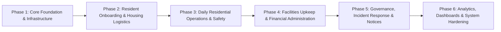
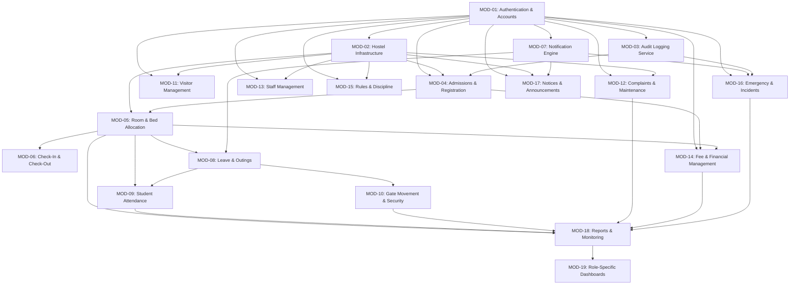

# Nestora — Module Development Plan

## 1. Introduction

### Purpose of the Module Development Plan
The purpose of this Module Development Plan is to establish a structured, phased, and manageable roadmap for the engineering and implementation of **Nestora — University Hostel Management System**. 

Building a multi-tenant university residential platform with six distinct user roles, multi-tier physical infrastructure modeling, strict data isolation boundaries, and interconnected administrative workflows requires a disciplined development sequence. This document serves as the implementation guide for developers, defining what modules will be constructed, their specific architectural responsibilities, functional dependencies, testing criteria, and milestone gates.

### Scope of the Development Roadmap
The roadmap encompasses both backend and frontend development across all confirmed functional areas defined in the project baseline. It details the progression from foundational security, authentication, and core infrastructure services through operational workflows (admissions, allocations, attendance, movements, maintenance, finance) to governance, incident handling, reporting, and dashboard synthesis.

### Relationship with Existing Documentation
This plan is directly grounded in the project documentation created to date:
- [01-project-overview.md](file:///Users/sayamdas/Documents/Programming/Mern%20Stack/My%20Website/Nestora/docs/01-project-overview.md): Project background, aim, and institutional context.
- [02-project-scope.md](file:///Users/sayamdas/Documents/Programming/Mern%20Stack/My%20Website/Nestora/docs/02-project-scope.md): In-scope features and explicit exclusions.
- [03-functional-requirements.md](file:///Users/sayamdas/Documents/Programming/Mern%20Stack/My%20Website/Nestora/docs/03-functional-requirements.md): 144 testable functional requirements and 16 business rules.
- [04-non-functional-requirements.md](file:///Users/sayamdas/Documents/Programming/Mern%20Stack/My%20Website/Nestora/docs/04-non-functional-requirements.md): 61 quality benchmarks covering security, performance, and data integrity.
- [05-user-roles-and-permissions.md](file:///Users/sayamdas/Documents/Programming/Mern%20Stack/My%20Website/Nestora/docs/05-user-roles-and-permissions.md): Six user roles, 19-module permission matrix, and hostel scoping rules.
- [06-system-architecture.md](file:///Users/sayamdas/Documents/Programming/Mern%20Stack/My%20Website/Nestora/docs/06-system-architecture.md): Decoupled modular monolith, 3-tier architecture, and deployment model.
- [07-database-design.md](file:///Users/sayamdas/Documents/Programming/Mern%20Stack/My%20Website/Nestora/docs/07-database-design.md): 56 relational entities, DDL schemas, indexes, and ERDs.
- [09-monorepo-architecture.md](file:///Users/sayamdas/Documents/Programming/Mern%20Stack/My%20Website/Nestora/docs/09-monorepo-architecture.md): pnpm + Turborepo workspace topology, package boundaries, and runtime configurations.

> [!NOTE]
> **Database Schema & Monorepo Foundation**: Detailed physical database schemas and entity-relationship models across all 56 relational tables are formally codified in [07-database-design.md](file:///Users/sayamdas/Documents/Programming/Mern%20Stack/My%20Website/Nestora/docs/07-database-design.md), and workspace package topology is defined in [09-monorepo-architecture.md](file:///Users/sayamdas/Documents/Programming/Mern%20Stack/My%20Website/Nestora/docs/09-monorepo-architecture.md). In accordance with project instructions, database entities and workspace boundaries referenced in this plan correspond to these authoritative baselines.

---

## 2. Development Strategy

### Modular Development Approach
Nestora follows a **Decoupled Client-Server Modular Monolith** architecture. Development will proceed by creating cohesive, self-contained domain modules on the backend (Fastify + TypeScript) paired with corresponding feature components and pages on the frontend (Next.js + React + Tailwind CSS). Each module encapsulates its controllers, domain services, validation schemas, and database operations, exposing clear internal interfaces to neighboring modules.

### Backend-First vs. Frontend-First Strategy
The project will execute using a **Backend-First, Contract-Driven Integration Strategy**:
1. **Domain Contract Definition**: Request/response schemas, DTOs, and validation rules are defined in TypeScript.
2. **Backend Service & API Implementation**: Database queries, transactions, RBAC guards, and REST endpoints are built and verified via automated integration tests.
3. **Frontend Implementation & Hookup**: Once API contracts are stable, frontend UI components, responsive layouts, forms, and client validation are constructed and integrated with the live API.

This sequence prevents frontend rework caused by shifting data structures and ensures backend security boundaries are proven before user interfaces are rendered.

### Incremental Implementation (Vertical Slicing)
Rather than building all backend tables and routes before touching any frontend code, development will advance in **vertical slices across functional phases**. Once the core architectural foundation is established, each phase will deliver fully functional, end-to-end capabilities (database $\rightarrow$ API $\rightarrow$ UI $\rightarrow$ tests) before advancing to dependent operational domains.

### Development and Testing Workflow
For every module, development follows a strict four-step quality cycle:
1. **Schema & Model Setup**: Declare Prisma schema entities, migrations, and seed fixtures.
2. **Service & Route Construction**: Implement business logic services, Fastify route controllers, boundary validation schemas, and RBAC middleware.
3. **Automated Verification**: Execute unit tests, route integration tests, role permission checks, and tenant isolation tests.
4. **Client Interface & Integration**: Build Next.js UI pages, forms, state management, and error/loading states, followed by end-to-end workflow verification.

---

## 3. Module Overview

The following table summarizes all 19 major functional modules, their core purpose, primary responsibilities, technical dependencies, and implementation priority:

| Module ID | Module Name | Purpose | Main Responsibilities | Dependencies | Priority |
| :--- | :--- | :--- | :--- | :--- | :--- |
| **MOD-01** | **Authentication & Account Management** | User identity, sessions, and account lifecycle | Email/password login, salted hashing, session management, password resets, account activation, user provisioning | None (Foundational) | Must (Phase 1) |
| **MOD-02** | **Hostel Infrastructure Management** | Physical asset hierarchy modeling | Mapping University $\rightarrow$ Hostel $\rightarrow$ Building $\rightarrow$ Block $\rightarrow$ Floor $\rightarrow$ Room $\rightarrow$ Bed; managing 6 room configurations | MOD-01 | Must (Phase 1) |
| **MOD-03** | **Audit Logging Service** | Regulatory and security auditability | Capturing immutable audit logs for administrative, financial, admission, and security state changes | MOD-01 | Must (Phase 1) |
| **MOD-04** | **Student Admission & Registration** | Resident applicant onboarding | Two-tier verification (Admin Tier 1, Warden Tier 2), admission approvals, duplicate record prevention | MOD-01, MOD-02, MOD-03 | Must (Phase 2) |
| **MOD-05** | **Room & Bed Allocation** | Bed inventory assignment | Preference submission, eligibility gating, individual bed allocation, vacancy tracking, room-change requests | MOD-02, MOD-04 | Must (Phase 2) |
| **MOD-06** | **Student Check-In & Check-Out** | Residential arrival and departure | Onboarding check-in logging, planned check-out submissions, administrative departures, bed release | MOD-04, MOD-05 | Must (Phase 2) |
| **MOD-07** | **Notification Engine** | In-app and outbound communication | In-app notification store, read/unread states, queued asynchronous transactional email dispatching | MOD-01 | Must (Phase 2) |
| **MOD-08** | **Temporary Leave & Outings** | Resident off-premises tracking | Leave applications, Warden review/approvals, extension workflows, bed retention during leave | MOD-05, MOD-07 | Must (Phase 3) |
| **MOD-09** | **Student Attendance** | Night roll-call accountability | Daily attendance entry, bulk floor logging, correction audit trails, leave cross-referencing, absence alerts | MOD-05, MOD-08 | Must (Phase 3) |
| **MOD-10** | **Student Movement & Gate Security** | Perimeter security enforcement | Gate pass verification, departure/arrival timestamp logging, late return logging, overstay alerts | MOD-08 | Must (Phase 3) |
| **MOD-11** | **Visitor Management** | Campus visitor access control | Visitor registration at gates, Warden pre-approval, entry/exit timestamp logging, visiting hour policy | MOD-01, MOD-02 | Must (Phase 3) |
| **MOD-12** | **Complaints & Maintenance** | Facilities repair ticketing | Student ticket submission with photos, Warden priority determination, staff assignment, 7 lifecycle states | MOD-01, MOD-02 | Must (Phase 4) |
| **MOD-13** | **Staff Management** | Operational personnel oversight | Staff profile management, hostel assignment, daily duty scheduling, staff attendance and leave workflows | MOD-01, MOD-02 | Must (Phase 4) |
| **MOD-14** | **Hostel Fee & Financial Management** | Billing, payments, and dues tracking | Semester fee schedules, offline payment recording, balance/dues tracking, late fees, waiver approvals | MOD-01, MOD-04, MOD-05 | Must (Phase 4) |
| **MOD-15** | **Hostel Rules & Disciplinary Management** | Conduct standards and sanctions | Rulebook publication, violation logging, progressive sanctions, student appeal workflows | MOD-01, MOD-02 | Should (Phase 5) |
| **MOD-16** | **Emergency & Incident Management** | Safety and crisis response | Incident reporting, severity rating, Warden response, auto-escalation to Admin, emergency contact lookups | MOD-01, MOD-07, MOD-03 | Must (Phase 5) |
| **MOD-17** | **Notices & Announcements** | Institutional broadcasting | University-wide and hostel-specific circulars, attachments, mandatory acknowledgement tracking | MOD-01, MOD-02, MOD-07 | Should (Phase 5) |
| **MOD-18** | **Reports & Administrative Monitoring** | Operational analytics and audit review | 10 administrative report categories, aggregated university metrics, hostel-scoped operational reports | MOD-01 to MOD-17 | Must (Phase 6) |
| **MOD-19** | **Role-Specific Dashboards** | Role-tailored user interfaces | Six dedicated dashboards (Admin, Warden, Student, Staff, Guard, Accountant) rendering metrics and quick actions | MOD-01 to MOD-18 | Must (Phase 6) |

### 3.1 Functional Requirement (FR) to Development Module (MOD) Cross-Reference Matrix

To ensure seamless traceability between requirements engineering and physical implementation, the following matrix maps all 19 functional requirement modules from [03-functional-requirements.md](file:///Users/sayamdas/Documents/Programming/Mern%20Stack/My%20Website/Nestora/docs/03-functional-requirements.md) and [05-user-roles-and-permissions.md](file:///Users/sayamdas/Documents/Programming/Mern%20Stack/My%20Website/Nestora/docs/05-user-roles-and-permissions.md) (`FR-01` to `FR-19`, comprising all 144 requirements `FR-001` through `FR-144`) to their authoritative development modules (`MOD-01` to `MOD-19`):

| Functional Requirement Module (docs/03 & docs/05) | Requirement ID Range | Functional Title | Development Module ID | Development Module Name | Development Milestone Phase |
| :--- | :---: | :--- | :---: | :--- | :---: |
| **Module FR-01** | `FR-001` – `FR-009` | Authentication and Account Management | **MOD-01** | Authentication & Account Management | Phase 1 (MS-1) |
| **Module FR-02** | `FR-010` – `FR-017` | Student Admission and Registration | **MOD-04** | Student Admission & Registration | Phase 2 (MS-2) |
| **Module FR-03** | `FR-018` – `FR-023` | Hostel Infrastructure Management | **MOD-02** | Hostel Infrastructure Management | Phase 1 (MS-1) |
| **Module FR-04** | `FR-024` – `FR-031` | Room and Bed Allocation | **MOD-05** | Room & Bed Allocation | Phase 2 (MS-2) |
| **Module FR-05** | `FR-032` – `FR-037` | Student Check-in and Check-out | **MOD-06** | Student Check-In & Check-Out | Phase 2 (MS-2) |
| **Module FR-06** | `FR-038` – `FR-044` | Temporary Leave and Late Return | **MOD-08** | Temporary Leave & Outings | Phase 3 (MS-3) |
| **Module FR-07** | `FR-045` – `FR-052` | Student Attendance | **MOD-09** | Student Attendance | Phase 3 (MS-3) |
| **Module FR-08** | `FR-053` – `FR-058` | Student Movement and Outings | **MOD-10** | Student Movement & Gate Security | Phase 3 (MS-3) |
| **Module FR-09** | `FR-059` – `FR-064` | Visitor Management | **MOD-11** | Visitor Management | Phase 3 (MS-3) |
| **Module FR-10** | `FR-065` – `FR-073` | Complaints and Maintenance Management | **MOD-12** | Complaints & Maintenance Management | Phase 4 (MS-4) |
| **Module FR-11** | `FR-074` – `FR-083` | Hostel Fee and Financial Management | **MOD-14** | Hostel Fee & Financial Management | Phase 4 (MS-4) |
| **Module FR-12** | `FR-084` – `FR-090` | Notices and Announcements | **MOD-17** | Notices & Announcements | Phase 5 (MS-5) |
| **Module FR-13** | `FR-091` – `FR-098` | Staff Management | **MOD-13** | Staff Management | Phase 4 (MS-4) |
| **Module FR-14** | `FR-099` – `FR-107` | Hostel Rules and Disciplinary Management | **MOD-15** | Hostel Rules & Disciplinary Management | Phase 5 (MS-5) |
| **Module FR-15** | `FR-108` – `FR-117` | Emergency and Incident Management | **MOD-16** | Emergency & Incident Management | Phase 5 (MS-5) |
| **Module FR-16** | `FR-118` – `FR-122` | Notification Management | **MOD-07** | Notification Engine | Phase 2 (MS-2) |
| **Module FR-17** | `FR-123` – `FR-128` | Role-Specific Dashboards | **MOD-19** | Role-Specific Dashboards | Phase 6 (MS-6) |
| **Module FR-18** | `FR-129` – `FR-139` | Reports and Administrative Monitoring | **MOD-18** | Reports & Administrative Monitoring | Phase 6 (MS-6) |
| **Module FR-19** | `FR-140` – `FR-144` | Audit History | **MOD-03** | Audit Logging Service | Phase 1 (MS-1) |

#### Rationale for Differing Sequencing Between Catalogues:
- **Requirements Catalogue (`FR-01` to `FR-19`)**: Structured domain-first from the perspective of institutional stakeholders and student residential journeys (e.g., student admissions `FR-02` precede physical allocations `FR-04`, while cross-cutting audit oversight `FR-19` sits at the culmination of the requirement inventory).
- **Development Plan Modules (`MOD-01` to `MOD-19`)**: Sequenced strictly in **technical dependency order**:
  1. `MOD-02` (Infrastructure) and `MOD-03` (Audit Logging) are elevated into **Milestone 1** alongside `MOD-01` (Authentication) because admissions and allocations cannot execute without pre-existing physical assets (hostels, rooms, beds) and require immutable audit logging from day one.
  2. `MOD-07` (Notification Engine) is built in **Milestone 2** so that subsequent operational modules (leave approvals, emergency alerts, fee notices) have a functional in-app and email dispatch channel to call.
  3. `MOD-18` (Reports) and `MOD-19` (Dashboards) are scheduled for **Milestone 6** because analytical aggregation and dashboard KPIs consume data produced across all preceding operational modules.

> [!NOTE]
> All original requirement IDs (`FR-001` through `FR-144`) and development module IDs (`MOD-01` through `MOD-19`) remain canonical and unchanged. When implementing any development module, engineers should reference both the module specifications in this document and the exact functional acceptance criteria in [03-functional-requirements.md](file:///Users/sayamdas/Documents/Programming/Mern%20Stack/My%20Website/Nestora/docs/03-functional-requirements.md).

---

## 4. Module Development Breakdown

### Module 01: Authentication & Account Management (MOD-01)
- **Module Overview & Objectives**: Provides the security root for Nestora, managing credential authentication, role resolution, secure session issuance, account provisioning, and password resets.
- **Main Functionalities**: Email/password login; Argon2/bcrypt salted hashing; secure HTTP-only session cookies; time-limited email password reset links; account activation; Admin/Warden user provisioning; account status transitions (`Active`, `Inactive`, `Suspended`).
- **Relevant User Roles**: All six roles (University Administrator, Hostel Warden, Student, Hostel Staff, Security Guard, Accountant).
- **Frontend Responsibilities**: Login form (`/login`), Forgot Password form (`/forgot-password`), Account Activation view (`/activate`), User Management table for Administrators (`/admin/users`).
- **Backend Responsibilities**: `/api/v1/auth/*` endpoints; Fastify authentication hook; rate-limiting plugin; credential validation; token generation; user provisioning routes.
- **Database Entities Involved**: `User`, `AccountStatus`, `PasswordResetToken`, `Session`.
- **Dependencies**: None (Foundational).
- **Validation & Security**: Rate limiting on login attempts; password complexity validation; generic error messages on failed auth; zero plaintext credential storage; `HttpOnly`, `Secure`, `SameSite` cookies.
- **Testing Requirements**: Unit tests for password hashing; integration tests for login/logout; brute-force rate-limiting tests; token expiration tests; RBAC middleware rejection tests.
- **Completion Criteria**: Users across all six roles can securely log in, receive authenticated session cookies, and be redirected based on role; invalid credentials and expired tokens are rejected.

### Module 02: Hostel Infrastructure Management (MOD-02)
- **Module Overview & Objectives**: Models the physical housing assets of the university across a 7-tier relational hierarchy down to individual bed spaces.
- **Main Functionalities**: Configuration of University, Hostels (Boys' and Girls' categories), Buildings, Blocks, Floors, Rooms, and Beds; management of exactly six room configurations; bed operational status tracking (`Available`, `Occupied`, `Reserved`, `Maintenance`).
- **Relevant User Roles**: University Administrator (Full), Hostel Warden (Manage within assigned hostel), Student/Staff/Guard/Accountant (View/Limited).
- **Frontend Responsibilities**: Infrastructure hierarchy tree view; room configuration cards; interactive bed layout grid; hostel registration forms.
- **Backend Responsibilities**: `/api/v1/infrastructure/*` endpoints; hierarchical CRUD controllers; bed status mutation services; room capacity validation.
- **Database Entities Involved**: `Hostel`, `Building`, `Block`, `Floor`, `Room`, `Bed`, `RoomConfiguration`.
- **Dependencies**: MOD-01.
- **Validation & Security**: Referential integrity enforcement (`ON DELETE RESTRICT` on physical assets); room capacity constraints; validation of the 6 allowed room types; gender category immutability.
- **Testing Requirements**: Hierarchy creation tests; cascade prevention tests; unique bed numbering within room tests; capacity boundary validation.
- **Completion Criteria**: Complete multi-tier hierarchy can be configured from university down to individual beds; bed operational states update reliably.

### Module 03: Audit Logging Service (MOD-03)
- **Module Overview & Objectives**: Provides an immutable, append-only audit trail capturing sensitive administrative, financial, operational, and security actions.
- **Main Functionalities**: Synchronous recording of actor user ID, role, action, target entity type, entity ID, previous state, new state, client IP, and UTC timestamp; audit log querying for University Administrator.
- **Relevant User Roles**: University Administrator (Exclusive View access); System (Automatic writer).
- **Frontend Responsibilities**: Admin Audit Trail inspection console (`/admin/audit-logs`) with filtering by entity, actor, date range, and action type.
- **Backend Responsibilities**: `/api/v1/audit-logs` query endpoint; internal `AuditService.logEvent()` utility invoked by mutating domain services; database append-only enforcement.
- **Database Entities Involved**: `AuditLog`.
- **Dependencies**: MOD-01.
- **Validation & Security**: Append-only data access layer (no `UPDATE` or `DELETE` methods exposed); strict authorization restriction to `UNIVERSITY_ADMINISTRATOR`.
- **Testing Requirements**: Verification of audit emission on administrative mutations; security penetration tests confirming rejection of audit log edit/delete attempts.
- **Completion Criteria**: System mutations consistently generate immutable audit entries accessible exclusively to the University Administrator.

### Module 04: Student Admission & Registration (MOD-04)
- **Module Overview & Objectives**: Orchestrates the multi-step onboarding of resident students, enforcing two-tier verification before accommodation eligibility is granted.
- **Main Functionalities**: Student registration initiation; academic/demographic profile capture; Tier-1 verification (University Administrator); Tier-2 verification (Hostel Warden); dual sign-off final admission approval; rejection handling and resubmission; duplicate registration prevention.
- **Relevant User Roles**: University Administrator, Hostel Warden, Student, Accountant (Read-only for fee setup).
- **Frontend Responsibilities**: Student Registration Wizard; Admin Tier-1 Verification Queue; Warden Tier-2 Verification Queue; Student Admission Status Tracker.
- **Backend Responsibilities**: `/api/v1/admissions/*` endpoints; sequential verification workflow engine; unique identity validator (student ID, email); audit log integration.
- **Database Entities Involved**: `Student`, `AdmissionApplication`, `AdmissionVerification`.
- **Dependencies**: MOD-01, MOD-02, MOD-03.
- **Validation & Security**: Duplicate registration check on student ID; sequential approval gate (Tier 2 cannot occur before Tier 1); final admission requires both approvals; hostel gender validation.
- **Testing Requirements**: Sequential verification state machine tests; rejection resubmission tests; duplicate registration rejection tests; role authorization boundary tests.
- **Completion Criteria**: Student application progresses strictly through Draft $\rightarrow$ Tier 1 Verified $\rightarrow$ Tier 2 Verified $\rightarrow$ Fully Approved; unapproved students cannot proceed to accommodation.

### Module 05: Room & Bed Allocation (MOD-05)
- **Module Overview & Objectives**: Manages the matching of fully approved students to individual bed spaces based on preferences and hostel capacity.
- **Main Functionalities**: Accommodation preference submission (hostel category, room type, AC/Non-AC); Administrator and Warden bed allocation execution; independent bed allocation in multi-bed rooms; bed status toggling; room-change request submission and review; historical allocation logging.
- **Relevant User Roles**: University Administrator, Hostel Warden, Student, Accountant (View).
- **Frontend Responsibilities**: Student Preference Form; Warden Bed Allocation Matrix; Vacancy Heatmap; Room-Change Request Modal.
- **Backend Responsibilities**: `/api/v1/allocations/*` endpoints; atomic bed allocation transactions (`prisma.$transaction`); room vacancy query services; room-change approval workflow.
- **Database Entities Involved**: `BedPreference`, `AllocationRecord`, `RoomChangeRequest`, `Bed`.
- **Dependencies**: MOD-02, MOD-04.
- **Validation & Security**: Atomic check-and-set query preventing double-booking; validation that student is `FULLY_APPROVED`; enforcement that bed is `AVAILABLE`; gender matching between student and hostel.
- **Testing Requirements**: Concurrent allocation race-condition tests; double-allocation rejection tests; unapproved student allocation rejection tests; room-change transfer tests.
- **Completion Criteria**: Individual beds can be allocated independently without race conditions; allocated bed transitions to `OCCUPIED`; allocation history is preserved.

### Module 06: Student Check-In & Check-Out (MOD-06)
- **Module Overview & Objectives**: Manages physical arrival onboarding and formal departure clearance for resident students.
- **Main Functionalities**: Check-in physical timestamp logging and key issuance; student-initiated planned check-out submissions; administration-initiated evictions; room condition and inventory inspection logging; financial dues clearance sign-off; automatic bed deallocation upon checkout.
- **Relevant User Roles**: University Administrator, Hostel Warden, Student, Accountant (Dues sign-off), Hostel Staff (Inspection notes).
- **Frontend Responsibilities**: Check-In Confirmation Dialog; Student Check-Out Request Form; Warden Check-Out Inspection Checklist; Dues Clearance Indicator.
- **Backend Responsibilities**: `/api/v1/checkin-out/*` endpoints; arrival logging service; departure clearance workflow; bed release transaction.
- **Database Entities Involved**: `CheckInRecord`, `CheckOutRecord`, `InventoryInspection`, `Bed`.
- **Dependencies**: MOD-04, MOD-05.
- **Validation & Security**: Check-out requires verification of zero outstanding financial dues; bed deallocation executes atomically with checkout finalization.
- **Testing Requirements**: Check-in status transition tests; check-out blocked by pending dues tests; atomic bed release verification tests.
- **Completion Criteria**: Formal check-in establishes active residency; approved check-out terminates allocation and immediately resets the bed space to `AVAILABLE`.

### Module 07: Notification Engine (MOD-07)
- **Module Overview & Objectives**: Coordinates multi-channel notifications across in-app alerts and asynchronous transactional emails.
- **Main Functionalities**: In-app notification creation and inbox querying; read/unread status updates; background task queuing for outbound emails (welcome, verification, leave updates, emergency alerts); user preference toggling for non-critical notifications.
- **Relevant User Roles**: All six roles.
- **Frontend Responsibilities**: Notification Bell Dropdown; Notification Center View (`/notifications`); Notification Preferences Panel.
- **Backend Responsibilities**: `/api/v1/notifications/*` endpoints; internal `NotificationService.dispatch()` helper; background email queue worker; SMTP transport handler.
- **Database Entities Involved**: `Notification`, `NotificationPreference`.
- **Dependencies**: MOD-01.
- **Validation & Security**: Critical emergency and administrative notifications cannot be disabled; rate limiting on notification dispatch; email template sanitization.
- **Testing Requirements**: In-app notification creation tests; email queue processing tests; mandatory notification bypass tests; mark-as-read state tests.
- **Completion Criteria**: Workflow events reliably generate in-app notification records and enqueue outbound emails without blocking HTTP request threads.

### Module 08: Temporary Leave & Outings (MOD-08)
- **Module Overview & Objectives**: Manages short-term student absences (day outings and overnight leaves) while safeguarding bed retention.
- **Main Functionalities**: Temporary leave application submission (dates, reason, emergency contact); Warden review, approval, and rejection; leave extension requests; bed retention enforcement; daily outing request submission; Warden routine approval; Admin exceptional approval; digital pass generation.
- **Relevant User Roles**: Hostel Warden, Student, University Administrator (Exceptional outings).
- **Frontend Responsibilities**: Student Leave Application Form; Outing Request Form; Warden Leave/Outing Approval Queue; Digital Gate Pass View.
- **Backend Responsibilities**: `/api/v1/leaves/*` and `/api/v1/outings/*` endpoints; leave date validation; pass token generator; leave state machine.
- **Database Entities Involved**: `LeaveApplication`, `LeaveExtension`, `OutingRequest`, `GatePass`.
- **Dependencies**: MOD-05, MOD-07.
- **Validation & Security**: Return date must follow departure date; leave does not release bed occupancy; students cannot approve own requests; Warden can only approve assigned hostel leaves.
- **Testing Requirements**: Date boundary validation tests; bed occupancy preservation tests; extension workflow tests; unauthorized approval attempt tests.
- **Completion Criteria**: Students can apply for leaves and outings; Wardens can approve or reject; digital passes are generated; active bed allocations remain strictly locked.

### Module 09: Student Attendance (MOD-09)
- **Module Overview & Objectives**: Digitizes daily night roll-call attendance, absence alerting, and attendance record correction auditing.
- **Main Functionalities**: Daily attendance recording (Present, Absent, On Leave); individual and bulk floor/block entry; Warden and authorized Staff attendance modification; immutable correction history logging; student attendance history and percentage view; student discrepancy reporting; consecutive absence threshold alerting; leave cross-referencing.
- **Relevant User Roles**: Hostel Warden, Hostel Staff (when authorized), Student (View only), University Administrator (Alert escalation).
- **Frontend Responsibilities**: Warden/Staff Daily Attendance Roster; Quick Bulk-Mark Controls; Student Attendance Calendar & Percentage Widget; Discrepancy Lodging Modal.
- **Backend Responsibilities**: `/api/v1/attendance/*` endpoints; attendance submission controllers; correction audit service; automatic leave cross-referencing logic; consecutive absence scanner.
- **Database Entities Involved**: `AttendanceRecord`, `AttendanceCorrectionLog`, `AttendanceDiscrepancy`.
- **Dependencies**: MOD-05, MOD-08.
- **Validation & Security**: Students strictly prohibited from editing attendance; correction requires editor ID, timestamp, and justification note; approved temporary leaves automatically resolve to `ON_LEAVE`.
- **Testing Requirements**: Bulk entry tests; correction revision history retention tests; automatic leave cross-reference reconciliation tests; consecutive absence threshold trigger tests.
- **Completion Criteria**: Daily roll-call can be logged rapidly; corrections preserve audit history; approved leaves prevent false unexcused absence marks.

### Module 10: Student Movement & Gate Security (MOD-10)
- **Module Overview & Objectives**: Equips gate security personnel to validate student permissions and capture entry/exit movements in real time.
- **Main Functionalities**: Security Guard digital gate pass verification by student ID or pass token; real-time gate departure and return timestamp logging; late return flagging; automated overstay alerts to Warden; movement duration calculation.
- **Relevant User Roles**: Security Guard, Hostel Warden (Alert recipient), Student.
- **Frontend Responsibilities**: Security Guard Gate Console (`/guard/movement`); Quick Student Lookup Input; Gate Pass Scanner View; Late Return Prompt.
- **Backend Responsibilities**: `/api/v1/movement/*` endpoints; pass token verification service; timestamp logging controller; late return event emitter.
- **Database Entities Involved**: `GateMovementLog`, `GatePass`.
- **Dependencies**: MOD-08.
- **Validation & Security**: Guards can verify and log movements but cannot approve leaves or modify allocations; server timestamps enforced on all gate entries.
- **Testing Requirements**: Valid pass verification tests; expired/invalid pass rejection tests; server-side timestamp tampering prevention tests; late return trigger tests.
- **Completion Criteria**: Guards can search and verify student passes in $<1$ second; actual departure and arrival times are immutably logged; late returns trigger alerts.

### Module 11: Visitor Management (MOD-11)
- **Module Overview & Objectives**: Secures campus perimeters by digitizing visitor registration, Warden authorization, and visitor check-in/out logging.
- **Main Functionalities**: Visitor registration at security gates (name, phone, government ID, resident visited, purpose); Warden digital pre-approval workflow; Guard actual entry/exit timestamp logging; visiting hours and duration limits enforcement; Warden exception overrides.
- **Relevant User Roles**: Security Guard, Hostel Warden, Student (Host).
- **Frontend Responsibilities**: Guard Visitor Check-in Form; Warden Visitor Authorization Queue; Live On-Premises Visitor Monitor; Visitor History Table.
- **Backend Responsibilities**: `/api/v1/visitors/*` endpoints; visitor registration service; Warden approval hook; visiting hours validation middleware.
- **Database Entities Involved**: `VisitorRecord`, `VisitorPass`.
- **Dependencies**: MOD-01, MOD-02.
- **Validation & Security**: Mandatory government identification capture; visitor cannot enter without Warden approval; duration limit validation.
- **Testing Requirements**: Unapproved visitor entry rejection tests; visiting hour boundary tests; Warden override justification tests; exit timestamp logging tests.
- **Completion Criteria**: Visitors are registered at the gate, approved digitally by the Warden, and tracked with entry and exit timestamps.

### Module 12: Complaints & Maintenance Management (MOD-12)
- **Module Overview & Objectives**: Provides a complete facility grievance and repair ticketing lifecycle from submission to verified resolution.
- **Main Functionalities**: Student complaint submission with title, category (Electrical, Plumbing, Carpentry, Cleaning, Civil), location, description, and optional photo attachment; student suggested priority vs. Warden final priority; Warden ticket assignment to Hostel Staff; category-based staff suggestion; staff progress updates (7 statuses); student resolution confirmation or reopening; configurable automatic closure.
- **Relevant User Roles**: Student, Hostel Warden, Hostel Staff, University Administrator (View).
- **Frontend Responsibilities**: Student Complaint Form with Image Upload; Warden Ticket Assignment Board; Staff Task Queue View; Resolution Confirmation Modal.
- **Backend Responsibilities**: `/api/v1/complaints/*` endpoints; file upload pipeline; ticket lifecycle state machine; automatic closure scheduler job.
- **Database Entities Involved**: `ComplaintTicket`, `ComplaintAttachment`, `TicketAssignment`, `TicketStatusHistory`.
- **Dependencies**: MOD-01, MOD-02.
- **Validation & Security**: Image attachment validation (MIME, max 5 MB); students can only view/confirm their own tickets; staff can only update assigned tickets.
- **Testing Requirements**: Status transition validation tests; image upload validation tests; reopened ticket escalation tests; auto-closure timeout tests.
- **Completion Criteria**: Tickets transition smoothly through `Submitted` $\rightarrow$ `Under Review` $\rightarrow$ `Assigned` $\rightarrow$ `In Progress` $\rightarrow$ `Resolved` $\rightarrow$ `Closed` (or `Reopened`).

### Module 13: Staff Management (MOD-13)
- **Module Overview & Objectives**: Structures operational personnel records, hostel assignments, daily duty scheduling, and staff attendance.
- **Main Functionalities**: Staff profile creation and role assignment by Administrator; assignment of staff to specific hostels; Warden daily duty and zone assignments; staff task queue view; staff daily attendance recording; staff leave request submission (routine to Warden, exceptional to Admin); attendance synchronization.
- **Relevant User Roles**: University Administrator, Hostel Warden, Hostel Staff.
- **Frontend Responsibilities**: Administrator Staff Directory; Warden Daily Duty Scheduler; Staff Shift Dashboard; Staff Leave Form.
- **Backend Responsibilities**: `/api/v1/staff/*` endpoints; staff allocation services; duty roster controllers; staff leave routing engine.
- **Database Entities Involved**: `StaffProfile`, `DutyAssignment`, `StaffAttendance`, `StaffLeave`.
- **Dependencies**: MOD-01, MOD-02.
- **Validation & Security**: Staff access restricted to assigned hostel and duties; leave requests route according to duration thresholds; staff cannot self-assign duties.
- **Testing Requirements**: Staff hostel assignment isolation tests; duty assignment creation tests; routine vs. exceptional leave routing tests.
- **Completion Criteria**: Operational staff can be provisioned, assigned to hostels, scheduled for daily duties, and tracked for attendance.

### Module 14: Hostel Fee & Financial Management (MOD-14)
- **Module Overview & Objectives**: Manages institutional accommodation fee structures, tracks offline payment receipts, calculates late fees, and reconciles balances.
- **Main Functionalities**: Annual and semester fee schedule definition linked to room types; University Administrator fee structure approval; offline payment recording (challan, DD, NEFT); student ledger balance and dues tracking; late fee computation; manual fee adjustment/waiver proposals by Accountant; Administrator waiver approval; payment reminders; individual student fee statements.
- **Relevant User Roles**: Accountant, University Administrator, Student, Hostel Warden (View clearance).
- **Frontend Responsibilities**: Accountant Fee Structure Creator; Admin Fee Schedule Approval Queue; Offline Payment Entry Form; Student Fee Statement View.
- **Backend Responsibilities**: `/api/v1/finance/*` endpoints; fee schedule activation engine; offline payment ledger service; late-fee calculation scheduler; balance reconciliation.
- **Database Entities Involved**: `FeeSchedule`, `FeeItem`, `StudentLedger`, `PaymentRecord`, `FeeAdjustment`.
- **Dependencies**: MOD-01, MOD-04, MOD-05.
- **Validation & Security**: No fee schedule activates without Admin approval; manual fee adjustments require Admin sign-off before balance alters; online gateway explicitly excluded.
- **Testing Requirements**: Fee structure approval gate tests; offline payment balance recalculation tests; unauthorized fee adjustment rejection tests; late fee calculation tests.
- **Completion Criteria**: Fee structures can be created, approved, and assigned; offline payments credit student ledgers accurately; waivers require Administrator approval.

### Module 15: Hostel Rules & Disciplinary Management (MOD-15)
- **Module Overview & Objectives**: Publishes institutional codes of conduct and records student disciplinary infractions, sanctions, and appeal reviews.
- **Main Functionalities**: University-wide rule management by Administrator; hostel-specific rule formulation by Warden; resident rulebook access; violation recording with descriptions and evidence attachments; progressive sanctions (Verbal Warning, Written Warning, Formal Action, Facility Suspension); student written appeal submission; Warden first-tier review; Administrator escalated appeal adjudication.
- **Relevant User Roles**: University Administrator, Hostel Warden, Student.
- **Frontend Responsibilities**: Digital Hostel Rulebook View; Warden Infraction Logging Form; Student Disciplinary Profile & Appeal Form; Admin Escalated Appeal Console.
- **Backend Responsibilities**: `/api/v1/rules/*` and `/api/v1/discipline/*` endpoints; disciplinary record service; appeal routing state machine; confidential audit logging.
- **Database Entities Involved**: `HostelRule`, `DisciplinaryViolation`, `DisciplinarySanction`, `DisciplinaryAppeal`.
- **Dependencies**: MOD-01, MOD-02.
- **Validation & Security**: Disciplinary files are confidential, hidden from Staff, Guards, and peers; suspensions require Administrator confirmation.
- **Testing Requirements**: Progressive sanction transition tests; appeal escalation workflow tests; confidential record access restriction tests.
- **Completion Criteria**: Rules are accessible to residents; infractions and sanctions are logged confidentially; student appeals can be submitted and reviewed.

### Module 16: Emergency & Incident Management (MOD-16)
- **Module Overview & Objectives**: Provides a rapid-response reporting mechanism for urgent campus safety, medical, and security incidents.
- **Main Functionalities**: Universal emergency reporting across all six roles; predefined categories (Fire, Medical, Security, Missing Student, Infrastructure, Other); initial severity rating (Low, Medium, High, Critical); Warden on-site review and severity adjustment; restricted resolution authority (Warden/Admin only); immediate Warden alerting; automatic escalation to Administrator if unacknowledged; confidential emergency contact lookups; automated guardian emails for High/Critical incidents.
- **Relevant User Roles**: All six roles (Reporters); Hostel Warden & University Administrator (Resolvers).
- **Frontend Responsibilities**: Universal Quick-Report Emergency Button; Active Incident Command Center; Emergency Contact Lookup Modal; Incident Resolution Dialog.
- **Backend Responsibilities**: `/api/v1/emergency/*` endpoints; high-priority notification dispatcher; unacknowledged incident escalation timer; emergency contact access auditing.
- **Database Entities Involved**: `EmergencyIncident`, `IncidentActionLog`, `IncidentContactViewLog`.
- **Dependencies**: MOD-01, MOD-07, MOD-03.
- **Validation & Security**: Emergency alerts cannot be muted; emergency contact lookups emit synchronous audit records; incident closure restricted to Warden/Admin.
- **Testing Requirements**: Incident creation and notification dispatch tests; escalation timer trigger tests; emergency contact view audit log emission tests.
- **Completion Criteria**: Any authenticated user can report an emergency; notifications route instantly; unacknowledged incidents escalate; resolution is strictly audited.

### Module 17: Notices & Announcements (MOD-17)
- **Module Overview & Objectives**: Centralizes institutional communication via targeted circulars, attachments, and mandatory acknowledgement tracking.
- **Main Functionalities**: University-wide notice publication by Administrator; hostel-specific notice publication by Wardens; rich text descriptions and PDF attachments; notice categorization (General, Rules, Fees, Maintenance, Emergency, Events); mandatory acknowledgement tracking with recipient rosters; automated acknowledgement reminder alerts.
- **Relevant User Roles**: University Administrator, Hostel Warden, All Users (Viewers/Acknowledgers).
- **Frontend Responsibilities**: Notice Publisher Form with Attachment Upload; Interactive Notice Board View; Acknowledgment Roster Tracker.
- **Backend Responsibilities**: `/api/v1/notices/*` endpoints; notice scoping controllers; acknowledgement tracking services; reminder scheduler.
- **Database Entities Involved**: `Notice`, `NoticeAttachment`, `NoticeAcknowledgement`.
- **Dependencies**: MOD-01, MOD-02, MOD-07.
- **Validation & Security**: Wardens cannot publish university-wide notices; PDF attachment validation; acknowledgement records are timestamped and immutable.
- **Testing Requirements**: Notice scope visibility tests (university vs. assigned hostel); acknowledgement logging tests; overdue acknowledgement reminder tests.
- **Completion Criteria**: Notices publish with correct institutional scoping; residents can read and acknowledge; authors can track acknowledgement completion.

### Module 18: Reports & Administrative Monitoring (MOD-18)
- **Module Overview & Objectives**: Aggregates operational datasets across ten administrative categories to facilitate data-driven oversight.
- **Main Functionalities**: Compilation of reports for: Student Admissions, Occupancy & Bed Vacancies, Attendance & Movement, Leave & Outings, Visitors, Complaints & Maintenance, Staff Attendance, Fees & Dues, Disciplinary Records, Emergency Summaries; automated data isolation (Admin sees university-wide aggregate data, Wardens see assigned hostel data).
- **Relevant User Roles**: University Administrator (Global), Hostel Warden (Assigned Hostel), Accountant (Financial Reports).
- **Frontend Responsibilities**: Administrative Analytics Center (`/admin/reports`, `/warden/reports`); Report Filter Bar; Data Visualization Charts; CSV/PDF Export Controls.
- **Backend Responsibilities**: `/api/v1/reports/*` endpoints; optimized aggregate reporting queries; tenant scope filter injection; export serialization.
- **Database Entities Involved**: Cross-cutting queries across all operational tables.
- **Dependencies**: MOD-01 through MOD-17.
- **Validation & Security**: Rigid tenant boundary enforcement (Wardens cannot query cross-hostel aggregate datasets); non-blocking asynchronous execution for heavy queries.
- **Testing Requirements**: Cross-tenant data isolation tests in reporting; query performance benchmarking; aggregation mathematical accuracy tests.
- **Completion Criteria**: All ten report categories generate accurate tabular and graphical summaries strictly within the authorized hostel boundary.

### Module 19: Role-Specific Dashboards (MOD-19)
- **Module Overview & Objectives**: Synthesizes module metrics and pending operational actions into dedicated starting landing views for each user role.
- **Main Functionalities**:
  - **University Administrator Dashboard**: Cross-hostel occupancy metrics, pending admission verifications, fee collection totals, active emergency incidents, quick action links.
  - **Hostel Warden Dashboard**: Assigned hostel occupancy, pending leave/outing queues, pending second-tier admissions, open complaints, attendance summary, active incidents.
  - **Student Dashboard**: Assigned room/bed card, current leave status, attendance percentage, outstanding fee balance, active complaint tracker, recent notices.
  - **Hostel Staff Dashboard**: Assigned maintenance work orders, priority tags, task status toggles, shift schedule notes.
  - **Security Guard Dashboard**: Quick gate pass verification search, departure/arrival movement logging tools, visitor registration form, emergency trigger.
  - **Accountant Dashboard**: Fee collection overview, pending student dues roster, fee schedule approval status, quick offline payment logging form.
- **Relevant User Roles**: All six roles (Dedicated landing pages).
- **Frontend Responsibilities**: Six role-specific landing views (`/admin`, `/warden`, `/student`, `/staff`, `/guard`, `/accountant`); metric card components; quick-action buttons.
- **Backend Responsibilities**: `/api/v1/dashboard/*` endpoints delivering pre-aggregated role payloads tailored to authenticated session claims.
- **Database Entities Involved**: Aggregated reads across `Bed`, `AdmissionApplication`, `LeaveApplication`, `ComplaintTicket`, `StudentLedger`, `EmergencyIncident`.
- **Dependencies**: MOD-01 through MOD-18.
- **Validation & Security**: Dashboards strictly render data within verified user role and assigned hostel scope; dynamic date-range filters and customization excluded per scope.
- **Testing Requirements**: Role landing redirection tests; dashboard payload latency tests ($\le 2.0\text{s}$); tenant scope leakage tests.
- **Completion Criteria**: Every user role logs into a customized dashboard displaying immediate operational indicators and task queues.

---

## 5. Development Phases

Development is structured into **six sequential phases** respecting technical and functional dependencies:



### Phase 1: Core Foundation & Security
- **Phase Objective**: Establish the technical backbone, database connection, authentication mechanisms, user provisioning, physical infrastructure modeling, and audit framework.
- **Modules Included**:
  - MOD-01: Authentication & Account Management
  - MOD-02: Hostel Infrastructure Management
  - MOD-03: Audit Logging Service
- **Tasks to Complete**:
  - Setup Fastify backend runtime with CORS, Helmet, Rate Limiting, and centralized error handling.
  - Establish Prisma ORM configuration and database migration pipeline with PostgreSQL.
  - Implement user models, credential hashing, and secure session management.
  - Build physical infrastructure models (University, Hostels, Buildings, Blocks, Floors, Rooms, Beds).
  - Implement the append-only `AuditLog` service.
  - Build Next.js authentication pages (`/login`, `/forgot-password`, `/activate`) and infrastructure configuration forms.
- **Dependencies**: None.
- **Expected Deliverables**: Working authentication system, physical accommodation hierarchy database, audit logger, and initial admin configuration screens.
- **Completion Criteria**: Users can log in; Administrators can provision accounts and configure the complete multi-tier infrastructure; audit logs record administrative actions.

### Phase 2: Resident Onboarding & Housing Logistics
- **Phase Objective**: Implement the student admission lifecycle, bed allocation engine, physical check-in/out workflows, and asynchronous notification engine.
- **Modules Included**:
  - MOD-04: Student Admission & Registration
  - MOD-05: Room & Bed Allocation
  - MOD-06: Student Check-In & Check-Out
  - MOD-07: Notification Engine
- **Tasks to Complete**:
  - Build two-tier admission verification workflow (Admin Tier 1, Warden Tier 2).
  - Implement accommodation preference capture and bed allocation atomic transaction (`prisma.$transaction`).
  - Implement arrival check-in and departure check-out clearance workflows.
  - Setup background task worker and SMTP transactional email queue.
  - Construct Next.js admission wizards, bed allocation matrices, and check-in/out dialogs.
- **Dependencies**: Phase 1 (MOD-01, MOD-02, MOD-03).
- **Expected Deliverables**: Operational student admission pipeline, bed allocation engine with vacancy tracking, check-in/out logging, and notification worker.
- **Completion Criteria**: Students can be admitted via two-tier approval, allocated to vacant beds without race conditions, checked in upon arrival, and checked out upon departure.

### Phase 3: Daily Residential Operations & Safety
- **Phase Objective**: Digitize day-to-day student movements, leave applications, nightly attendance roll-calls, gate checkpoints, and visitor tracking.
- **Modules Included**:
  - MOD-08: Temporary Leave & Outings
  - MOD-09: Student Attendance
  - MOD-10: Student Movement & Gate Security
  - MOD-11: Visitor Management
- **Tasks to Complete**:
  - Implement leave application, Warden approval, and extension workflows while locking bed retention.
  - Build daily night attendance roster with bulk entry and leave cross-referencing.
  - Construct gate security verification tools and movement timestamp logging.
  - Build visitor registration, Warden pre-approval, and gate check-in/out tracking.
  - Develop Next.js Warden attendance roster, Guard movement console, and Student leave portal.
- **Dependencies**: Phase 2 (MOD-05, MOD-07).
- **Expected Deliverables**: Real-time movement tracking at campus gates, nightly attendance roster with correction audit trails, and visitor access control.
- **Completion Criteria**: Wardens can mark attendance and approve leaves; Guards can verify gate passes and log movements; visitors require digital authorization.

### Phase 4: Facilities Upkeep & Financial Administration
- **Phase Objective**: Implement maintenance ticketing, operational staff duty allocations, and student fee ledgers.
- **Modules Included**:
  - MOD-12: Complaints & Maintenance Management
  - MOD-13: Staff Management
  - MOD-14: Hostel Fee & Financial Management
- **Tasks to Complete**:
  - Build complaint submission with image upload, Warden priority setting, and staff assignment.
  - Implement staff profiles, hostel assignments, and daily duty scheduling.
  - Implement fee schedule definition, Admin fee structure authorization, and offline payment logging.
  - Build balance recalculation, late fee calculation, and Admin waiver approval workflows.
  - Construct Next.js complaint boards, staff duty views, and accountant financial consoles.
- **Dependencies**: Phase 2 (MOD-04, MOD-05), Phase 1 (MOD-01, MOD-02).
- **Expected Deliverables**: End-to-end maintenance ticketing pipeline, staff shift management, and student fee billing/payment tracking.
- **Completion Criteria**: Students can lodge complaints and view fee dues; Wardens can assign staff to repairs; Accountants can log offline payments; waivers require Admin sign-off.

### Phase 5: Governance, Incident Response & Notices
- **Phase Objective**: Implement institutional conduct rules, disciplinary sanctioning, emergency crisis management, and official announcements.
- **Modules Included**:
  - MOD-15: Hostel Rules & Disciplinary Management
  - MOD-16: Emergency & Incident Management
  - MOD-17: Notices & Announcements
- **Tasks to Complete**:
  - Build rulebook repository, infraction logging, progressive sanctions, and student appeal workflows.
  - Implement universal emergency reporting, severity adjustment, unacknowledged incident auto-escalation, and emergency contact lookup auditing.
  - Construct university-wide and hostel-scoped notice publishing with attachment uploads and mandatory acknowledgement rosters.
  - Develop Next.js Emergency Command modal, Disciplinary Appeal console, and Notice Board.
- **Dependencies**: Phase 1 (MOD-01, MOD-02, MOD-03), Phase 2 (MOD-07).
- **Expected Deliverables**: Crisis reporting system with automated escalations, disciplinary appeal tracking, and targeted institutional broadcasting.
- **Completion Criteria**: Emergencies alert authorities instantly; rules and disciplinary appeals are logged confidentially; notices track student acknowledgements.

### Phase 6: Analytics, Dashboards & System Hardening
- **Phase Objective**: Aggregate domain data into role-specific landing dashboards, build comprehensive reporting engines, and perform end-to-end security and load hardening.
- **Modules Included**:
  - MOD-18: Reports & Administrative Monitoring
  - MOD-19: Role-Specific Dashboards
- **Tasks to Complete**:
  - Implement 10 administrative report categories with automated tenant data isolation.
  - Construct the six dedicated role dashboards (Admin, Warden, Student, Staff, Guard, Accountant).
  - Execute end-to-end integration testing covering multi-hostel isolation and cross-tenant probing.
  - Perform performance profiling, database index tuning, and security penetration test runs.
  - Finalize documentation and deployment scripts.
- **Dependencies**: Phases 1 through 5 (MOD-01 through MOD-17).
- **Expected Deliverables**: Complete, hardened multi-hostel management platform with six operational dashboards and administrative analytics.
- **Completion Criteria**: All six roles have functional dashboards; all 10 report categories function; zero cross-hostel data leakage; response latency satisfies NFR benchmarks.

---

## 6. Module Dependency Plan

The following Mermaid diagram maps the structural dependencies governing the development sequence:



---

## 7. Frontend Development Plan

### 1. Application Foundation Setup
- Initialize Next.js project with App Router, TypeScript, and Tailwind CSS.
- Configure `shadcn/ui` component primitives (Button, Dialog, Card, Input, Table, Dropdown).
- Establish base layout shell, typography system, color tokens, and notification toast provider.
- Implement central `apiClient` wrapper with base URL handling, session cookie inclusion, and global error handling.

### 2. Authentication Interfaces
- Construct responsive public authentication views: `/login`, `/forgot-password`, `/activate`.
- Bind client-side form validation using React Hook Form and Zod schemas.
- Implement `AuthContext` to store authenticated user profile, role claims, and assigned hostel IDs.

### 3. Role-Based Navigation & Layout Shells
- Develop layout wrappers with dynamic sidebars and headers for each role:
  - `/admin/*`: Administrator layout with institutional navigation.
  - `/warden/*`: Warden layout with assigned hostel operational navigation.
  - `/student/*`: Resident portal layout with housing, leave, fee, and complaint tabs.
  - `/staff/*`: Staff layout focused on task queues and shift notes.
  - `/guard/*`: Security layout optimized for rapid gate pass lookup and timestamp logging.
  - `/accountant/*`: Financial layout focusing on fee ledgers and payment entry.

### 4. Module-Specific Interfaces & Forms
- Build dedicated feature screens adhering to responsive design standards:
  - Admissions verification queues and wizards.
  - Visual room and bed allocation grid with vacancy indicators.
  - Daily attendance roster table with bulk-toggle buttons.
  - Real-time gate movement logger and visitor registration forms.
  - Maintenance complaint board with image attachment previews.
  - Fee statements, dues ledgers, and receipt viewers.
  - Emergency command modal accessible from any screen.

### 5. UI State Handling
- Standardize four visual states across every data-fetching view:
  1. **Loading State**: Skeleton placeholders preventing layout shifts.
  2. **Empty State**: Explanatory icons and text when zero records exist.
  3. **Success State**: Clear toast banners and optimistic updates on user actions.
  4. **Error State**: Informative, user-friendly error alerts with retry triggers.

---

## 8. Backend Development Plan

### 1. Backend Foundation Setup
- Configure Node.js runtime and Fastify HTTP server with TypeScript compilation.
- Register essential plugins: `@fastify/cors`, `@fastify/helmet`, `@fastify/rate-limit`, `@fastify/cookie`.
- Configure Prisma ORM client with PostgreSQL connection pooling and transaction support.
- Implement centralized error-handling hook mapping application exceptions to standardized HTTP status codes and error envelopes.

### 2. Authentication & Authorization Pipeline
- Implement credential verification using Argon2/bcrypt password hashing.
- Configure secure session cookie management (`HttpOnly`, `Secure`, `SameSite`).
- Implement `authenticate` middleware to verify session validity and populate `request.user`.
- Implement `authorize` middleware to enforce RBAC permissions across all six roles.
- Implement `scopeHostel` middleware to inject authorized `hostel_id` constraints and block cross-tenant parameter tampering.

### 3. Domain Module Implementation
- Construct backend feature modules sequentially according to Phase 1 through Phase 5:
  - Declare route paths and bind Fastify JSON validation schemas.
  - Implement domain service classes containing core business logic.
  - Execute multi-entity updates within `prisma.$transaction()` boundaries.
  - Emit structured audit log events for administrative, financial, and safety mutations.

### 4. Background Processing & Supporting Services
- Implement Node.js task worker for asynchronous job execution.
- Setup SMTP email service integration for account activation, password resets, and emergency alerts.
- Configure local filesystem storage service (with interface readiness for S3 object storage).

---

## 9. Integration Strategy

### 1. Frontend-Backend API Contract Integration
- Frontend and backend share TypeScript data transfer object (DTO) interfaces.
- Standardized RESTful response envelopes (`success`, `data`, `meta`, `error`) ensure predictable parsing.
- Automated API mock servers can be utilized during early UI development to allow parallel work streams.

### 2. Authentication & Session Integration
- The client relies on secure cookies automatically sent with `fetch({ credentials: "include" })`.
- Frontend route guards verify authentication status via an initial `/api/v1/auth/me` profile probe.
- Server returns HTTP 401 on session expiration, triggering an automatic client redirect to `/login`.

### 3. Cross-Module Transactional Integration
- Business workflows spanning multiple modules execute via domain service orchestration:
  - `AdmissionService` invokes `AllocationService` upon final approval.
  - `LeaveService` updates status checked by `AttendanceService` during roll-call generation.
  - `CheckOutService` queries `FinanceService` to verify zero dues before calling `InfrastructureService` to free the bed.
- Atomic database transactions ensure cross-module mutations succeed together or roll back completely.

---

## 10. Testing Strategy

The quality assurance strategy utilizes a multi-layered testing pyramid:

```
          / \
         / E2E \       - End-to-End User Journey Tests (Playwright / Cypress)
        /-------\
       / Integr. \     - API Endpoint & Cross-Module Transaction Tests
      /-----------\
     / Unit & Schema\  - Service Logic, Password Hashing, Schema Validation
    /-----------------\
```

### 1. Unit Testing
- Test pure business logic functions in isolation (e.g., late fee calculation formulas, password complexity checks).
- Test validation schemas against valid and invalid edge-case payloads.
- Target: $>80\%$ code coverage on core domain service calculation methods.

### 2. API & Integration Testing
- Execute automated HTTP requests against Fastify endpoints using supertest or Fastify's native `inject()`.
- Test request validation rejections (HTTP 400), authentication failures (HTTP 401), and authorization rejections (HTTP 403).
- Verify database state mutations and rollbacks on transaction errors.

### 3. Role & Permission Matrix Testing
- Execute automated test matrices verifying that each of the six roles can access only their authorized routes.
- Verify that restricted endpoints (e.g., fee schedule approval, audit logs) reject unauthorized roles with HTTP 403 Forbidden.

### 4. Multi-Hostel Data-Isolation Testing
- Simulate an authenticated Hostel Warden assigned to Hostel 1 attempting to read, update, or delete records belonging to Hostel 2.
- Verify that every tenant query returns HTTP 403 Forbidden or empty datasets, ensuring zero data leakage.

### 5. Security Testing
- Perform automated vulnerability scans against OWASP Top 10 risks.
- Test SQL injection resistance via parameterized Prisma queries.
- Test XSS mitigation via React auto-escaping.
- Test rate limiting on authentication routes via rapid burst requests.

### 6. End-to-End (E2E) Workflow Testing
- Simulate complete user journeys:
  - Admin registers student $\rightarrow$ Admin verifies $\rightarrow$ Warden verifies $\rightarrow$ Student submits preferences $\rightarrow$ Warden allocates bed $\rightarrow$ Warden checks in student.
  - Student submits leave $\rightarrow$ Warden approves $\rightarrow$ Guard verifies gate exit $\rightarrow$ Student returns $\rightarrow$ Guard logs arrival.

---

## 11. Development Milestones

The following milestone schedule establishes clear deliverables and completion gates without imposing arbitrary calendar dates:

| Milestone ID | Milestone Name | Work Included | Expected Deliverable | Completion Criteria |
| :--- | :--- | :--- | :--- | :--- |
| **MS-1** | **Foundation & Security Core** | Setup Fastify, Next.js, Prisma, PostgreSQL; implement MOD-01, MOD-02, MOD-03 | Working authentication, physical housing hierarchy CRUD, and append-only audit logger | Users log in across all 6 roles; admin can configure hostels, rooms, and beds; audit trail records mutations. |
| **MS-2** | **Admissions & Housing Logistics** | Implement MOD-04, MOD-05, MOD-06, MOD-07 | Two-tier admission engine, atomic bed allocation, check-in/out clearance, email worker | Student admitted via dual verification; bed allocated without race conditions; check-out releases bed. |
| **MS-3** | **Daily Operations & Safety** | Implement MOD-08, MOD-09, MOD-10, MOD-11 | Nightly attendance roster, leave pass system, gate security console, visitor tracking | Wardens mark attendance; approved leaves reconcile; guards verify passes and log gate movements. |
| **MS-4** | **Facilities & Financial Administration** | Implement MOD-12, MOD-13, MOD-14 | Complaint ticketing board, staff duty scheduler, fee schedules, offline payment tracking | Students lodge complaints; wardens assign staff; accountants log offline fees; waivers require admin approval. |
| **MS-5** | **Governance, Emergency & Notices** | Implement MOD-15, MOD-16, MOD-17 | Rulebook, disciplinary appeals, emergency reporting & auto-escalation, notice board | Emergencies dispatch instant alerts; disciplinary appeals route to admin; notices track student acknowledgements. |
| **MS-6** | **Analytics, Dashboards & Final Hardening** | Implement MOD-18, MOD-19; comprehensive testing | Six role dashboards, 10 report categories, security audit, E2E test verification | All 6 roles have tailored dashboards; zero cross-hostel data leakage; performance meets target benchmarks. |

---

## 12. Quality and Completion Criteria

Before any module is marked as **Complete**, it must satisfy the following verification checklist:

1. **Functional Completeness**: All functional requirements assigned to the module in [03-functional-requirements.md](file:///Users/sayamdas/Documents/Programming/Mern%20Stack/My%20Website/Nestora/docs/03-functional-requirements.md) are fully implemented.
2. **Schema & Boundary Validation**: Inbound HTTP payloads are validated against strict Fastify JSON schemas; invalid inputs return HTTP 400 with actionable messages.
3. **Role Authorization & Tenant Scoping**: RBAC guards enforce permissions across all six roles; tenant middleware enforces `hostel_id` isolation.
4. **Data Integrity & Transactions**: Multi-entity mutations execute within `prisma.$transaction()`; database constraints prevent orphaned records.
5. **Audit Trail Compliance**: Sensitive mutations synchronously emit audit log records to the append-only `AuditLog` table.
6. **UI State & Accessibility**: Frontend components provide loading, empty, success, and error states; responsive layouts adapt across Desktop, Tablet, and Mobile viewports.
7. **Automated Test Coverage**: Unit and integration tests pass with zero errors in CI/CD pipelines.
8. **Documentation Alignment**: API endpoints and component behaviors match the specifications in documents 01 through 07.

---

## 13. Risks and Dependencies

| Risk / Dependency | Impact | Probability | Mitigation Strategy |
| :--- | :--- | :--- | :--- |
| **Cross-Tenant Data Leakage** | Critical | Low | Enforce `hostel_id` filtering programmatically in backend middleware and service query builders; write automated tests specifically attempting cross-hostel access. |
| **Bed Allocation Race Conditions** | High | Medium | Execute bed vacancy checks and status updates within atomic database transactions (`prisma.$transaction`) with database-level unique constraints. |
| **Sequential Admission Bottlenecks** | Medium | Medium | Implement clear visual indicators for pending verification queues; allow rejected registrations to be corrected and resubmitted without restarting from scratch. |
| **Database Schema Alignment** | Medium | Low | Align Prisma schema models strictly with the 56 relational entities codified in [07-database-design.md](file:///Users/sayamdas/Documents/Programming/Mern%20Stack/My%20Website/Nestora/docs/07-database-design.md) prior to executing database migrations. |
| **Email Worker Service Downtime** | Medium | Low | Implement graceful degradation: if SMTP fails, log the failure and allow core in-app operations to proceed; queue failed messages for retry. |
| **Complex Disciplinary / Appeal Logic** | Low | Low | Enforce strict state machines for disciplinary actions, ensuring progressive sanctions and formal escalation paths are auditable. |

---

## 14. Future Development Considerations

The following capabilities are recognized as valuable long-term enhancements, but are **explicitly excluded from the initial project scope** to safeguard feasibility:

1. **Third-Party SMS Gateways**: Dispatching SMS text messages for gate passes and emergency alerts (in-app alerts and emails are utilized for the initial baseline).
2. **Real-Time WebSockets / Push Notifications**: Instantaneous bi-directional updates for gate logs and chat-based maintenance updates without client polling.
3. **Hardware Biometric / RFID Integration**: Physical turnstile integration at campus gates for automated biometric or smart-card entry logging.
4. **Direct Online Payment Gateways**: Credit card, net banking, and UPI payment processing (initial scope manages recording and tracking offline/external payments).
5. **Read-Replica Database Clusters**: Scaled multi-node database architecture for large university systems operating dozens of campus hostels.
